# Architecture

## Overview

LGTM runs a browser interface and Rust backend in one local process, managed by the `lgtm` CLI.

## Requirement

### Functional

- Support reviews through the web interface, Neovim, and the CLI directly.
- Persist reviews across application restarts.
- Synchronize reviews with GitHub.
- Support notes and annotations without requiring a review.

### Non-Functional

- Keep large diffs responsive and readable.
- Make every interface action accessible through keyboard navigation.

## Design

### Project structure

```text
lgtm/
├── apps/
│   ├── lgtm-cli/       CLI and bundled application
│   ├── lgtm-backend/   Rust services and shared Protobuf schema
│   └── lgtm-web/       SvelteKit interface and generated client
└── libs/
    └── lgtm-db/        Private Rust library
```

### Components and Responsibilities



- `lgtm-cli` starts the application and serves the bundled interface and backend on the local machine.
- `lgtm-backend` provides greeting and health services through ConnectRPC. It also runs as a standalone server.
- `lgtm-web` sends browser requests through gRPC-Web at `/rpc/*`. Its client is generated from the backend schema.
- `lgtm-db` contains starter library code and is independent of the applications.

### Data and Control Flow

#### Development flow



`mise run dev` starts Vite and the Rust backend watcher. Vite updates the browser when frontend files change. Backend and schema changes regenerate client code and restart the server.

#### Packaging flow



The CLI bundle contains backend source, generated Rust protocol code, and static web assets. Cargo includes the bundle in `lgtm-cli`. The installed executable runs without Bun, Buf, or a source checkout.

Only the CLI publishes. GoReleaser defines macOS and Linux archives for arm64 and x86_64. Premise publishes the Cargo package, while archive publication uses a separate task.

### Interfaces and Contracts

The [CLI architecture](cli/index.md) defines commands and server discovery. The [backend module](cli/backend.md) defines the shared service schema and message contracts.

## Implementation

The backend uses Rust and ConnectRPC. Axum serves the bundled SvelteKit interface and routes its requests to the backend. Protobuf defines the shared service schema and generates Rust and TypeScript code.

The CLI embeds `daemonize` for background startup on macOS and Linux. `status --json` exposes server addresses for editor clients. `review` opens the current directory through the web interface's `path` query parameter.

The store module keeps runtime files in `~/.lgtm`. The UI module builds review URLs and opens the browser.

Mise manages tools and development tasks. Cargo and Bun manage dependencies. Tests cover native gRPC, browser requests, and CLI startup and shutdown.

## References

- [CLI module architecture](cli/index.md).
- [Development guide](../development.md).
- [Architecture decision](../../adr/0001-initial-architecture.md).
- [Product requirements](../../prd/0001-core-concepts/README.md).
- [Design prototype](../../designs/prototypes/lgtm-v0/README.md).
