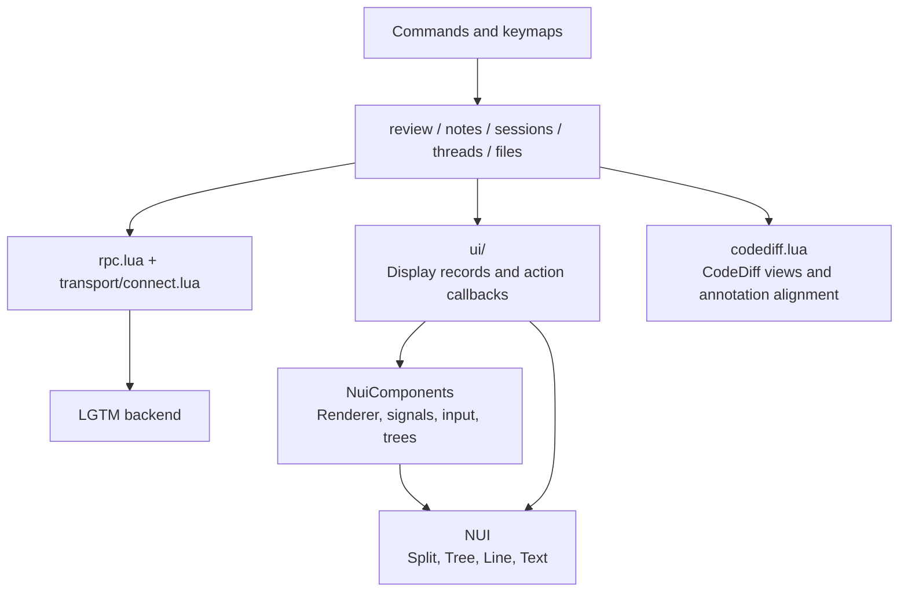
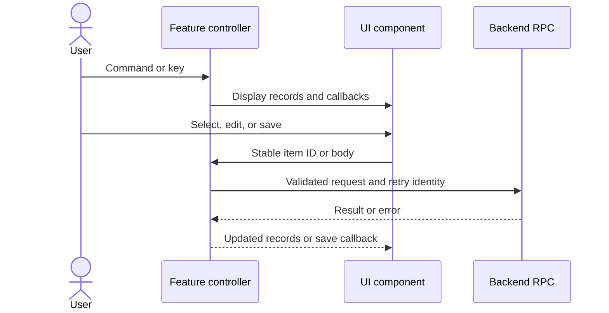
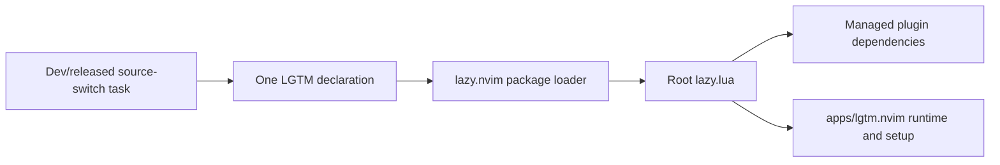

# lgtm.nvim architecture

## Overview

LGTM adds saved-file notes and local/GitHub reviews to Neovim. Feature modules call the backend through Connect JSON, a JSON RPC protocol. UI components display records and return user actions. The backend owns durable review data.

The plugin does not access the database or use the web frontend. CodeDiff owns diff buffers and its Git explorer. NuiComponents and NUI own windows and widgets.

## Requirement

### Functional

- FR1: Preserve notes, comparisons, thread actions, reviewed marks, exports, and explicit submission.
- FR2: Keep attribution and permissions in the backend-facing feature modules.
- FR3: Preserve editable text after failed saves and cancellation.
- FR4: Keep the thread pane open during navigation and resolution.
- FR5: Install required plugins through one supported lazy.nvim declaration.

### Non-Functional

- NFR1: Keep the editor responsive during RPCs and provider operations.
- NFR2: Follow the active colorscheme and preserve configured mappings and borders.
- NFR3: Keep UI components independent of session creation, persistence, and forge credentials.

## Design

### Components and Responsibilities

| Owner | Responsibility |
| --- | --- |
| `init.lua`, `keymaps.lua` | Commands, mappings, tab hooks, and theme refresh. |
| `context.lua`, `review.lua`, `notes.lua` | Active view state, capabilities, review actions, and saved-file scopes. |
| `threads.lua`, `files.lua` | Comment permissions, source placement, file selection, and reviewed marks. |
| `sessions.lua` | Candidate loading and conversion to display IDs/labels. |
| `ui/` | [Search](ui/search.md), [composer](ui/composer.md), [conversation](ui/conversation.md), [directory files](ui/files.md), and [cards](ui/cards.md). |
| `ui/theme.lua` | Semantic highlight links, configured borders, and dependency diagnostics. |
| `codediff.lua`, `sources.lua`, `anchors.lua` | Diff lifecycle, saved source evidence, placement, and virtual-line alignment. |
| `notifications.lua`, `picker.lua` | nvim-notify messages and the user's simple `vim.ui` prompts. |

### Data and Control Flow

A controller is a feature module that runs application actions. A view is a mounted UI component. Controllers retain review IDs, permissions, and source evidence. Components retain display selection and temporary text. The backend keeps comments, replies, sessions, and receipts.

NuiComponents mounts asynchronously. A global edit/delete shortcut waits for `threads.open` readiness before sending its action. `x` refreshes a thread pane in place. Enter navigates to code while keeping the pane open. Outside-diff feedback keeps its discussion and explains why navigation is unavailable.

### Interfaces and Contracts

The user API remains `require("lgtm").setup(opts)` and `:Lgtm` commands. See the [plugin guide](../../../apps/lgtm.nvim/README.md) for configuration and commands.

| Boundary | Contract |
| --- | --- |
| UI to controller | Opaque item IDs, file paths, thread/comment IDs, or draft text. |
| Composer to controller | `submit(body, done)`. A nil error acknowledges success. An error retains text for retry. |
| Controller to conversation | Display records, allowed actions, mapping overrides, and readiness callback. |
| Plugin to backend | Identity and capabilities bootstrap, then asynchronous Connect requests through curl. |
| CodeDiff adapter | Preserve source-side locations and align annotations without changing source content. |

UI modules do not call RPCs or decide ownership. The [backend review architecture](../backend/reviews.md) defines persistence, draft synchronization, and submission contracts.

## Implementation

### Package and dependency installation

The root `lazy.lua` declares NuiComponents, NUI, CodeDiff, WhichKey, and nvim-notify. It adds `apps/lgtm.nvim` to the runtime path and applies setup once. Lazy.nvim reads package metadata from the Git root. The root `doc` symlink exposes editor help.

`nvim:install-dev-plugin` selects this checkout root. `nvim:install-released-plugin` selects the repository's main branch. Both preserve user options. Neither task builds the CLI. Restart Neovim after switching.

Other managers and disabled package metadata need explicit dependencies and runtime setup. Older LGTM versions without `lazy.lua` need their version's manual instructions. The CLI, curl, Git, backend GitHub login, and CodeDiff native library remain separate requirements.

### UI and review state

NuiComponents supplies declarative floating views. NUI supplies persistent splits and tree/text primitives. A declarative view describes components and their data. The library mounts and updates their windows.

Neovim extmarks attach card lines to existing source buffers. LGTM keeps this small adapter because CodeDiff alignment is application-specific. Card display records contain no review model or RPC client.

`ui/theme.lua` maps semantic `Lgtm*` groups to configured highlights. Window configuration stays local to LGTM. `ColorScheme` refreshes default links without replacing explicit user overrides.

The current backend permits one active session per review context. Session lifetime stays outside UI components. A possible future persistent-session model requires a separate change.

Existing Vitest BDD journeys cover application outcomes. The install journey uses an empty manager root and an uncommitted source snapshot. Framework geometry and widget internals remain upstream responsibilities.

## References

- [Plugin source](../../../apps/lgtm.nvim/lua/lgtm).
- [Editor journeys](../../../e2e/nvim).
- [Installation and usage](../../../apps/lgtm.nvim/README.md).
- [NuiComponents](https://nui-components.grapp.dev/docs/) and [NUI](https://github.com/MunifTanjim/nui.nvim).
- [lazy.nvim packages](https://lazy.folke.io/packages).
