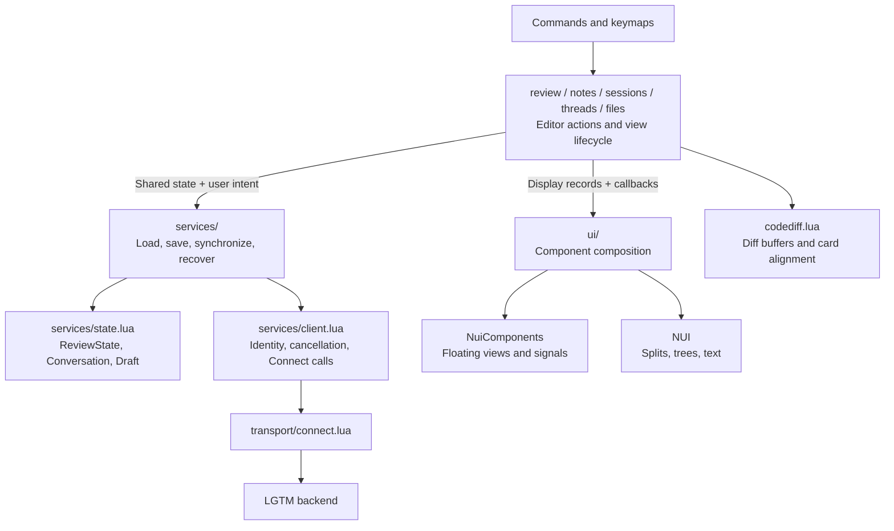
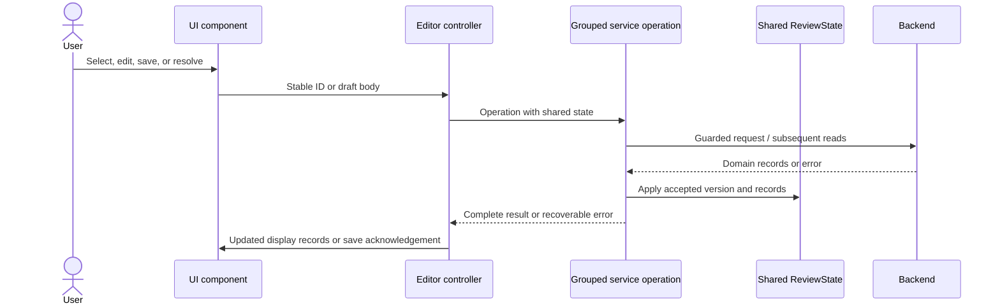
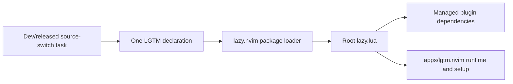
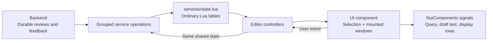

# lgtm.nvim architecture

## Overview

LGTM adds saved-file notes and local/GitHub reviews to Neovim. Feature modules call the backend through Connect JSON, a JSON RPC protocol. UI components display records and return user actions. The backend owns durable review data.

The plugin does not access the database or use the web frontend. CodeDiff owns diff buffers and its Git explorer. NuiComponents and NUI own windows and widgets.

## Requirement

### Functional

- FR1: Preserve notes, comparisons, thread actions, reviewed marks, exports, and explicit submission.
- FR2: Keep attribution and permissions in the backend-facing feature modules.
- FR3: Preserve editable text after failed saves and cancellation.
- FR4: Keep the thread pane open during navigation and resolution.
- FR5: Install required plugins through one supported lazy.nvim declaration.

### Non-Functional

- NFR1: Keep the editor responsive during RPCs and provider operations.
- NFR2: Follow the active colorscheme and preserve configured mappings and borders.
- NFR3: Keep UI components independent of session creation, persistence, and forge credentials.

## Design

### Review workspace

The layouts use text captured from Neovim at 100 columns with sample feedback. This example shows the NUI thread pane beside a source buffer. The selected comment uses a background highlight in the editor. The pane stays open when Enter returns focus to code.

```text
  8 -- review implementation                             │ OPEN · 1 reply · src/review.lua:21
  9 -- review implementation                             │──────────────────────────────────────────
 10 -- review implementation                             │ TOP-LEVEL COMMENT · Alex · Published
 11 -- review implementation                             │   Keep the draft after a failed save.
 12 -- review implementation                             │
 13 -- review implementation                             │   └─ REPLY 1 · You · GitHub draft
 14 -- review implementation                             │      Agreed. This now retains the text.
 15 -- review implementation                             │
 16 -- review implementation                             │
 17 -- review implementation                             │
 18 -- review implementation                             │
 19                                                      │
 20 local function save(body)                            │
 21   submit(body, done)                                 │
 22 end                                                  │
                                                         │
```

Git reviews also include CodeDiff's diff buffers and native explorer. Explicit directory reviews use the [directory file pane](ui/files.md). [Search](ui/search.md) and the [composer](ui/composer.md) float over the workspace. Each component page shows its rendered layout in different states.

### Components and Responsibilities



| Path | Responsibility |
| --- | --- |
| `review.lua`, `notes.lua`, `sessions.lua` | Commands, prompts, composer callbacks, and opening editor views. |
| `threads.lua`, `files.lua` | Source annotations, selection, key bindings, and pane lifecycle. |
| `services/reviews.lua` | Start/resume, version-bound conversation reads, refresh, draft synchronization, and completion. |
| `services/feedback.lua` | Create guarded drafts, save comments, mutate threads, promote notes, and check ownership. |
| `services/submissions.lua` | Retain submission intent, send, reconcile, and interpret durable outcomes. |
| `services/diffs.lua`, `services/files.lua` | Load paginated diffs and selected content, persist reviewed marks, and invalidate changed marks. |
| `services/sessions.lua` | Load review/PR candidates and consume review pagination. |
| `services/sources.lua` | Read exact source bytes and reconcile source observations. |
| `services/state.lua` | Shared record shapes, active review/tab state, saved-file state, and submission drafts. |
| `services/client.lua` | Backend capabilities, identity bootstrap, cancellation, and request routing. |
| `ui/` | [Search](ui/search.md), [composer](ui/composer.md), [conversation](ui/conversation.md), [directory files](ui/files.md), and [cards](ui/cards.md). |
| `codediff.lua`, `anchors.lua`, `locations.lua` | Diff lifecycle, source-side placement, and observed filesystem moves. |

### Data and Control Flow



### Source structure

```text
lua/lgtm/
├── services/
│   ├── state.lua          ReviewState, Conversation, Draft + shared stores
│   ├── reviews.lua        start → apply review → read conversation
│   ├── feedback.lua       guard → write once → update state → refresh
│   ├── submissions.lua    retain intent → submit/reconcile → apply outcome
│   ├── diffs.lua          diff → all file pages → selected file bytes
│   ├── files.lua          reviewed marks → serialized writes → invalidation
│   ├── sessions.lua       review/PR candidates
│   ├── sources.lua        exact source reads and observations
│   └── client.lua         identity + cancellable transport
└── ui/
    ├── search.lua         query input + results list
    ├── composer.lua       Markdown input + retained draft
    ├── conversation.lua   thread header + comment rows, in modal/split hosts
    ├── files.lua          file rows + left split
    ├── cards.lua          highlighted lines for source annotations
    └── theme.lua          semantic highlights and borders
```

UI view files use `State`, `Render`, `Lifecycle`, `Methods`, and `Private` separators. Search composes `render_query` and `render_results`. Conversation composes `render_header` and `render_comment` for both hosts. Module-private helpers sit after public operations.

### Interfaces and Contracts

Global keyboard API uses the configured prefix, which defaults to `<leader>r`. These keys come from `keymaps.lua`. Component-local keys appear in each component's Public API section.

| Prefix + key | Action | Mode |
| --- | --- | --- |
| b / r | Review the branch / working tree. | Normal |
| p / S | Search PRs / resume a session. | Normal |
| D | Review a directory. | Normal |
| n / c | Add a note / line comment. | Normal or Visual |
| f / g | Add a file / general comment. | Normal |
| e / d | Edit / delete the selected comment through its conversation. | Normal |
| t / F | Open all threads / review files. | Normal |
| m | Toggle the current file's reviewed mark. | Normal |
| P | Promote a note. | Normal |
| x | Export the active review, or notes when no review is active. | Normal |
| s / y | Submit the review / sync GitHub drafts. | Normal |
| q | Close the review view. | Normal |

The user API remains `require("lgtm").setup(opts)` and `:Lgtm` commands. See the [plugin guide](../../../apps/lgtm.nvim/README.md) for configuration and commands.

| Shared shape | Use |
| --- | --- |
| `ReviewState` | The same active review/notes object passes through controllers, diff loading, reviewed marks, and feedback operations. |
| `Review`, `ReviewFile` | Backend review metadata and file records. The diff service fills content on the selected file. |
| `Conversation`, `Thread`, `Comment` | Backend records with stable IDs, versions, ownership, and source evidence. |
| `Draft` | A body, anchor, guarded version, and stable request key retained for retries. Created by the feedback service. |
| `OperationResult` | Submission message and optional warning after applying its durable result. |

Shapes are declared beside the shared store in `services/state.lua`. `OperationResult` is declared in `services/submissions.lua`. Services retain backend records rather than creating a second domain model for each view. UI components receive the small display records that their layout needs.

| Service operation | Work grouped behind the boundary |
| --- | --- |
| `reviews.start` | Start/resume, recover comparison conflicts, apply review metadata, and return a `ReviewState`. The caller supplies a conflict-choice callback. |
| `reviews.get_conversation` | Read every page at one server version and coalesce concurrent readers into a fresh `Conversation`. |
| `diffs.get_files` / `get_file` | Read diff metadata and all file pages, then fill the selected `ReviewFile` on demand. |
| `feedback.save` | Ensure a writable review, keep the write identity, save once, and refresh accepted state. |
| `feedback.mutate` | Find the guarded object version, suppress duplicate writes, apply deletion/resolution, and refresh the conversation. |
| `submissions.submit` / `reconcile` / `recover` | Retain the final draft and request identity, reconcile uncertainty, and apply the durable outcome. |
| `files.save_reviewed` | Serialize writes per path, keep optimistic marks, and reconcile an overlapping read. |

See the [backend review architecture](../backend/reviews.md) for persistence and forge contracts.

## Implementation

### Package and dependency installation

The root `lazy.lua` declares NuiComponents, NUI, CodeDiff, WhichKey, and nvim-notify. It adds `apps/lgtm.nvim` to the runtime path and applies setup once. Lazy.nvim reads package metadata from the Git root. The root `doc` symlink exposes editor help.



`nvim:install-dev-plugin` selects this checkout root. `nvim:install-released-plugin` selects the repository's main branch. Both preserve user options. Neither task builds the CLI. Restart Neovim after switching.

Other managers and disabled package metadata need explicit dependencies and runtime setup. Older LGTM versions without `lazy.lua` need their version's manual instructions. The CLI, curl, Git, backend GitHub login, and CodeDiff native library remain separate requirements.

### UI and review state



## References

- [Plugin source](../../../apps/lgtm.nvim/lua/lgtm).
- [Editor journeys](../../../e2e/nvim).
- [Installation and usage](../../../apps/lgtm.nvim/README.md).
- [NuiComponents](https://nui-components.grapp.dev/docs/) and [NUI](https://github.com/MunifTanjim/nui.nvim).
- [lazy.nvim packages](https://lazy.folke.io/packages).
