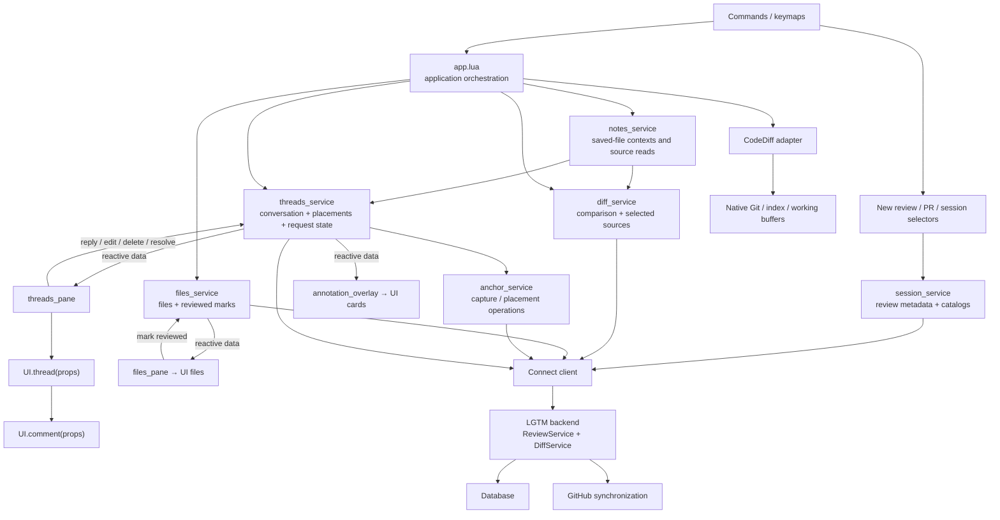
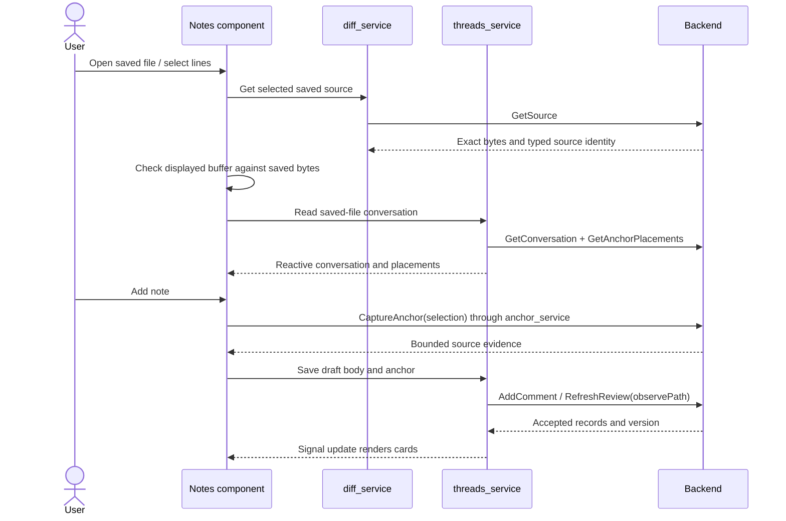
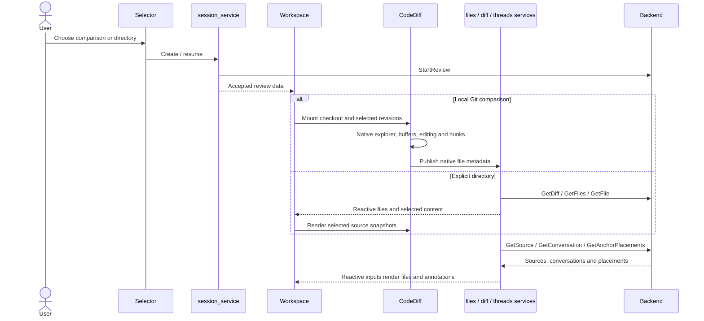
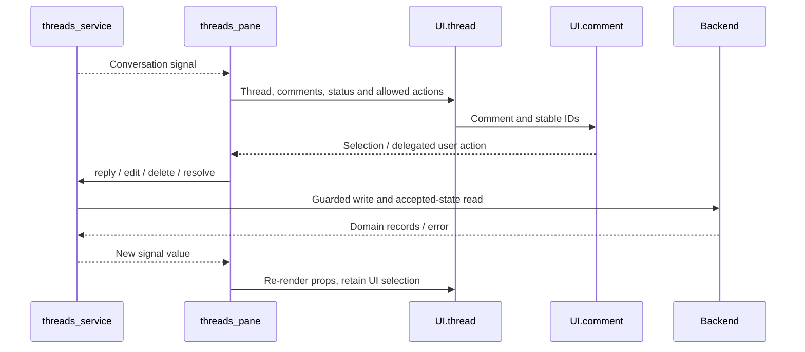
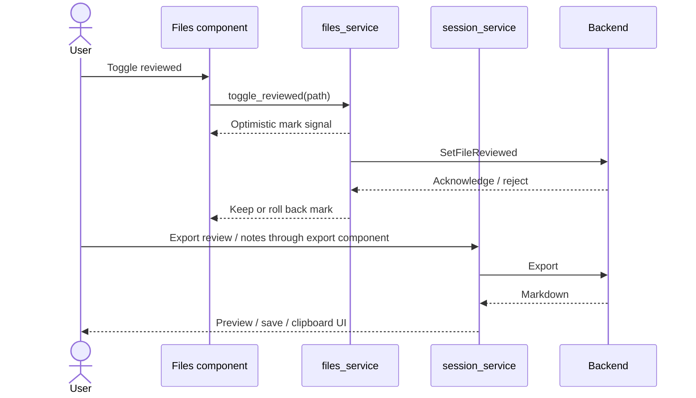
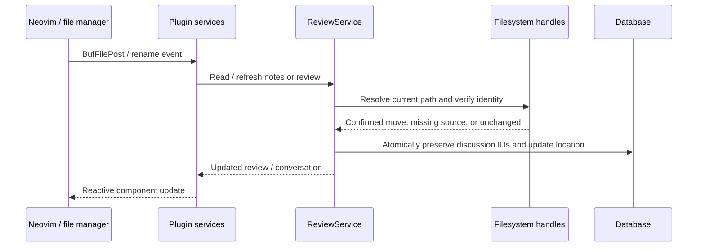

# lgtm.nvim architecture

## Overview

LGTM adds notes, local reviews, and forge PR reviews to Neovim. Services own reactive application data and backend operations. Feature components render that data and keep only UI interaction state. CodeDiff retains its native diff experience.

## Requirement

### Functional

- Preserve notes, working/staged/branch comparisons, PR reviews, feedback actions, reviewed marks, export, and submission.
- Keep original evidence, placement, stale/outdated decisions, permissions, and persistence authoritative in the backend.
- Compose thread panes from threads and comment components. Keep drafts after failed saves.
- Keep native CodeDiff buffers, explorer, editing, layout changes, and refresh.
- Install LGTM’s required Lua dependencies through one supported lazy.nvim declaration.

### Non-Functional

- Keep RPC and forge requests asynchronous.
- Keep application records in service signals; components must not keep another conversation or file catalog.
- Unsubscribe when windows or buffers unmount. Retain selection while service data changes.

## Design

### Components and Responsibilities



| Owner | Data or state |
| --- | --- |
| `session_service` | Review metadata, catalogs, creation, completion, submission, recovery and [export reads](../../lgtm.nvim/services/export.md). |
| [`notes_service`](../../lgtm.nvim/services/notes.md) | Saved-file notes contexts and source/conversation refreshes. |
| `threads_service` | Conversations, backend placements, loading/saving/error state, paginated reads and guarded feedback operations. |
| `files_service` | File records, reviewed marks, native file-metadata adoption, and serialized/optimistic mark writes. |
| `diff_service` | Comparison descriptors and selected saved sources, including backend-loaded fallback content. |
| `anchor_service` | Capture and placement requests. Results publish into the thread service; it does not create another conversation store. |
| `forge_service` | Stateless local checkout/revision discovery and the pinned CodeDiff filename workaround. Remote forge operations use backend APIs. |
| Feature/UI component | Query, selection, expansion, draft text, open/closed windows, buffer bindings, and focus/scroll state. |

`ReviewState` gives native integrations read-only projections of service records. Services remain the writers. These projections let a CodeDiff callback identify its review without creating another thread or file model.

### Feature components

The [application module](../../lgtm.nvim/app.md) connects these components to services and manages tabs, buffers and user actions.

| Feature | Composition / service connection |
| --- | --- |
| [New review dialog](../../lgtm.nvim/feature/new-review-dialog.md) | Choose a flow and call session operations. |
| [Branch / PR selector](../../lgtm.nvim/feature/branch-pr-selector.md) | Render the reactive PR catalog and select a review. |
| [Session selector](../../lgtm.nvim/feature/session-selector.md) | Render the reactive active/completed review catalog. |
| [Threads pane](../../lgtm.nvim/feature/threads-pane.md) | Subscribe to conversation data and host modal/split interaction. |
| [Thread](../../lgtm.nvim/feature/thread.md) | Render a header, evidence and comment children from props. |
| [Thread comment](../../lgtm.nvim/feature/thread-comment.md) | Render a supplied comment; no fetching or review-state lookup. |
| [Files pane](../../lgtm.nvim/feature/files-pane.md) | Render file-service records or annotate CodeDiff’s explorer. |
| [Annotation overlay](../../lgtm.nvim/feature/annotation-overlay.md) | Render backend placements as cards and padding. |
| [CodeDiff view](../../lgtm.nvim/feature/diff-view.md) | Adapt the external plugin’s native lifecycle and buffers. |

The reusable widgets remain documented under `ui/`: [search](ui/search.md), [composer](ui/composer.md), [conversation host](ui/conversation.md), [files](ui/files.md), [cards](ui/cards.md), and [export](ui/export.md).

### State and Data Flow

#### Notes



#### Local working, staged, branch and directory reviews



#### Forge PR reviews

```mermaid
sequenceDiagram
  actor User
  participant Selector as PR selector
  participant Sessions as session_service
  participant Workspace
  participant CodeDiff
  participant Threads as threads_service
  participant Backend
  participant GitHub
  Selector->>Sessions: Query PR catalog
  Sessions->>Backend: ListPullRequests
  Backend->>GitHub: Read PR metadata
  Sessions-->>Selector: Reactive candidates
  User->>Selector: Select PR
  Sessions->>Backend: Start / resume PR review
  Backend->>GitHub: Synchronize complete provider observation
  alt Commits available locally
    Workspace->>CodeDiff: Native base/head view and explorer
  else No local commits
    Workspace->>Backend: GetDiff / GetFiles / GetFile
    Workspace->>CodeDiff: Backend source snapshots
  end
  Threads->>Backend: Read conversation and placements
  Backend-->>Threads: Original evidence + provider current/outdated state
  Threads-->>Workspace: Signal update
  User->>Workspace: Save draft
  Workspace->>Threads: Save feedback
  Threads->>Backend: Guarded comment write
  User->>Workspace: Submit / reconcile
  Workspace->>Sessions: submit / reconcile
  Sessions->>Backend: Explicit submission operation
  Backend->>GitHub: Private draft or explicit submission
  Backend-->>Sessions: Confirmed state or recoverable failure
  Sessions-->>Workspace: Signal update; retain editable text on failure
```

#### Thread composition and writes



#### Reviewed marks and export



#### Note promotion

```mermaid
sequenceDiagram
  actor User
  participant Notes
  participant Threads as threads_service
  participant Backend
  User->>Notes: Select note and target review file
  Notes->>Backend: Capture target anchor through anchor_service
  Notes->>Threads: promote(source, target, comment, anchor)
  Threads->>Backend: PromoteNotes with both guarded versions
  Backend->>Backend: Copy atomically; retain original note
  Backend-->>Threads: Accepted target feedback
  Threads-->>Notes: Target conversation signal updates
```

### Filesystem refresh



Lua does not supply old/new paths, decide which discussions moved, or retain move retries. Backend reads reconcile opened saved-file and directory scopes independently of editor events. Confirmed locations persist across backend restart.

### Source structure

```text
lua/lgtm/
├── features/   Review flows and component composition
├── models/     Shared record shapes and source conversions
├── services/   Reactive data, operations, native reads and Connect transport
├── ui/         NuiComponents / NUI widgets and presentation utilities
├── app.lua     Application orchestration across services and UI
├── init.lua    Plugin setup, command dispatch and editor event registration
├── config.lua  Configuration defaults and validation
├── keymaps.lua Global keymap API
├── bindings.lua Save/restore mappings shared with native CodeDiff buffers
└── health.lua  Neovim’s required :checkhealth discovery entry point
```

`app.lua` coordinates review tabs, notes actions and export presentation. The other root files handle plugin setup, configuration, keymaps and Neovim discovery. CodeDiff-specific buffer/lifecycle adaptation lives in `features/diff_view.lua`; it does not implement an alternative diff engine.

### Public API

The user API remains `require("lgtm").setup(opts)` and `:Lgtm` commands. See the [plugin guide](../../../apps/lgtm.nvim/README.md) for commands and global mappings. Each feature page documents its modes, keys, remapping and permission limits.

```lua
require("lgtm").setup({
  identity = {
    name = "Reviewer",
    email = "reviewer@example.com",
  },
  prefix = "<leader>r",
})
```

## Implementation

- Root `lazy.lua` declares the required Lua dependencies and adds `apps/lgtm.nvim` to Neovim’s runtime. Supported lazy.nvim users install one plugin declaration. Other managers need explicit dependencies/runtime setup; the CLI, curl, Git, backend forge login and CodeDiff native library remain separate requirements.
- Services use NuiComponents signals without importing UI components or notification providers. Native NUI splits subscribe/unsubscribe at their lifecycle boundary; floating trees receive reactive data props.
- Use `UI.header`, `UI.body`, `UI.footer` and named child components for composition. Use `Private` for non-rendering helpers.
- Backend capture verifies source hashes and bounded excerpts. Backend writes independently verify saved sources. Lua checks native buffers and renders results; it does not retain a placement algorithm.

## References

- [Backend review contracts](../backend/reviews.md) and [source / anchor APIs](../backend/diffs.md).
- [Feature source](../../../apps/lgtm.nvim/lua/lgtm/features) and [service source](../../../apps/lgtm.nvim/lua/lgtm/services).
- [Editor journeys](../../../e2e/nvim) and [replay instructions](../../../e2e/README.md).
