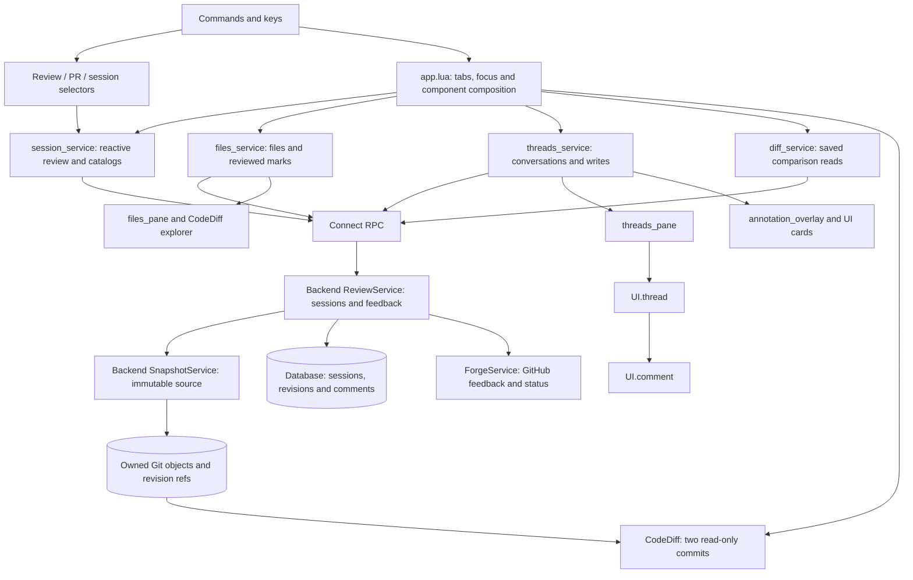
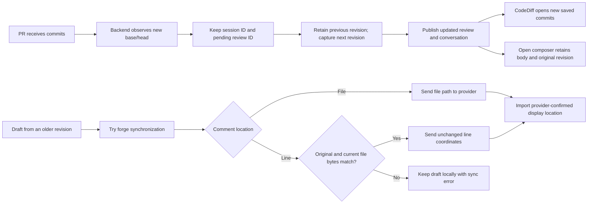

# lgtm.nvim architecture

## Overview

LGTM renders local and PR reviews in Neovim. The backend owns sessions, saved source revisions and comment locations. Lua services own reactive application data. Components render that data and keep interaction state such as expanded cards and focus.

## Requirement

### Functional

- Review saved working files, the index, branches, directories and PRs in CodeDiff.
- Preserve sessions, comments, replies and drafts across workspace changes and PR pushes.
- Open the original saved source when navigating historical feedback.
- Keep feedback, permissions, completion, export and forge synchronization in the backend.
- Install Lua dependencies through one supported lazy.nvim declaration.

### Non-Functional

- Capture without changing the user's index, branch or worktree.
- Retain source after the original checkout is removed or pruned.
- Keep RPC asynchronous and unsubscribe components when they close.

## Design

### Components and Responsibilities



### Data and Control Flow

```mermaid
sequenceDiagram
  actor User
  participant UI as Neovim components
  participant Data as Lua services
  participant Backend as ReviewService
  participant Snapshots as SnapshotService
  participant Git as Managed Git store
  User->>UI: Start working / staged / branch / directory / PR review
  UI->>Data: Create selected review
  Data->>Backend: StartReview
  Backend->>Snapshots: Capture saved selection
  Snapshots->>Git: Use Gitoxide to import commits or write saved bytes
  Snapshots-->>Backend: Revision ID, store, base and head
  Backend-->>Data: Session and saved revision
  Data-->>UI: Reactive records
  UI->>Git: CodeDiff reads both commits
  User->>UI: Comment on a range
  UI->>Data: Save body, revision, side, path and range
  Data->>Backend: AddComment
  Backend->>Git: Validate range against saved source
  Backend-->>Data: Persisted comment or error
  Data-->>UI: Updated conversation; retain body on failure
```





```mermaid
stateDiagram-v2
  [*] --> Capturing: Start review
  Capturing --> Reviewing: Saved revision ready
  Reviewing --> Reviewing: Workspace changes; source stays fixed
  Reviewing --> CapturingNext: Explicit refresh or new PR head
  CapturingNext --> Reviewing: New revision in same session
  CapturingNext --> Reviewing: Capture fails; previous revision retained
  Reviewing --> Historical: Enter on historical thread
  Historical --> Reviewing: Refresh selects latest saved source
  Reviewing --> Completed: Complete or submit
  Completed --> Historical: Inspect saved feedback
```

### Interfaces and Contracts

| Shape | Contract |
| --- | --- |
| Review | Session identity, comparison selection, current snapshot and retained revision history. |
| Snapshot | Revision UUID, repository UUID, backend-local Git store and base/head commits. |
| Comment location | Snapshot UUID, side, relative path and optional line range. The original location stays fixed. |
| Thread display location | Coordinates for the selected revision, or current coordinates supplied by GitHub. No local text search. |
| Component state | Selected revision, file/side, expanded cards, focus and window lifecycle. |

`StartReview` captures source. `GetReview` resumes saved local source. `RefreshReview` captures another revision in the same active session. `GetDiff` accepts a review ID and optional historical revision ID. `GetConversation` accepts a snapshot ID to select visible locations. File and general feedback do not invent line numbers.

GitHub supplies current coordinates and outdated status. A draft whose original source cannot be attached to the pending GitHub review stays local with a specific synchronization error. Other feedback and the session remain available.

## Implementation

### Source ownership and storage

```text
$LGTM_HOME/
├── reviews.sqlite
└── snapshots/
    └── <repository-id>/
        └── .git/
            ├── objects/
            └── refs/lgtm/revisions/<revision-id>/{base,head}
```

CodeDiff reads the managed Git store when backend and editor share a filesystem. For a remote backend, diff_service reads saved file content through RPC and the adapter creates read-only local display buffers.

Gitoxide writes complete source objects into LGTM's separate repository. Capture leaves the user's branch, index, files and `git status` output unchanged. The database stores revision metadata and conversation records. Imported commits keep their original hashes. Working and directory snapshots use synthetic commits when saved content differs. Index capture uses staged bytes. No capture includes unsaved editor changes.

### Lua modules and public keys

| Module | Responsibility |
| --- | --- |
| `features/` | Review selectors, diff lifecycle, thread/comment components, file pane and annotation adapter. |
| `services/` | Reactive review, files and threads; RPC workflows and export reads. |
| `models/` | Shared review, snapshot, file, conversation, comment, thread and draft shapes. |
| `ui/` | Reusable NuiComponents composition and NUI card primitives. |
| Root modules | Setup, configuration, bindings, health checks and application composition. |

`<leader>rr` starts working review, `rb` branch review, `rD` directory review, `rp` PR selection and `rS` session selection. In source panes, `c` or `<leader>rc` comments on the line or visual range. `rf` and `rg` create file and general feedback. `rt` opens threads; `rm` marks a file reviewed; `rx` exports; `rs` submits; `rq` closes the view. `setup.prefix` changes the global prefix. Component pages list local keys and permission limits.

### Installation

The root `lazy.lua` still declares NUI, NuiComponents, CodeDiff and the configured UI providers. A supported lazy.nvim installation needs one LGTM declaration. Other package managers must list the dependencies because they do not read lazy.nvim package metadata. Snapshots add backend Git storage and require the existing Git executable; they add no Lua plugin dependency.

Standalone live-buffer notes, their mappings and promotion are removed. Existing note records remain in the database and can be read or exported through the archived notes scope. They are no longer restored into ordinary buffers.

## References

- [Plugin installation and commands](../../../apps/lgtm.nvim/README.md).
- [CodeDiff view](../../lgtm.nvim/feature/diff-view.md), [thread pane](../../lgtm.nvim/feature/threads-pane.md), [annotations](../../lgtm.nvim/feature/annotation-overlay.md).
- [GitHub pending review thread input](https://docs.github.com/en/graphql/reference/pulls#addpullrequestreviewthreadinput).
