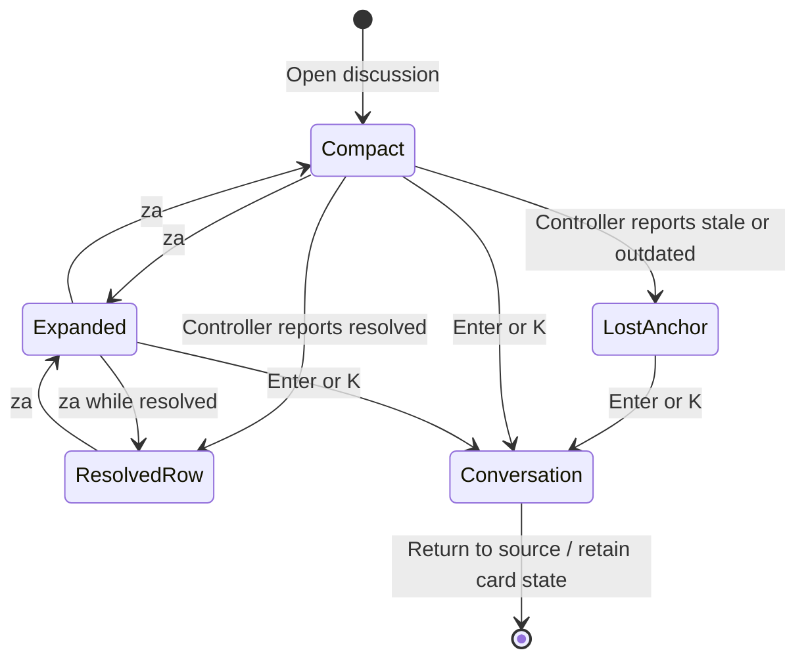
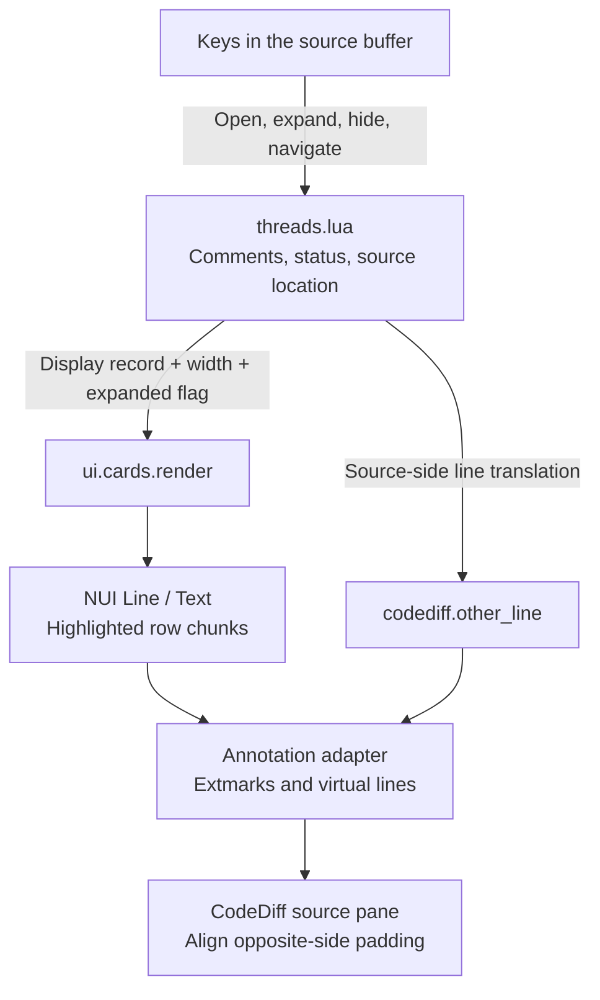

# Comment cards

## Overview

Cards summarize feedback beside source code. They return highlighted virtual lines rather than opening a window. The annotation adapter places those lines in the correct source buffer.

## Design

### Layout

Cards add display rows above their attached source line. They do not change the file. A collapsed card shows status, a preview, its author, and the open/expand keys.

```text
 20 local function save(body)
    ╭─ Local draft · Open · 1 reply                                                               ╮
    │ Keep the draft after a failed save.                                                         │
    ╰─Alex · Enter open · za expand                                                               ╯
 21   submit(body, done)
```

After `za`, the card shows all supplied comment bodies. Enter opens the conversation with comment selection and actions.

```text
 20 local function save(body)
    ╭─ Local draft · Open · 1 reply                                                               ╮
    │ Alex                                                                                        │
    │ Keep the draft after a failed save.                                                         │
    │ You                                                                                         │
    │ Agreed. This now retains the text.                                                          │
    ╰─Enter open · za collapse                                                                    ╯
 21   submit(body, done)
```

A lost anchor adds `Stale · anchor lost` or `Outdated · anchor lost` to the heading. The card stays compact. The conversation shows the original range and source excerpt. A resolved, collapsed card uses one row:

```text
 Resolved · Enter open · za expand                                                   ✓
```

### Behavior



## Implementation

### Public API

Keyboard API:

| Keys | Mode | Result |
| --- | --- | --- |
| Enter / K | Normal, on commented source | Open the conversation at the current line. |
| za | Normal | Expand/collapse discussions at the current line. Fall back to normal folding when none exist. |
| zA | Normal | Toggle expansion for each discussion in this file. |
| gH | Normal | Toggle comment-card visibility. |
| ]c / ]n | Normal | Jump to the next feedback location. |
| [c / [n | Normal | Jump to the previous feedback location. |
| x | Normal | Resolve/reopen a single thread at the line, or open the chooser when several exist. Permissions still apply. |
| dd | Normal, on commented source | Open the conversation. It does not immediately delete the comment. |

These keys belong to `threads.lua`, which hosts the card in the source buffer. `setup.mappings` can replace them. Away from feedback, Enter/K and normal editing/folding actions keep their existing behavior.

Lua API:

```lua
local rows = require("lgtm.ui.cards").render(
  {
    resolved = false,
    file = false,
    status = "Local draft",
    location_status = nil,
    comments = {
      {
        author = "Reviewer",
        body = "Comment",
        is_reply = false,
      },
    },
  },
  width,
  expanded
)
```

### State and Data Flow



### Maintainer Notes

Keep source-side translation in `codediff.other_line`. NUI composes the card text, but the annotation adapter still aligns its virtual rows with CodeDiff's other pane.

See the [implementation](../../../../apps/lgtm.nvim/lua/lgtm/ui/cards.lua) and [plugin architecture](../index.md).
