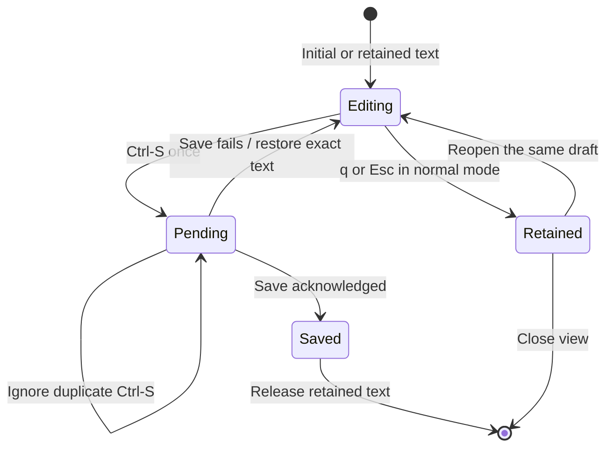
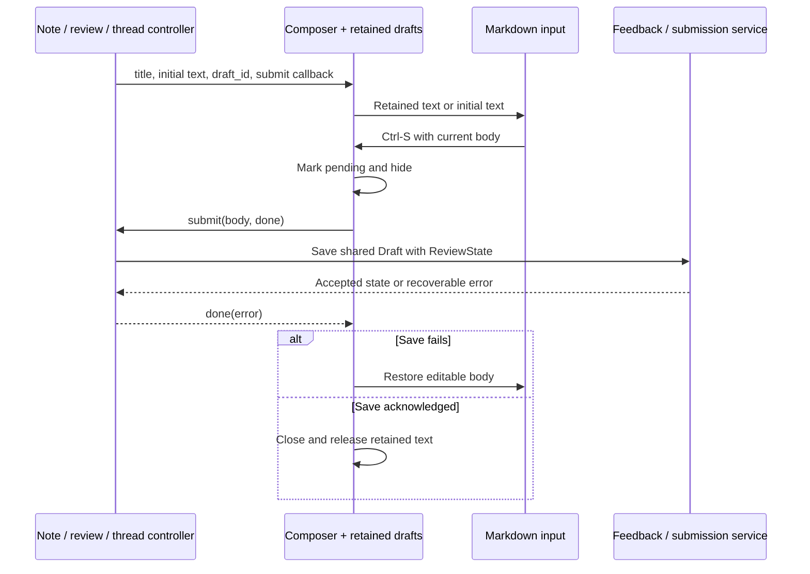

# Draft composer

## Overview

The composer edits notes, comments, replies, and final review bodies. Its caller supplies persistence. The component manages text and pending-save state.

## Design

### Layout

The composer floats over the source. The body is an editable Markdown buffer. The bottom border shows the save and cancel keys.

```text
 14 -- review implementation
 15 -- re╭──────────────────────────────── Review comment ────────────────────────────────╮
 16 -- re│Can we keep this draft after a failed save?                                     │
 17 -- re│                                                                                │
 18 -- re│The next retry must send the same text.                                         │
 19      │                                                                                │
 20 local│                                                                                │
 21   sub│                                                                                │
 22 end  │                                                                                │
         │                                                                                │
         │                                                                                │
         │                                                                                │
         │                                                                                │
         │                                                                                │
         ╰────────────────────────── <C-s> save · q/Esc cancel ───────────────────────────╯
```

After Ctrl-S, the composer hides and the source receives focus. The save notification belongs to nvim-notify. Its placement follows the provider configuration.

```text
  8 -- review implementation                    ╭──────────────────────────────────────────────────╮
  9 -- review implementation                    │ | LGTM: Saving draft…                           │
 10 -- review implementation                    ╰──────────────────────────────────────────────────╯
 11 -- review implementation
 12 -- review implementation
 13 -- review implementation
 14 -- review implementation
 15 -- review implementation
 16 -- review implementation
 17 -- review implementation
 18 -- review implementation
 19
 20 local function save(body)
 21   submit(body, done)
 22 end
```

A failed save restores the exact text in the composer. The error appears through nvim-notify. A successful save closes the composer and releases the retained text.

```text
  8 -- review implementation                    ╭──────────────────────────────────────────────────╮
  9 -- review implementation                    │ | LGTM: Saving draft…                           │
 10 -- review implementation                    ╰──────────────────────────────────────────────────╯
 11 -- review implementation                    ╭──────────────────────────────────────────────────╮
 12 -- review implementation                    │ | LGTM: Could not reach the backend             │
 13 -- review implementation                    ╰──────────────────────────────────────────────────╯
 14 -- review implementation
 15 -- re╭──────────────────────────────── Review comment ────────────────────────────────╮
 16 -- re│Can we keep this draft after a failed save?                                     │
 17 -- re│                                                                                │
 18 -- re│The next retry must send the same text.                                         │
 19      │                                                                                │
 20 local│                                                                                │
 21   sub│                                                                                │
 22 end  │                                                                                │
         │                                                                                │
         │                                                                                │
         │                                                                                │
         │                                                                                │
         │                                                                                │
         ╰────────────────────────── <C-s> save · q/Esc cancel ───────────────────────────╯
```

### Behavior



### Public API

Keyboard API:

| Keys | Mode | Result |
| --- | --- | --- |
| i / a and normal editing keys | Normal | Enter text editing. The composer opens in Normal mode. |
| Ctrl-S | Normal or Insert | Send the body once while a save is pending. |
| Esc | Insert | Leave Insert mode. Keep the composer open. |
| q / Esc | Normal | Close and retain the draft without sending it. |

Lua API:

```lua
require("lgtm.ui.composer").open(
  "Comment",
  "",
  function(body, done)
    -- The feature performs its save and calls done(err).
  end,
  {
    action = "save",
    draft_id = "optional-owner-key",
  }
)
```

### State and Data Flow



## Implementation

- The pinned TextInput rejects a `linebreak` prop; set `win_options.linebreak` on its popup.
- Reacquire the window ID after a failed save because NUI hide/show recreates it.
- [Source](../../../../apps/lgtm.nvim/lua/lgtm/ui/composer.lua).
