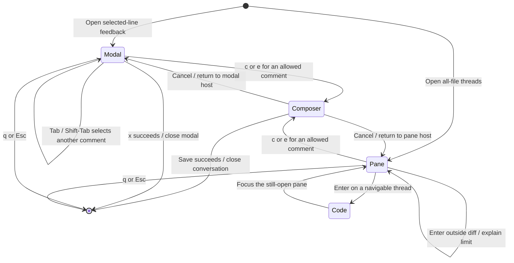
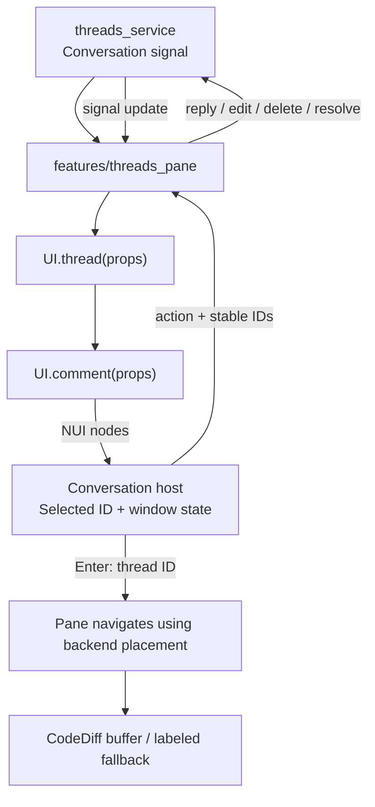

# Conversation view

## Overview

The conversation displays thread status, comments, replies, and original location evidence. A floating modal shows selected-line feedback. A persistent split shows all-file discussions.

## Design

### Layout

Modal with a reply selected. In Neovim, the selected comment has a background highlight. Tab changes the selected comment, and the footer names it.

```text
 16 -- review implementation
 17 --╭─────────────────────────────────── Review thread ────────────────────────────────────╮
 18 --│ OPEN · 1 reply                                                                       │
 19   │──────────────────────────────────────────────────────────────────────────────────────│
 20 lo│ TOP-LEVEL COMMENT · Alex · Published                                                 │
 21   │   Keep the draft after a failed save.                                                │
 22 en│                                                                                      │
      │   └─ REPLY 1 · You · GitHub draft                                                    │
      │      Agreed. This now retains the text.                                              │
      │                                                                                      │
      ╰ Reply 1 · Tab next · c reply · e edit · dd delete · q close ─────────────────────────╯
```

The persistent pane sits to the right of the source. Enter navigates to code without closing it. Resolution updates these rows in place.

```text
  8 -- review implementation                             │ OPEN · 1 reply · src/review.lua:21
  9 -- review implementation                             │──────────────────────────────────────────
 10 -- review implementation                             │ TOP-LEVEL COMMENT · Alex · Published
 11 -- review implementation                             │   Keep the draft after a failed save.
 12 -- review implementation                             │
 13 -- review implementation                             │   └─ REPLY 1 · You · GitHub draft
 14 -- review implementation                             │      Agreed. This now retains the text.
 15 -- review implementation                             │
 16 -- review implementation                             │
 17 -- review implementation                             │
 18 -- review implementation                             │
 19                                                      │
 20 local function save(body)                            │
 21   submit(body, done)                                 │
 22 end                                                  │
                                                         │
```

A lost anchor adds the original range and source excerpt above the comments. The compact source card keeps only a preview.

```text
 14 -- review implementation
 15 --╭─────────────────────────────────── Review thread ────────────────────────────────────╮
 16 --│ OUTDATED · OPEN · 1 reply                                                            │
 17 --│──────────────────────────────────────────────────────────────────────────────────────│
 18 --│ Original lines 20–22                                                                 │
 19   │ > local function save(body)                                                          │
 20 lo│ >   submit(body, done)                                                               │
 21   │ > end                                                                                │
 22 en│ TOP-LEVEL COMMENT · Alex · Published                                                 │
      │   Keep the draft after a failed save.                                                │
      │                                                                                      │
      │   └─ REPLY 1 · You · GitHub draft                                                    │
      │      Agreed. This now retains the text.                                              │
      │                                                                                      │
      ╰ Reply 1 · Tab next · c reply · e edit · dd delete · q close ─────────────────────────╯
```

A thread outside the selected comparison shows `OUTSIDE DIFF`. Enter explains the navigation limit and keeps focus in the pane.

### Behavior



### Public API

Keyboard API:

| Keys | Mode | Result |
| --- | --- | --- |
| Tab / Shift-Tab | Normal | Select the next/previous comment, including replies. |
| j / k | Normal | Move by displayed rows through wrapped text. |
| c | Normal | Reply to the selected comment. |
| e / dd | Normal | Edit/delete the selected comment when the identity owns it. Delete asks for confirmation. |
| x | Normal | Resolve/reopen local threads or published PR threads. A draft-only PR thread cannot be resolved. |
| Enter | Normal, split only | Navigate to the thread's source. Keep the pane open. |
| q / Esc | Normal | Close and restore a valid source window. |

`setup.mappings` can replace Tab, Shift-Tab, c, e, dd, x, Enter, q, and Esc in this view. j/k remain wrapped-row motions. Services guard actions and the backend enforces permissions even when a key is mapped.

Lua API:

```lua
require("lgtm.ui.conversation").open({
  mode = "modal", -- or "split"
  data = rendered_nodes, -- service-derived signal of NUI tree nodes
  mappings = {},
  on_action = function(action, thread_id, comment_id)
  end,
  on_navigate = function(thread_id)
  end,
  on_change = function(view)
  end,
  on_ready = function()
  end,
})
-- Handle: selected(), select_comment(id), close().
```

### State and Data Flow



## Implementation

- Wait for `on_ready` before sending edit/delete keys; mounting is asynchronous and earlier input can edit the source buffer.
- [Source](../../../../apps/lgtm.nvim/lua/lgtm/ui/conversation.lua).
