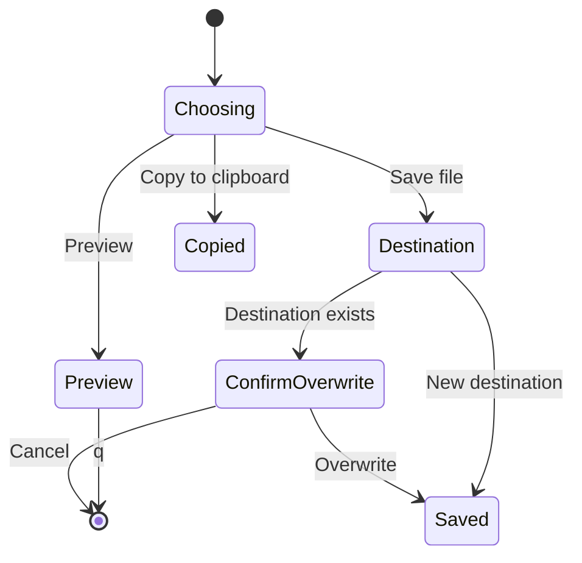
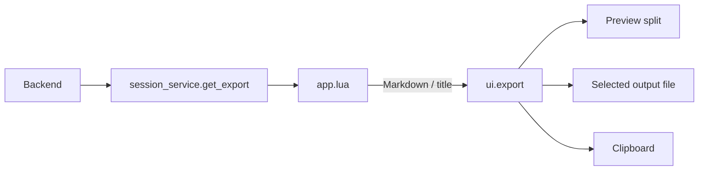

# Export widget

## Overview

Present Markdown already produced by a service. This widget does not load review records.

## Design

### Layout

```text
Export review
  Preview
  Save file
  Copy to clipboard
```

### Behavior



### Public API

```lua
require("lgtm.ui.export").open(
  markdown,
  "review"
)
```

Preview uses a read-only split; `q` closes it. Choice and destination prompts use the configured `vim.ui` providers.

### State and Data Flow



Only transient prompt and preview-window state belongs to the widget.

## Implementation

- [Source](../../../../apps/lgtm.nvim/lua/lgtm/ui/export.lua).
