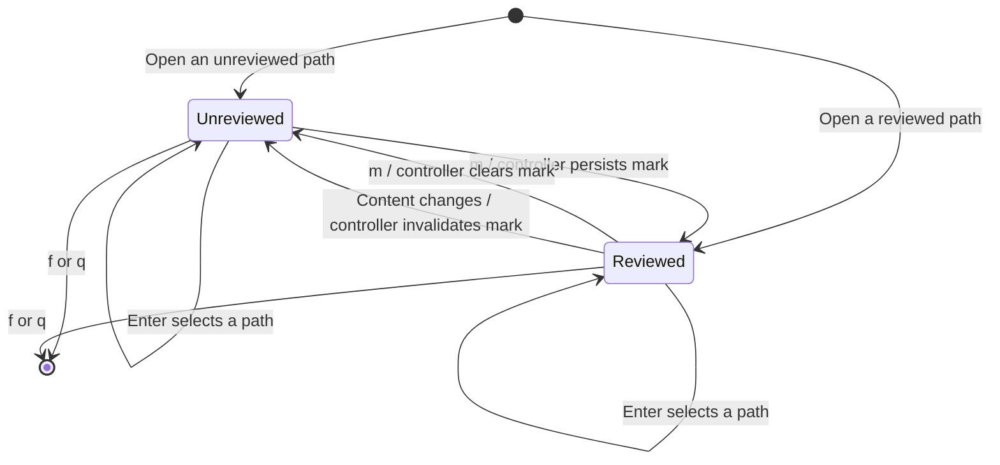
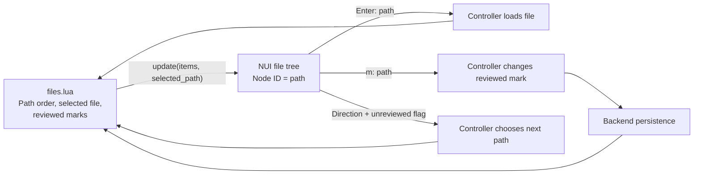

# Directory file pane

## Overview

This pane lists files for explicit directory reviews. Git-backed reviews keep CodeDiff's native explorer. The component receives paths and display flags from `files.lua`.

## Design

### Layout

The directory pane sits to the left of the selected file. Its winbar names the selection and reviewed-mark keys. The fixed pane width can shorten the winbar text. Git reviews keep CodeDiff's own explorer.

Selected file with a reviewed checkmark:

```text
<s · Enter select · m reviewed│  8 -- review implementation
▶ ✓ M src/review.lua          │  9 -- review implementation
  · = src/notes.lua           │ 10 -- review implementation
  · M README.md               │ 11 -- review implementation
                              │ 12 -- review implementation
                              │ 13 -- review implementation
                              │ 14 -- review implementation
                              │ 15 -- review implementation
                              │ 16 -- review implementation
                              │ 17 -- review implementation
                              │ 18 -- review implementation
                              │ 19
                              │ 20 local function save(body)
                              │ 21   submit(body, done)
                              │ 22 end
                              │
```

The first glyph names the open file. The checkmark means reviewed. `M` means changed content, and `=` means unchanged content.

After the file changes, its reviewed mark clears. Selection stays on the same path.

```text
<s · Enter select · m reviewed│  8 -- review implementation
▶ · M src/review.lua          │  9 -- review implementation
  · = src/notes.lua           │ 10 -- review implementation
  · M README.md               │ 11 -- review implementation
                              │ 12 -- review implementation
                              │ 13 -- review implementation
                              │ 14 -- review implementation
                              │ 15 -- review implementation
                              │ 16 -- review implementation
                              │ 17 -- review implementation
                              │ 18 -- review implementation
                              │ 19
                              │ 20 local function save(body)
                              │ 21   submit(body, done)
                              │ 22 end
                              │
```

### Behavior



## Implementation

### Public API

Keyboard API:

| Keys | Mode | Result |
| --- | --- | --- |
| Enter | Normal | Open the selected path. |
| m | Normal | Toggle the reviewed mark for that path. |
| Tab / Shift-Tab | Normal | Navigate to the next/previous unreviewed file. |
| ]f / [f | Normal | Navigate to the next/previous file. |
| f / q | Normal | Hide the directory pane. |

Lua API:

```lua
require("lgtm.ui.files").open({
  anchor_win = source_win,
  focus = true,
  on_select = function(path)
  end,
  on_toggle_reviewed = function(path)
  end,
  on_navigate = function(direction, unreviewed)
  end,
  on_close = function()
  end,
})
-- Handle: update(items, selected_path), close().
-- Each item has these fields:
-- path
-- selected
-- reviewed
-- changed
```

### State and Data Flow



See the [implementation](../../../../apps/lgtm.nvim/lua/lgtm/ui/files.lua) and [plugin architecture](../index.md).
