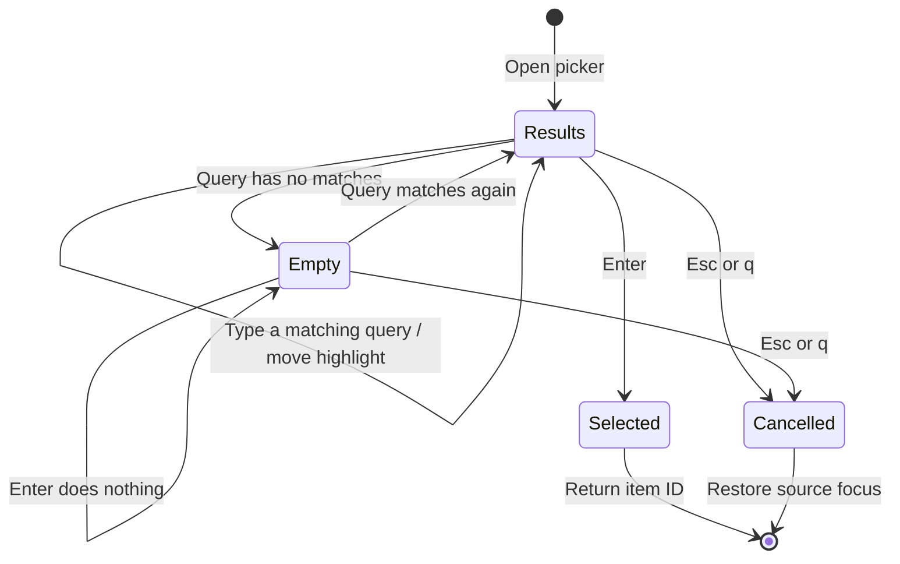
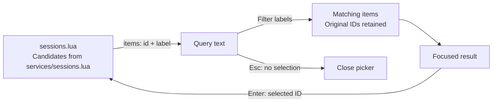

# Searchable selection

## Overview

The PR and session pickers show searchable candidates. Controllers supply labels and opaque IDs. This component does not load reviews or inspect repository data.

## Design

### Layout

The query has its own border above the results. Typing `draft` filters both matching titles. Arrow keys move the highlighted result while the cursor stays in the query.

```text
 13 -- review implementation
 14 -- revi╭─────────────────────────── Search pull requests ───────────────────────────╮
 15 -- revi│draft                                                                       │
 16 -- revi╰────────────────────────────────────────────────────────────────────────────╯
 17 -- revi╭────────────────────────────────────────────────────────────────────────────╮
 18 -- revi│#248 Keep failed drafts editable                                            │
 19        │#251 Block duplicate draft saves                                            │
 20 local f│                                                                            │
 21   submi│                                                                            │
 22 end    │                                                                            │
           │                                                                            │
           │                                                                            │
           │                                                                            │
           │                                                                            │
           │                                                                            │
           ╰─────────────── Enter select · Esc cancel · Up/Down navigate ───────────────╯
```

With no matching title, the results area stays open and Enter does nothing. Escape returns to the source buffer.

```text
 13 -- review implementation
 14 -- revi╭─────────────────────────── Search pull requests ───────────────────────────╮
 15 -- revi│zzzz                                                                        │
 16 -- revi╰────────────────────────────────────────────────────────────────────────────╯
 17 -- revi╭────────────────────────────────────────────────────────────────────────────╮
 18 -- revi│(no matches)                                                                │
 19        │                                                                            │
 20 local f│                                                                            │
 21   submi│                                                                            │
 22 end    │                                                                            │
           │                                                                            │
           │                                                                            │
           │                                                                            │
           │                                                                            │
           │                                                                            │
           ╰─────────────── Enter select · Esc cancel · Up/Down navigate ───────────────╯
```

### Behavior



### Public API

Keyboard API:

| Keys | Mode | Result |
| --- | --- | --- |
| Text entry | Insert | Filter labels. |
| Up / Down, Ctrl-P / Ctrl-N | Normal or Insert | Move the focused result. |
| Enter | Normal or Insert | Select the focused ID. Ignore an empty result. |
| Esc | Normal, Insert, or Visual | Close without selecting. |
| q | Normal | Close without selecting. |

Lua API:

```lua
require("lgtm.ui.search").open({
  title = "Reviews",
  items = {
    {
      id = "review-id",
      label = "Review title",
    },
  },
  on_select = function(id)
  end,
})
```

### State and Data Flow



## Implementation

- Schedule filtering outside the text-change callback to avoid Neovim text-lock errors.
- [Source](../../../../apps/lgtm.nvim/lua/lgtm/ui/search.lua).
