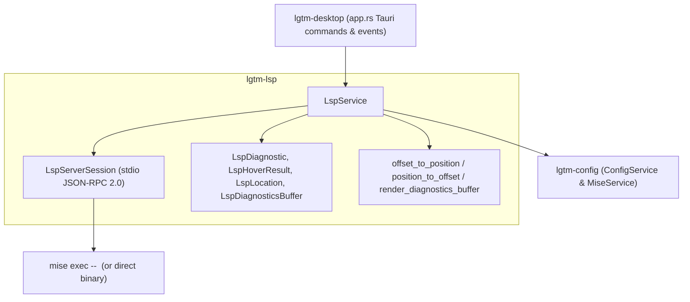
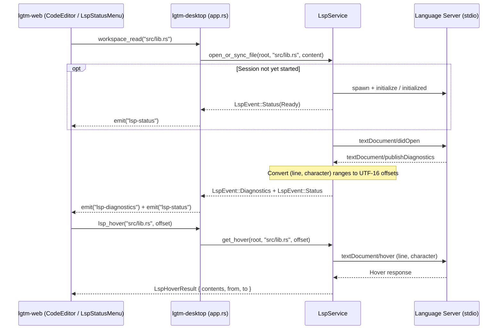

# LSP library — software architecture

## Overview

`lgtm-lsp` is the Rust Language Server Protocol client and process orchestration SDK for `lgtm-desktop`. Consuming `lgtm-config`, it spawns and pools per-`(workspace_root, language_id, project_root)` stdio JSON-RPC 2.0 language server sessions (via `mise exec` with direct binary fallback), maintains open UTF-8 document snapshots, converts between CodeMirror UTF-16 character offsets (`u32`) and LSP `(line, character)` coordinates in Rust, and provides diagnostics, hover documentation, go-to-definition locations, and plain-text diagnostics buffers.

## Requirement

### Functional

- Automatic language server pooling: Start and reuse one stdio JSON-RPC 2.0 server session per `(workspace_root, language_id, project_root)` when matching files are opened.
- Document lifecycle synchronization: Send `textDocument/didOpen`, `textDocument/didChange`, `textDocument/didSave`, and `textDocument/didClose` notifications as files are opened, edited, saved, renamed, or deleted.
- UTF-16 offset coordinate translation: Convert between flat 0-based UTF-16 character offsets used by CodeMirror 6 and 0-based `(line, character)` positions required by LSP 3.17 entirely in Rust.
- Diagnostics streaming and text buffers: Parse `textDocument/publishDiagnostics` notifications, emit workspace-relative `LspEvent::Diagnostics` and `LspEvent::Status` events, and format full plain-text diagnostics buffers (`LspDiagnosticsBuffer`) for viewing in read-only editor tabs.
- Hover and go-to-definition: Resolve `textDocument/hover` (`LspHoverResult`) and `textDocument/definition` (`Vec<LspLocation>`) from a file path and UTF-16 cursor offset.

### Non-Functional

- Graceful degradation: If a language server binary or `mise` toolchain is missing or fails to initialize, transition the server status to `unavailable` with a descriptive message without blocking file viewing or editing.
- Clean process lifecycle: Terminate child language server processes via `shutdown`/`exit` and `SIGKILL` fallback when workspaces close or the desktop app exits.

## Design

### Usage

```rust
use std::path::Path;
use lgtm_config::ConfigService;
use lgtm_lsp::{LspEvent, LspService};

let config_service = ConfigService::new();
let lsp_service = LspService::new(config_service, |event| match event {
    LspEvent::Status(status) => println!("LSP {}: {:?}", status.language_id, status.status),
    LspEvent::Diagnostics(diags) => println!("{} diagnostics for {}", diags.diagnostics.len(), diags.path),
});

let workspace = Path::new("/path/to/workspace");
let file = workspace.join("src/lib.rs");
let source = "pub fn helper() -> i32 { 42 }\n";

let (language_id, status) = lsp_service.open_or_sync_file(workspace, &file, source);
let hover = lsp_service.get_hover(workspace, &file, 7)?;
let definitions = lsp_service.get_definition(workspace, &file, 7)?;
let buffer = lsp_service.get_diagnostics_buffer(workspace, language_id.as_deref())?;
lsp_service.shutdown_all();
```

### Components and Responsibilities



- `LspService`: Owns the active session pool, open document snapshots, per-file diagnostics store, and server status table; exposes synchronous methods invoked from `lgtm-desktop`'s blocking task runner.
- `LspServerSession`: Manages one child language server process, frames outgoing requests and notifications with `Content-Length` headers over `ChildStdin`, demultiplexes incoming responses and `textDocument/publishDiagnostics` notifications on a reader thread, and enforces request timeouts.
- `models::lsp`: Defines serializable IPC payloads (`LspServerStatusEvent`, `LspDiagnostic`, `LspFileDiagnosticsEvent`, `LspHoverResult`, `LspLocation`, `LspWorkspaceSnapshot`, `LspDiagnosticsBuffer`), UTF-16 offset conversion functions, `file://` URI helpers, and plain-text diagnostics buffer formatting.

### Data and Control Flow



### Interfaces and Contracts

| Method / Function | Signature | Description |
| --- | --- | --- |
| `LspService::new` | `fn new<F>(config_service: ConfigService, event_sink: F) -> Self` | Create an `LspService` forwarding `LspEvent::Status` and `LspEvent::Diagnostics` to `event_sink`. |
| `LspService::open_or_sync_file` | `fn open_or_sync_file(&self, workspace_root: &Path, file_path: &Path, content: &str) -> (Option<String>, Option<LspServerStatusEvent>)` | Detect file language, start or reuse the project's language server, and send `didOpen` or `didChange`. |
| `LspService::did_change` | `fn did_change(&self, workspace_root: &Path, file_path: &Path, content: &str) -> Result<()>` | Update the in-memory document snapshot and send `textDocument/didChange`. |
| `LspService::did_save` | `fn did_save(&self, workspace_root: &Path, file_path: &Path, content: &str) -> Result<()>` | Synchronize latest content and send `textDocument/didSave`. |
| `LspService::did_close` | `fn did_close(&self, workspace_root: &Path, file_path: &Path) -> Result<()>` | Remove the open document snapshot and send `textDocument/didClose`. |
| `LspService::get_hover` | `fn get_hover(&self, workspace_root: &Path, file_path: &Path, offset: u32) -> Result<Option<LspHoverResult>>` | Convert UTF-16 `offset` to `(line, character)` and query `textDocument/hover`. |
| `LspService::get_definition` | `fn get_definition(&self, workspace_root: &Path, file_path: &Path, offset: u32) -> Result<Vec<LspLocation>>` | Convert UTF-16 `offset` to `(line, character)`, query `textDocument/definition`, and return workspace-relative locations with UTF-16 offsets. |
| `LspService::get_workspace_snapshot` | `fn get_workspace_snapshot(&self, workspace_root: &Path) -> Result<LspWorkspaceSnapshot>` | Return all active language server statuses and diagnostics for `workspace_root`. |
| `LspService::get_diagnostics_buffer` | `fn get_diagnostics_buffer(&self, workspace_root: &Path, language_id: Option<&str>) -> Result<LspDiagnosticsBuffer>` | Render a plain-text diagnostics report for all active servers or a single language server. |
| `offset_to_position` | `fn offset_to_position(text: &str, utf16_offset: u32) -> (u32, u32)` | Convert a 0-based UTF-16 code-unit offset to a 0-based LSP `(line, character)` pair. |
| `position_to_offset` | `fn position_to_offset(text: &str, target_line: u32, target_character: u32) -> u32` | Convert a 0-based LSP `(line, character)` pair to a 0-based UTF-16 code-unit offset. |

## Implementation

### Package layout

```text
libs/lgtm-lsp/
├── Cargo.toml
├── mise.toml
└── src/
    ├── lib.rs                 Public LspService, model, and coordinate helper exports
    ├── error.rs               LspError and Result alias
    ├── models/
    │   ├── mod.rs
    │   └── lsp.rs             LSP domain models, UTF-16 offset math, URI helpers, and buffer renderer
    └── services/
        ├── mod.rs
        └── lsp.rs             LspService and LspServerSession stdio JSON-RPC 2.0 client
```

### Mise execution with direct binary fallback

When spawning a language server whose `LanguageConfig` declares `mise_tools`, `LspService` first attempts `mise exec --cd <project_root> <tool@version>... -- <command> <args...>` with `MISE_CONFIG_FILE=<workspace>/.lgtm/mise.toml`. If `mise` or the managed tool is not installed in the current environment, `LspService` falls back to spawning `<command> <args...>` directly from `PATH` before reporting `LspServerStatus::Unavailable`.

## References

- [Configuration library architecture](../config/index.md).
- [Application architecture](../index.md).
