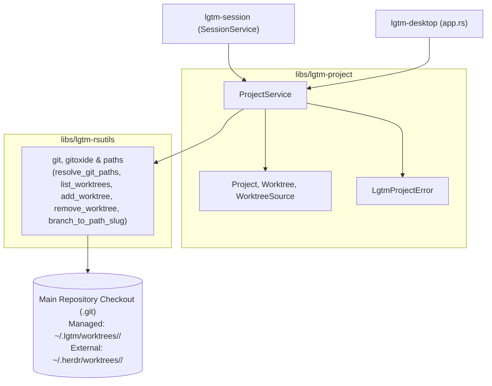
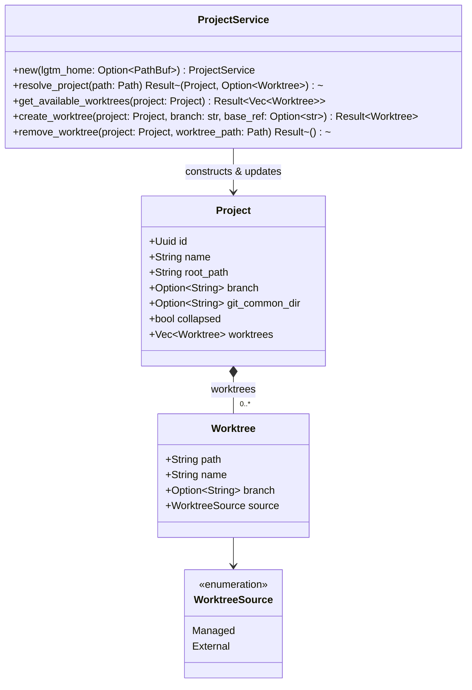
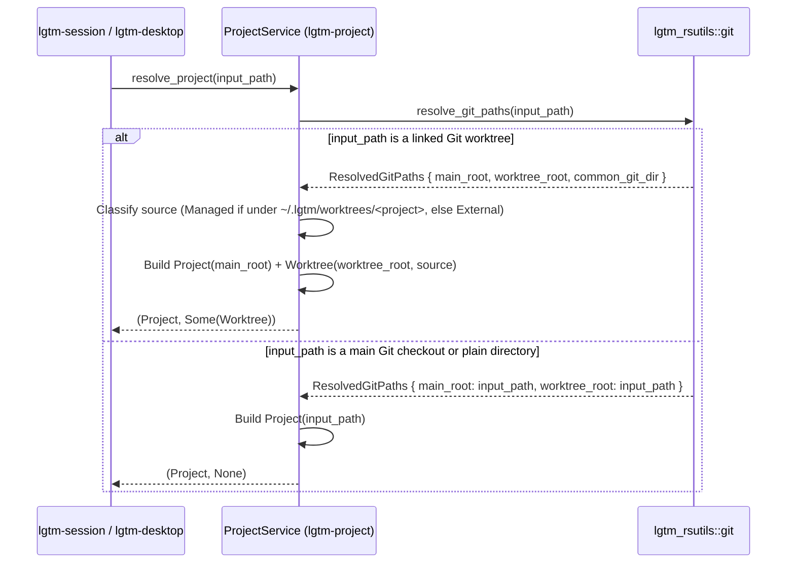

# Project library (`lgtm-project`) - software architecture

## Overview

`lgtm-project` manages projects and their Git worktrees for LGTM. Each project row represents the root repository checkout in the sidebar, and open linked Git worktrees appear as collapsible child rows underneath that project. Worktrees are classified as either managed by LGTM or external (such as Herdr worktrees), so LGTM only deletes disk storage for worktrees that it manages.

## Requirement

### Functional

- Resolve any directory path to its parent project root checkout and target worktree.
- Represent each project by its primary checkout and list open linked Git worktrees underneath it.
- Group any opened Git worktree under its parent project automatically.
- Collapse and expand a project's linked worktrees while keeping an active linked worktree visible when collapsed.
- Create new managed Git worktrees from a project primary checkout using an existing or new branch name, and surface clear errors when creation fails.
- Distinguish LGTM-managed worktrees from external worktrees so removing a managed worktree deletes its disk checkout (with dirty-checkout confirmation) while removing an external worktree only detaches it from the sidebar.

### Non-Functional

- Resolve projects and worktrees locally and offline.
- Complete project and worktree discovery without a background daemon process.
- Never delete files or Git worktree storage for external worktrees.

## Design

### Components and Responsibilities



- `ProjectService`: Resolves paths into `Project` and `Worktree` models, refreshes branch metadata, discovers external worktrees, and creates or removes managed worktrees under `~/.lgtm/worktrees/<project>/<branch-slug>` using the same `<project>/<branch-slug>` directory convention as Herdr.
- `Project`: Represents the primary repository checkout (`id`, `name`, `root_path`, `branch`, `git_common_dir`, `collapsed`, and child `worktrees`).
- `Worktree`: Represents a linked Git worktree checkout (`path`, `name`, `branch`, `source`) grouped under a `Project`.
- `WorktreeSource`: Classifies a linked worktree as `Managed` (created under `~/.lgtm/worktrees/<project>/<branch-slug>`, where LGTM owns and deletes the checkout storage on removal) or `External` (created outside `~/.lgtm/worktrees`, such as `~/.herdr/worktrees/<project>/<branch-slug>`, where LGTM never deletes disk storage).



### Data and Control Flow

#### Resolving a Path into a Project and Linked Worktree



### Interfaces and Contracts

| Type / Method | Signature | Description |
| --- | --- | --- |
| `ProjectService::new` | `fn new(lgtm_home: Option<PathBuf>) -> Self` | Create a project service managing worktrees under `$LGTM_HOME/worktrees` or `~/.lgtm/worktrees`. |
| `ProjectService::resolve_project` | `fn resolve_project(&self, path: &Path) -> Result<(Project, Option<Worktree>)>` | Resolve a directory into its parent `Project` and an optional linked `Worktree` (`Managed` or `External`). |
| `ProjectService::refresh_project` | `fn refresh_project(&self, project: &mut Project) -> Result<()>` | Refresh checked-out branch names, reclassify `WorktreeSource`, and prune missing worktree directories on disk. |
| `ProjectService::get_available_worktrees` | `fn get_available_worktrees(&self, project: &Project) -> Result<Vec<Worktree>>` | List all linked Git worktrees (`Managed` and `External`, including Herdr worktrees) for `project`. |
| `ProjectService::preview_worktree_path` | `fn preview_worktree_path(&self, project: &Project, branch: &str) -> PathBuf` | Compute the target `~/.lgtm/worktrees/<project>/<branch-slug>` checkout path for a branch name. |
| `ProjectService::create_worktree` | `fn create_worktree(&self, project: &Project, branch: &str, base_ref: Option<&str>) -> Result<Worktree>` | Create a `Managed` Git worktree at `~/.lgtm/worktrees/<project>/<branch-slug>`, reusing `branch` if it exists locally or creating `-b <branch>` from `base_ref`. |
| `ProjectService::remove_worktree` | `fn remove_worktree(&self, project: &Project, worktree_path: &Path, force: bool) -> Result<()>` | Delete checkout storage on disk when `worktree_path` is `Managed` (returning `LgtmProjectError::DirtyWorktree` unless `force` is `true`); reject disk deletion when `External`. |

### Error Handling

| Failure Condition | Error Variant | Behavior |
| --- | --- | --- |
| Empty or invalid branch name | `LgtmProjectError::InvalidBranch` | Reject creation before invoking `git worktree add` and return an inline validation message. |
| Branch already checked out in another worktree | `LgtmProjectError::BranchAlreadyCheckedOut` | Parse the `git worktree add` failure and report which worktree owns the branch without modifying the session. |
| Target checkout path already exists | `LgtmProjectError::CheckoutPathExists` | Reject overwriting an existing `~/.lgtm/worktrees/<project>/<branch-slug>` directory. |
| Project root is not a Git repository | `LgtmProjectError::NotGitRepository` | Reject worktree creation on plain non-Git folders. |
| Managed worktree has uncommitted or untracked files on removal | `LgtmProjectError::DirtyWorktree` | Prompt the user for force confirmation before re-running removal with `force = true`. |

## Implementation

### Package Layout

```text
libs/lgtm-project/
├── Cargo.toml
├── mise.toml
├── src/
│   ├── lib.rs                 Public ProjectService, Project, Worktree, and WorktreeSource exports
│   ├── error.rs               LgtmProjectError and Result alias
│   ├── models/
│   │   ├── mod.rs
│   │   └── project.rs         Project, Worktree, and WorktreeSource domain models
│   └── services/
│       ├── mod.rs
│       └── project.rs         ProjectService worktree resolution, classification, and cleanup
└── tests/
    └── project.rs             BDD integration suite for managed and external worktrees
```

## References

- [Session library (`lgtm-session`) architecture](../session/index.md).
- [Rust utilities library (`lgtm-rsutils`) architecture](../rsutils/index.md).
- [Desktop project and session management](../desktop/projects.md).
- [ProjectsPane UI component](../web/projects-pane.md).
