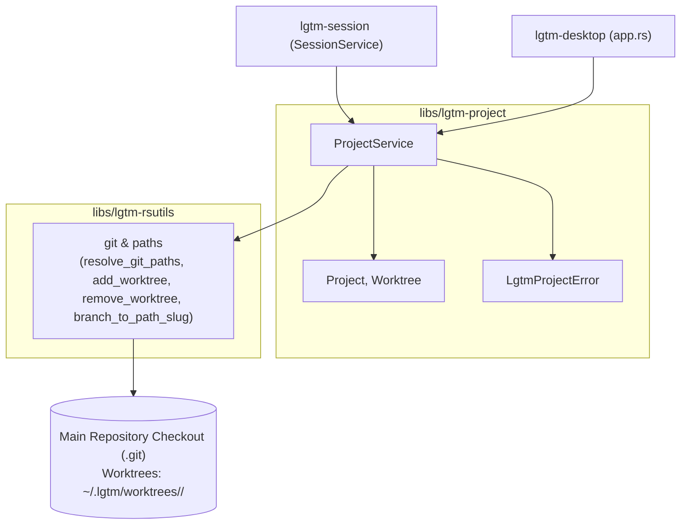
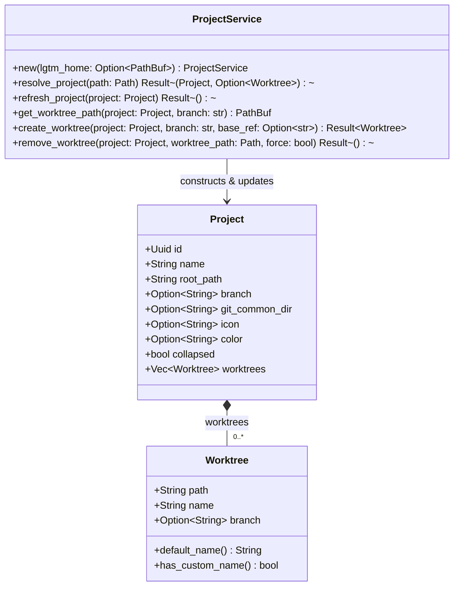
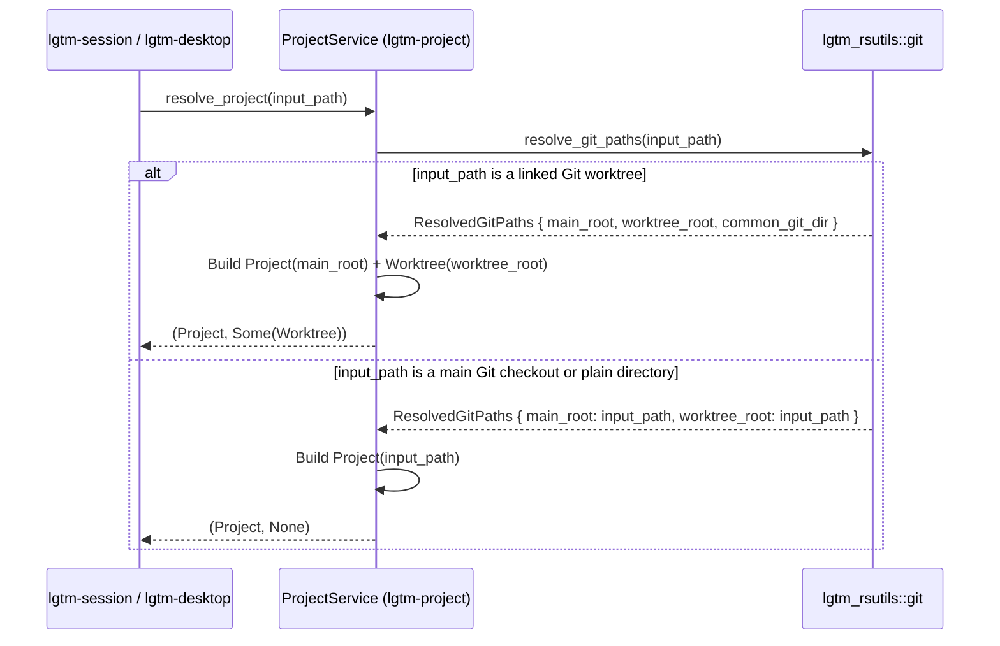

# Project library (`lgtm-project`) - software architecture

## Overview

`lgtm-project` manages projects and their Git worktrees for LGTM. Each project row represents the root repository checkout in the sidebar, and open linked Git worktrees appear as collapsible child rows underneath that project.

## Requirement

### Functional

- Resolve any directory path to its parent project root checkout and target worktree.
- Represent each project by its primary checkout and list open linked Git worktrees underneath it.
- Group any opened Git worktree under its parent project automatically.
- Collapse and expand a project's linked worktrees in the sidebar.
- Customize a project's name, icon, and color, and preserve custom worktree display names across refreshes without modifying Git branch names.
- Create new Git worktrees from a project primary checkout under `~/.lgtm/worktrees/<project>/<branch-slug>` using an existing or new branch name, and surface clear errors when creation fails.
- Remove a worktree and delete its disk checkout (with dirty-checkout confirmation when uncommitted or untracked changes are present).

### Non-Functional

- Resolve projects and worktrees locally and offline.
- Complete project and worktree discovery without a background daemon process.

## Design

### Components and Responsibilities



- `ProjectService`: Resolves paths into `Project` and `Worktree` models, refreshes branch metadata while preserving custom worktree labels, and creates or removes worktrees under `~/.lgtm/worktrees/<project>/<branch-slug>`.
- `Project`: Represents the primary repository checkout (`id`, `name`, `root_path`, `branch`, `git_common_dir`, `icon`, `color`, `collapsed`, and child `worktrees`).
- `Worktree`: Represents a linked Git worktree checkout (`path`, `name`, `branch`) grouped under a `Project`.



### Data and Control Flow

#### Resolving a Path into a Project and Linked Worktree



### Interfaces and Contracts

| Type / Method | Signature | Description |
| --- | --- | --- |
| `ProjectService::new` | `fn new(lgtm_home: Option<PathBuf>) -> Self` | Create a project service managing worktrees under `$LGTM_HOME/worktrees` or `~/.lgtm/worktrees`. |
| `ProjectService::resolve_project` | `fn resolve_project(&self, path: &Path) -> Result<(Project, Option<Worktree>)>` | Resolve a directory into its parent `Project` and an optional linked `Worktree`. |
| `ProjectService::refresh_project` | `fn refresh_project(&self, project: &mut Project) -> Result<()>` | Refresh checked-out branch names and prune missing worktree directories on disk. |
| `ProjectService::get_worktree_path` | `fn get_worktree_path(&self, project: &Project, branch: &str) -> PathBuf` | Compute the target `~/.lgtm/worktrees/<project>/<branch-slug>` checkout path for a branch name. |
| `ProjectService::create_worktree` | `fn create_worktree(&self, project: &Project, branch: &str, base_ref: Option<&str>) -> Result<Worktree>` | Create a Git worktree at `~/.lgtm/worktrees/<project>/<branch-slug>`, reusing `branch` if it exists locally or creating `-b <branch>` from `base_ref`. |
| `ProjectService::remove_worktree` | `fn remove_worktree(&self, project: &Project, worktree_path: &Path, force: bool) -> Result<()>` | Delete checkout storage on disk for `worktree_path` (returning `LgtmProjectError::DirtyWorktree` unless `force` is `true`). |

### Error Handling

| Failure Condition | Error Variant | Behavior |
| --- | --- | --- |
| Empty or invalid branch name | `LgtmProjectError::InvalidBranch` | Reject creation before invoking `git worktree add` and return an inline validation message. |
| Branch already checked out in another worktree | `LgtmProjectError::BranchAlreadyCheckedOut` | Parse the `git worktree add` failure and report which worktree owns the branch without modifying the session. |
| Target checkout path already exists | `LgtmProjectError::CheckoutPathExists` | Reject overwriting an existing `~/.lgtm/worktrees/<project>/<branch-slug>` directory. |
| Project root is not a Git repository | `LgtmProjectError::NotGitRepository` | Reject worktree creation on plain non-Git folders. |
| Worktree has uncommitted or untracked files on removal | `LgtmProjectError::DirtyWorktree` | Prompt the user for force confirmation before re-running removal with `force = true`. |

## Implementation

### Package Layout

```text
libs/lgtm-project/
├── Cargo.toml
├── mise.toml
├── src/
│   ├── lib.rs                 Public ProjectService, Project, and Worktree exports
│   ├── error.rs               LgtmProjectError and Result alias
│   ├── models/
│   │   ├── mod.rs
│   │   ├── project.rs         Project domain model
│   │   └── worktree.rs        Worktree domain model
│   └── services/
│       ├── mod.rs
│       └── project.rs         ProjectService worktree resolution, creation, and cleanup
└── tests/
    └── project.rs             BDD integration suite for projects and worktrees
```

## References

- [Session library (`lgtm-session`) architecture](../session/index.md).
- [Rust utilities library (`lgtm-rsutils`) architecture](../rsutils/index.md).
- [Desktop project and session management](../desktop/projects.md).
- [ProjectsPane UI component](../web/projects-pane.md).
