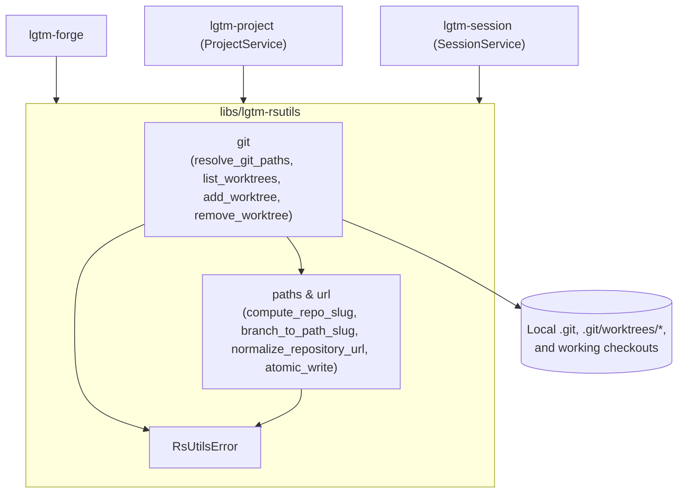
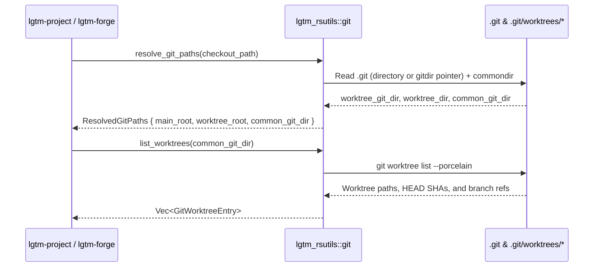

# Rust utilities library (`lgtm-rsutils`) - software architecture

## Overview

`lgtm-rsutils` provides shared Git, filesystem, and URL utilities for LGTM. It gives the workspace crates one implementation for local Git commands, repository metadata inspection, path resolution, and atomic file writes.

## Requirement

### Functional

- Resolve any checkout directory or Git metadata path to its main repository root and active worktree root.
- List, create, and remove Git worktrees and read the checked-out branch and commit.
- Generate deterministic repository identifiers, worktree directory slugs, and normalized remote repository URLs.

### Non-Functional

- Run all Git, path, and hash operations locally without network or database access.
- Keep all operations stateless so concurrent callers do not share mutable state.
- Write files atomically so interrupted writes do not leave partial files on disk.

## Design

### Components and Responsibilities



- `git`: Resolves `.git`, `gitdir`, and `commondir` paths and lists, creates, and removes `git worktree` checkouts.
- `paths` and `url`: Computes `$repoSlug` digests, formats worktree branch slugs, normalizes repository URLs, and performs atomic temporary-file-and-rename writes.
- `RsUtilsError`: Typed error enum for Git, filesystem, and URL validation failures.

### Data and Control Flow



### Interfaces and Contracts

| Module / Function | Signature | Description |
| --- | --- | --- |
| `git::resolve_git_paths` | `fn resolve_git_paths(path: &Path) -> Result<ResolvedGitPaths>` | Resolve any checkout or `.git` path to `main_root`, `worktree_root`, `worktree_git_dir`, and `common_git_dir`. |
| `git::list_worktrees` | `fn list_worktrees(repo_root: &Path) -> Result<Vec<GitWorktreeEntry>>` | Parse `git worktree list --porcelain` into main and linked worktree entries. |
| `git::add_worktree` | `fn add_worktree(repo_root: &Path, target_dir: &Path, branch: &str, base_ref: Option<&str>) -> Result<GitWorktreeEntry>` | Create a linked Git worktree at `target_dir` (checking out `branch` if it exists locally or creating `-b <branch>` from `base_ref`). |
| `git::remove_worktree` | `fn remove_worktree(repo_root: &Path, worktree_dir: &Path, force: bool) -> Result<()>` | Remove a linked Git worktree (`git worktree remove [--force]`), classify dirty-checkout errors, and clean up leftover directories when forced. |
| `paths::compute_repo_slug` | `fn compute_repo_slug(common_git_dir: &Path) -> Result<String>` | Compute `<repo-name>-<6-byte-sha256>` from the canonical `common_git_dir`. |
| `paths::branch_to_path_slug` | `fn branch_to_path_slug(branch: &str) -> String` | Convert a branch name into a lowercase hyphenated directory slug matching Herdr (`~/.lgtm/worktrees/<project>/<branch-slug>`). |
| `paths::generated_branch_slug` | `fn generated_branch_slug(seed: u64) -> String` | Generate a default `worktree/<adjective>-<noun>-<hex>` branch name when opening the new-worktree dialog. |
| `paths::atomic_write` | `fn atomic_write(path: &Path, bytes: &[u8]) -> Result<()>` | Write bytes to a sibling temporary file and rename it onto `path`. |
| `url::normalize_repository_url` | `fn normalize_repository_url(raw: &str) -> Result<String>` | Normalize SSH or HTTPS Git remote URLs to `https://<host>/<owner>/<repo>`. |

## Implementation

### Package Layout

```text
libs/lgtm-rsutils/
├── Cargo.toml
├── mise.toml
├── src/
│   ├── lib.rs                 Public module and type exports
│   ├── error.rs               RsUtilsError and Result alias
│   ├── git.rs                 Git path resolution and worktree CLI helpers
│   ├── paths.rs               Repo slug hashing, branch slugs, and atomic file writes
│   └── url.rs                 Repository URL normalization and owner/repo parsing
└── tests/
    └── git_worktrees.rs       BDD integration suite for git path and worktree resolution
```

## References

- [Project library (`lgtm-project`) architecture](../project/index.md).
- [Session library (`lgtm-session`) architecture](../session/index.md).
- [Forge architecture (`lgtm-forge`)](../forge/index.md).
