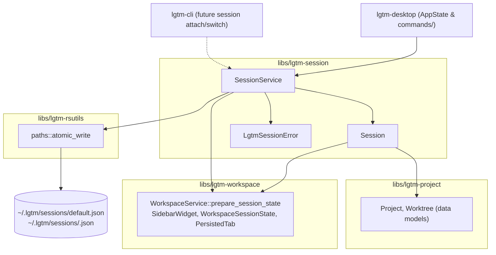
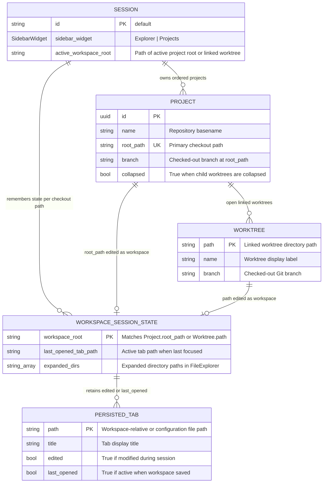
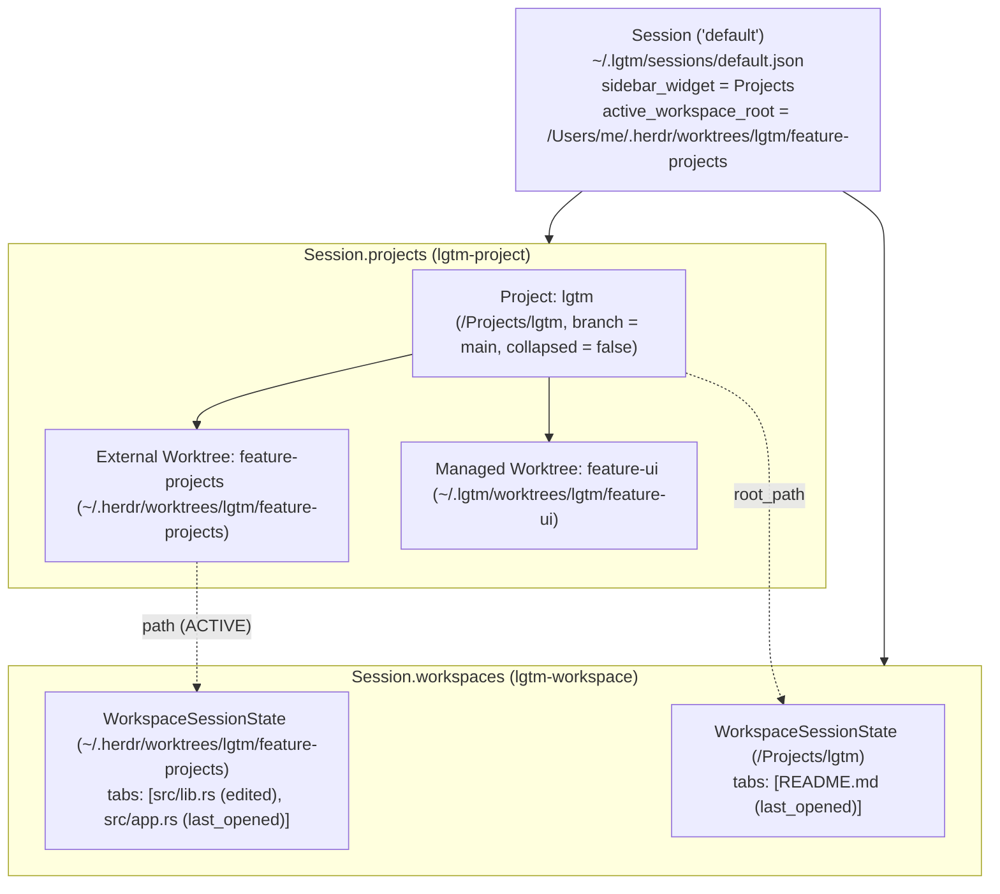
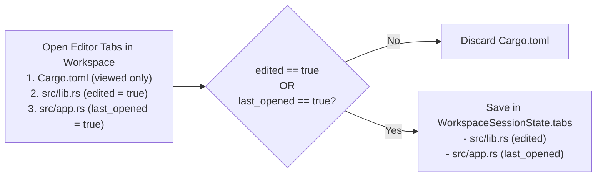

# Session library (`lgtm-session`) - software architecture

## Overview

`lgtm-session` manages atomic session persistence for LGTM (`~/.lgtm/sessions/<id>.json`). A `Session` stores the ordered open projects, active sidebar widget, active workspace directory, and remembered per-workspace editor tabs and explorer state. Cross-service orchestration with `lgtm-project` lives in application entry points (`apps/lgtm-desktop`), while workspace tab filtering delegates to pure `lgtm-workspace` helpers.

## Requirement

### Functional

- Persist and reload the ordered list of open projects and their worktrees in a named session file.
- Track the active workspace directory and the active left sidebar widget.
- Remember state separately for each project checkout and each worktree, including its active tab, tabs modified during the session, and expanded file-explorer directories.
- Retain only tabs modified during the session and the last active tab when a workspace is saved or switched.
- Prune remembered workspace entries and fall back `active_workspace_root` when a worktree or project is removed.

### Non-Functional

- Switch active workspaces in memory without waiting on disk writes.
- Write session state atomically (`lgtm-rsutils::atomic_write`) so crashes or power loss do not corrupt saved sessions.
- Read and write sessions locally without network access or a background daemon.

## Design

### Components and Responsibilities



- `SessionService`: Persists and reloads `~/.lgtm/sessions/<id>.json` atomically (`get_session`, `save_session`, `save_workspace_state`) without wrapping sibling domain services.
- `Session`: Top-level persisted root owning `id`, `sidebar_widget`, `active_workspace_root`, `projects`, and `workspaces`, plus pure state transition methods (`set_active_workspace`, `set_workspace_state`, `apply_worktree_removal`, `apply_project_removal`).
- `WorkspaceSessionState`, `PersistedTab`, `TabCandidate`, `SidebarWidget`, and `WorkspaceStatePatch` (`libs/lgtm-workspace`): Per-workspace UI state models and tab retention filtering (`WorkspaceService::prepare_session_state`).



### Data and Control Flow

#### 1. Ownership Hierarchy (`Session` -> `Project` -> `Workspace`)



#### 2. Tab Retention Filter on Workspace Save or Switch



### Interfaces and Contracts

| Type / Method | Signature | Description |
| --- | --- | --- |
| `SessionService::new` | `fn new(lgtm_home: Option<PathBuf>) -> Self` | Create a session service rooted at `$LGTM_HOME/sessions` or `~/.lgtm/sessions`. |
| `SessionService::get_session` | `fn get_session(&self, session_id: &str) -> Result<Session>` | Load `~/.lgtm/sessions/<session_id>.json` or initialize a new empty session. |
| `SessionService::save_session` | `fn save_session(&self, session: &Session) -> Result<()>` | Atomically write `session` to `~/.lgtm/sessions/<session.id>.json`. |
| `SessionService::save_workspace_state` | `fn save_workspace_state(&self, session_id: &str, patch: WorkspaceStatePatch) -> Result<Session>` | Delegate tab filtering to `WorkspaceService::prepare_session_state`, update `workspaces` and `sidebar_widget`, and write `default.json`. |
| `Session::set_active_workspace` | `fn set_active_workspace(&mut self, workspace_root: String)` | Update `active_workspace_root` and ensure a `WorkspaceSessionState` entry exists. |
| `Session::apply_worktree_removal` | `fn apply_worktree_removal(&mut self, canonical_path: &str, raw_path: &str, parent_root: String)` | Remove workspace state for a deleted worktree and fall back `active_workspace_root` to `parent_root`. |
| `Session::apply_project_removal` | `fn apply_project_removal(&mut self, removed: &Project)` | Remove workspace states for a detached project and its worktrees and update `active_workspace_root`. |

## Implementation

### Package Layout

```text
libs/lgtm-session/
├── Cargo.toml
├── mise.toml
├── src/
│   ├── lib.rs                 Public SessionService, Session, LgtmSessionError, and Result exports
│   ├── error.rs               LgtmSessionError and Result alias
│   ├── models/
│   │   ├── mod.rs
│   │   └── session.rs         Session aggregate root and pure state transition methods
│   └── services/
│       ├── mod.rs
│       └── session.rs         SessionService atomic ~/.lgtm/sessions/<id>.json persistence
└── tests/
    └── session.rs             BDD integration suite for session load, save, tab filtering, and removals
```

## References

- [Project library (`lgtm-project`) architecture](../project/index.md).
- [Rust utilities library (`lgtm-rsutils`) architecture](../rsutils/index.md).
- [Desktop project and session management](../desktop/projects.md).
- [ProjectsPane UI component](../web/projects-pane.md).
