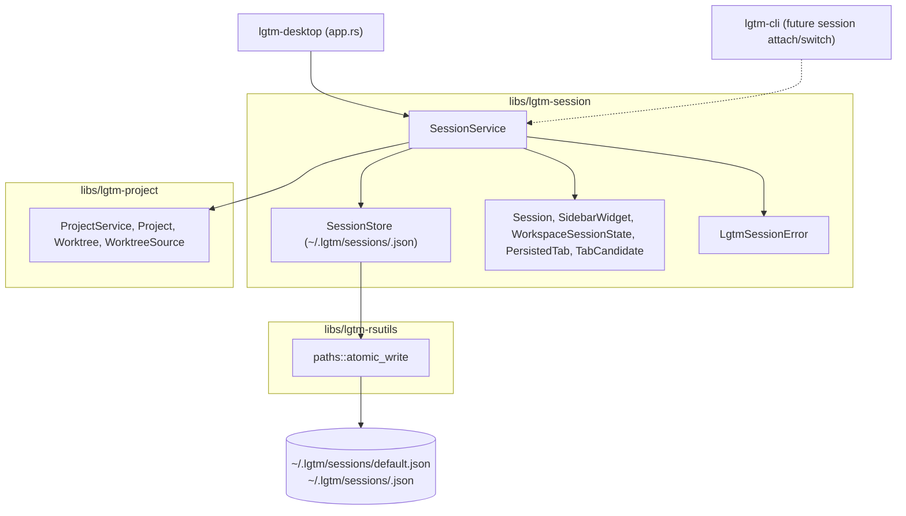
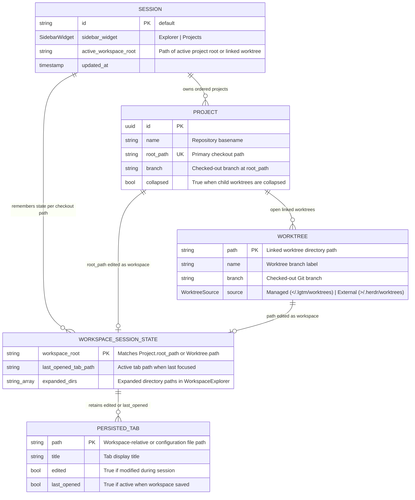
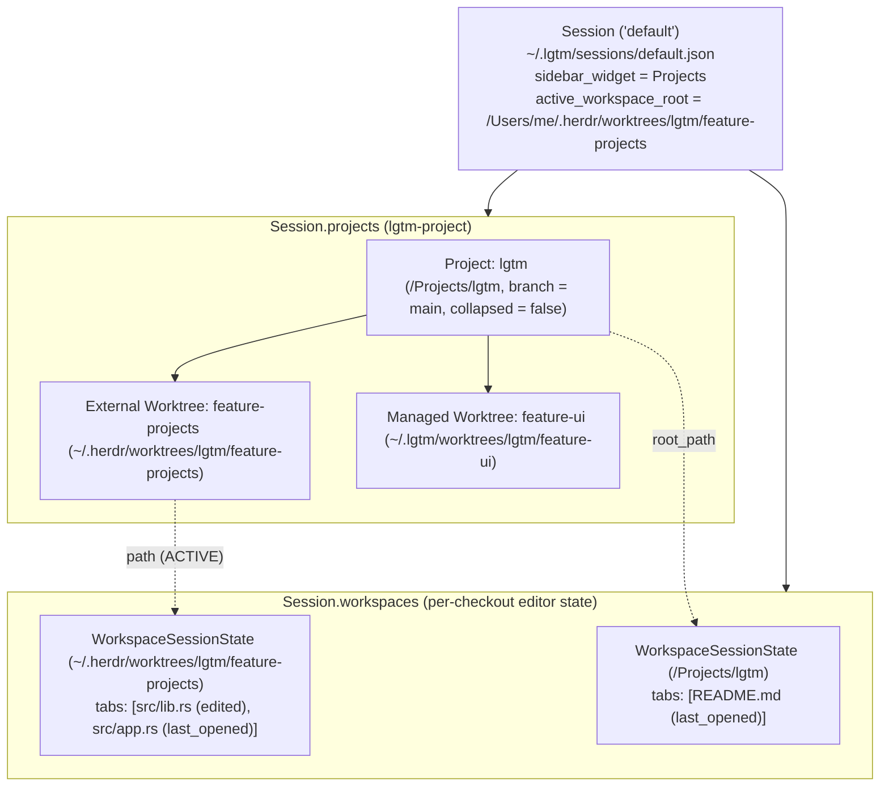
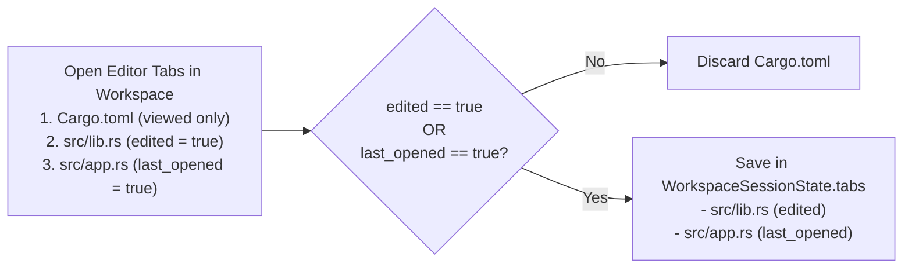

# Session library (`lgtm-session`) - software architecture

## Overview

`lgtm-session` manages workspace sessions and persistence for LGTM. A session owns the open projects, the active sidebar view, the active workspace directory, and the remembered editor tabs and explorer state for each project checkout and worktree.

## Requirement

### Functional

- Store the ordered list of open projects and their worktrees in a named session.
- Track the active workspace directory and the active left sidebar view.
- Remember state separately for each project checkout and each worktree, including its active tab, tabs modified during the session, and expanded file-explorer directories.
- Retain only tabs modified during the session and the last active tab when a workspace is saved or switched.
- Delete worktree disk storage when removing a managed worktree, and only detach the sidebar entry when removing an external worktree.

### Non-Functional

- Switch active workspaces in memory without waiting on disk writes.
- Debounce and write session state atomically in the background so crashes or power loss do not corrupt saved sessions.
- Read and write sessions locally without network access or a background daemon.

## Design

### Components and Responsibilities



- `SessionService`: Coordinates `SessionStore` and `lgtm_project::ProjectService` to load the `default` session, register projects and worktrees, toggle collapsed project groups, switch the active workspace, and save filtered workspace tabs.
- `Session`: Top-level persisted root owning `id`, `sidebar_widget`, `active_workspace_root`, `projects`, and `workspaces`.
- `WorkspaceSessionState`: Per-workspace UI snapshot storing the retained `tabs` (`Vec<PersistedTab>`), `last_opened_tab_path`, and `expanded_dirs` for a single checkout path (either `Project.root_path` or a `Worktree.path`).
- `PersistedTab` and `TabCandidate`: Tab descriptors that enforce the retention rule (`edited || last_opened`).



### Data and Control Flow

#### 1. Ownership Hierarchy (`Session` -> `Project` -> `Workspace`)



#### 2. Tab Retention Filter on Workspace Save or Switch



### Interfaces and Contracts

| Type / Method | Signature | Description |
| --- | --- | --- |
| `SessionService::new` | `fn new(lgtm_home: Option<PathBuf>) -> Result<Self>` | Create a session service rooted at `$LGTM_HOME/sessions` or `~/.lgtm/sessions`. |
| `SessionService::get_session` | `fn get_session(&self, session_id: &str) -> Result<Session>` | Load `~/.lgtm/sessions/<session_id>.json` or initialize the `default` session. |
| `SessionService::open_workspace` | `fn open_workspace(&self, session_id: &str, path: &Path) -> Result<Session>` | Resolve `path` via `lgtm-project`, upsert its parent `Project` and `Worktree`, and set `active_workspace_root`. |
| `SessionService::save_workspace_state` | `fn save_workspace_state(&self, session_id: &str, workspace_root: &Path, tabs: Vec<TabCandidate>, sidebar_widget: Option<SidebarWidget>) -> Result<Session>` | Filter `tabs` to `edited \|\| last_opened`, update `workspaces[workspace_root]`, and write `default.json`. |
| `SessionService::create_project_worktree` | `fn create_project_worktree(&self, session_id: &str, project_id: Uuid, branch: &str, base_ref: Option<&str>) -> Result<(Worktree, Session)>` | Create a `Managed` worktree at `~/.lgtm/worktrees/<project>/<branch-slug>`, attach it to `Session`, and activate it. |
| `SessionService::set_project_collapsed` | `fn set_project_collapsed(&self, session_id: &str, project_id: Uuid, collapsed: bool) -> Result<Session>` | Persist the collapsed or expanded worktree state for a project in `Session`. |
| `SessionService::remove_project_worktree` | `fn remove_project_worktree(&self, session_id: &str, project_id: Uuid, worktree_path: &Path, force: bool) -> Result<Session>` | Remove the worktree from `Session` and delete disk storage only when `WorktreeSource::Managed`. |
| `SessionService::remove_project` | `fn remove_project(&self, session_id: &str, project_id: Uuid) -> Result<Session>` | Remove a project and its workspace states from `Session` without deleting `External` worktrees. |

## Implementation

### Package Layout

```text
libs/lgtm-session/
├── Cargo.toml
├── mise.toml
├── src/
│   ├── lib.rs                 Public SessionService, Session, WorkspaceSessionState, and PersistedTab exports
│   ├── error.rs               LgtmSessionError and Result alias
│   ├── models/
│   │   ├── mod.rs
│   │   └── session.rs         Session, SidebarWidget, WorkspaceSessionState, PersistedTab, and TabCandidate
│   └── services/
│       ├── mod.rs
│       └── session.rs         SessionService orchestration and atomic ~/.lgtm/sessions/<id>.json persistence
└── tests/
    └── session.rs             BDD integration suite for session restore, worktree switching, and tab filtering
```

## References

- [Project library (`lgtm-project`) architecture](../project/index.md).
- [Rust utilities library (`lgtm-rsutils`) architecture](../rsutils/index.md).
- [Desktop project and session management](../desktop/projects.md).
- [ProjectsPane UI component](../web/projects-pane.md).
