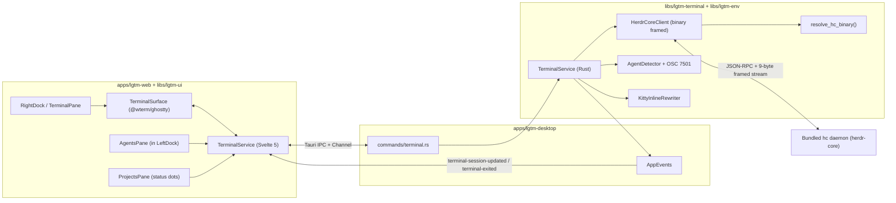
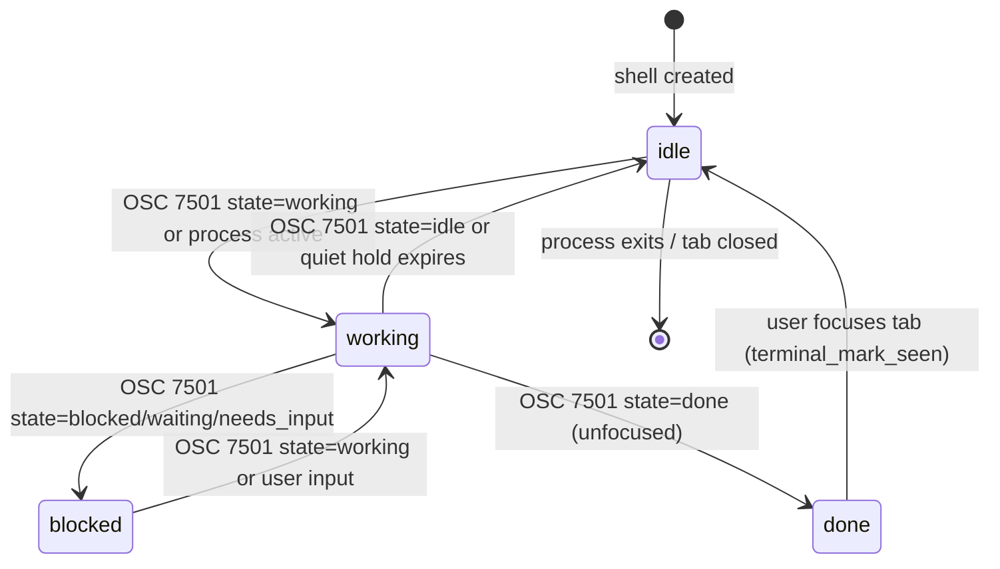

# Desktop integrated terminal — software architecture

## Overview

LGTM Desktop provides persistent, multi-tab workspace terminals powered by a bundled `herdr-core` (`hc`) sidecar binary, a Rust terminal service (`libs/lgtm-terminal`), and a `@wterm/dom` + `@wterm/ghostty` (`libghostty-vt` WASM) terminal surface in `libs/lgtm-ui`. Terminals survive workspace switches and app restarts, dynamically detect running coding agents via OSC 7501 and configurable process matchers, and surface worktree status dots and notifications across workspaces.

## Requirement

### Functional

- Open, switch, rename, and close multiple terminal tabs per workspace inside a resizable right-hand dock (`RightDock`) without losing running shells when switching workspaces or closing the dock.
- Persist right-dock open state, active widget, width, and agents-pane height across workspace switches and desktop restarts.
- Navigate focus between `projects`, `agents`, `workspace`, `editor`, and `right-dock` panes using `Ctrl+w` chords, and cycle or close terminal tabs with the same `tab.next`, `tab.prev`, and `tab.close` shortcuts used for editor tabs when `right-dock` is active.
- Detect running coding agents dynamically via OSC 7501 sequences and user-configurable `terminal.agentMatchers` in `config.json`, displaying active agents in `AgentsPane` sorted by attention priority (`blocked > working > done > idle`).
- Show Herdr-style status dots (`working`, `blocked`, `done`, `idle`) on worktree rows in `ProjectsPane`, emit per-session deduplicated background notifications when an unfocused worktree becomes `done` or `blocked`, and jump straight to the session with scrollback hydrated on click.
- Render inline images emitted via the Kitty Graphics Protocol (`t=f`, `t=t`, and `t=d`) directly inside the terminal surface.

### Non-Functional

- Mount at most one live `TerminalSurface` instance in the DOM at any time so memory stays bounded across many workspaces and tabs.
- Coalesce PTY output on a 12 ms cadence in Rust and cap attach replay buffers to 256 KB so high-throughput terminal floods do not saturate Tauri IPC or freeze the UI.
- Bundle `herdr-core` (`hc`) as a pinned, SHA-256-verified Tauri sidecar (`externalBin`) so users need no separate runtime installation.
- Avoid flickering agent status indicators by holding `working -> idle` transitions briefly unless confirmed by OSC 7501 `state=idle` or `state=done`.

## Design

### Architecture Overview

### Components and Responsibilities

| Component | Location | Responsibility |
| --- | --- | --- |
| Sidecar resolver | [`libs/lgtm-env/src/services/hc.rs`](../../../libs/lgtm-env/src/services/hc.rs) | Resolves `LGTM_HC_BIN`, bundled Tauri sidecar path, or `PATH` lookup for `hc`. |
| Terminal domain crate | [`libs/lgtm-terminal/src/lib.rs`](../../../libs/lgtm-terminal/src/lib.rs) | Manages `herdr-core` framed RPC, output coalescing, replay cap, Kitty APC rewriting, OSC 7501 parsing, and dynamic agent detection. |
| Desktop IPC & events | [`apps/lgtm-desktop/src/commands/terminal.rs`](../../../apps/lgtm-desktop/src/commands/terminal.rs) | Exposes `terminal_*` commands, streams PTY bytes over Tauri `Channel`, and emits status updates through `AppEvents`. |
| Terminal surface | [`libs/lgtm-ui/src/terminal/TerminalSurface.svelte`](../../../libs/lgtm-ui/src/terminal/TerminalSurface.svelte) | Wraps `@wterm/dom` + `@wterm/ghostty`, manages ResizeObserver fitting, theme sync, and clean unmount disposal. |
| Frontend service | [`apps/lgtm-web/src/lib/services/terminalService.svelte.ts`](../../../apps/lgtm-web/src/lib/services/terminalService.svelte.ts) | Tracks live sessions, active tab per workspace, priority-sorted agents, worktree status rollup, and background toasts. |
| Dock & panes | [`apps/lgtm-web/src/lib/components/RightDock.svelte`](../../../apps/lgtm-web/src/lib/components/RightDock.svelte), [`AgentsPane.svelte`](../../../apps/lgtm-web/src/lib/components/AgentsPane.svelte) | Renders the resizable right-hand terminal dock, bottom toolbar toggle, and vertically resizable agents list inside the Projects dock. |

### Agent Detection and Status Lifecycle

### Configuration and Persistence

- User-extensible agent matchers live under `terminal.agentMatchers` in `~/.lgtm/config.json` and `<workspace>/.lgtm/config.json` (`libs/lgtm-config`), defaulting to `claude`, `codex`, `pi`, `agy`, and `opencode`.
- Session layout fields (`right_dock_open`, `right_dock_widget`, `right_dock_width`, `agents_pane_height`) persist in `~/.lgtm/sessions/<id>.json` (`libs/lgtm-session`).
- Environment override `LGTM_HC_BIN` is documented in [`docs/environment.md`](../../environment.md).
