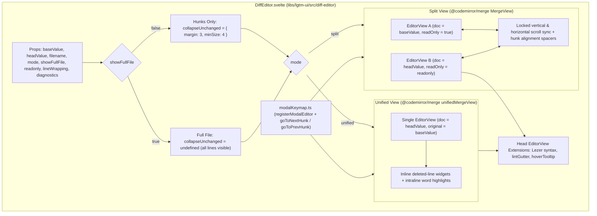
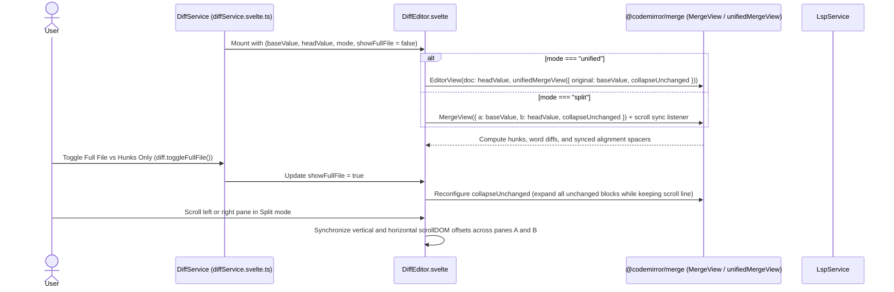

# DiffEditor

## Overview

`DiffEditor` (`libs/lgtm-ui/src/diff-editor/DiffEditor.svelte`) is a reusable Svelte 5 and CodeMirror 6 component that renders a single-file diff in either unified (single-column) or split (side-by-side) layout. It accepts the raw `baseValue` and `headValue` strings and uses `@codemirror/merge` to compute line hunks, word-level intraline highlights, alignment spacers, and collapsed unchanged blocks on the client. In split mode, the left (`base`) and right (`head`) panes stay scroll-synced and line-aligned at all times, and callers can toggle between viewing only diff hunks (`showFullFile = false`) or the entire uncollapsed file (`showFullFile = true`).

## Design

### Layout

```text
Unified mode (mode = "unified", showFullFile = false):
+-------------------------------------------------------------------+
| 12  12 |   const root = workspace.getRoot()                       |
| 13     | - const oldPath = resolveLegacy(root)                    |
|     13 | + const nextPath = resolveUnified(root)                  |
| 14  14 |   return nextPath                                        |
|--------+----------------------------------------------------------|
|        | ... 18 unchanged lines (collapsed in Hunks mode) ...     |
+-------------------------------------------------------------------+

Split mode (mode = "split", left and right panes always synced):
+---------------------------------+---------------------------------+
| Base (aef109c, read-only)       | Head (working tree / S2)        |
|---------------------------------+---------------------------------|
| 12 | const root = getRoot()     | 12 | const root = getRoot()     |
| 13 | - const old = legacy(root) | 13 | + const next = unify(root) |
|    | [alignment spacer]         | 14 | + checkPath(next)          |
| 14 | return root                | 15 | return next                |
+---------------------------------+---------------------------------+
```



### Behavior

- Render the file diff by default in the selected `mode` (`"split"` or `"unified"`) with `showFullFile = false` (collapsing unchanged regions of four or more lines with three context lines) and highlight added, removed, and intraline-changed spans.
- Keep the left (`a`) and right (`b`) panes synchronized in `"split"` mode across vertical scrolling, horizontal scrolling, collapsed hunk expansion, and alignment spacers at all times.
- Toggle `showFullFile` (or call `toggleFullFile()` on `DiffService`) to switch between viewing only diff hunks (`showFullFile = false`) and viewing the full uncollapsed file (`showFullFile = true`) without re-fetching blobs.
- Switch between `"unified"` and `"split"` without re-fetching file blobs from the backend.
- Call `goToNextHunk` or `goToPrevHunk` (`libs/lgtm-ui/src/code-editor/modalKeymap.ts`) to scroll both synced panes to the next or previous changed hunk.
- Hover over symbols or trigger go-to-definition in the `head` buffer to invoke `onhover` and `ongotodefinition` at the UTF-16 offset in `headValue`.
- Keep the `base` buffer strictly read-only in all modes, and make the `head` buffer read-only unless `readonly = false` (when viewing the live working tree).
- Render a single-side addition diff when `baseValue` is empty (`Added` file), a single-side deletion diff when `headValue` is empty (`Deleted` file), and an inline "No textual changes in this file." banner when `baseValue === headValue`.
- Expose `aria-label` on both CodeMirror content regions (`"<filename> base diff"` and `"<filename> head diff"`), preserve keyboard hunk navigation, and maintain focus in the `head` editor when toggling layout mode or `showFullFile`.

## Implementation

### Public API

```ts
export type DiffEditorMode = 'unified' | 'split'

export interface DiffEditorProps {
  baseValue: string
  headValue?: string
  filename?: string
  mode?: DiffEditorMode
  showFullFile?: boolean
  readonly?: boolean
  lineWrapping?: CodeEditorLineWrapping
  clickToInsert?: boolean
  collapseUnchangedMargin?: number
  collapseUnchangedMinSize?: number
  size?: DiffEditorRootVariants['size']
  label?: string
  class?: string
  diagnostics?: CodeEditorDiagnostic[]
  onchange?: (value: string) => void
  onsave?: (value: string) => void
  onhover?: (offset: number) => Promise<CodeEditorHoverResult | null>
  ongotodefinition?: (offset: number) => void | Promise<void>
  onmodetoggle?: (mode: DiffEditorMode) => void
  onfullfiletoggle?: (showFullFile: boolean) => void
  onViewReady?: (view: EditorView | null) => void
}
```

```svelte
<DiffEditor
  baseValue={workspace.diff.activeDiff.baseContent}
  headValue={workspace.diff.draftHeadContent ?? workspace.diff.activeDiff.headContent}
  filename={workspace.diff.activeDiff.path}
  mode={workspace.diff.viewMode}
  showFullFile={workspace.diff.showFullFile}
  readonly={workspace.diff.activeDiff.readonly}
  lineWrapping={workspace.settings.lineWrapping}
  clickToInsert={workspace.settings.clickToInsert}
  diagnostics={workspace.diagnosticsForPath(workspace.diff.activeDiff.path)}
  onchange={(next) => workspace.updateDiffContent(next)}
  onsave={(next) => void workspace.saveDiffNow(next)}
  onhover={(offset) => workspace.hoverAtPath(workspace.diff.activeDiff.path, offset)}
  ongotodefinition={(offset) => void workspace.gotoDefinitionAtPath(workspace.diff.activeDiff.path, offset)}
  onViewReady={(view) => {
    activeEditorView = view
  }}
/>
```

### State and Data Flow



| State / Compartment | Owner | Description |
| --- | --- | --- |
| `baseValue` / `headValue` | Parent (`DiffService` / `WorkspaceService`) | Raw UTF-8 strings for the old (`a`) and new (`b`) file revisions. |
| `mode` (`'unified' \| 'split'`) | Parent (`DiffService`) | Selects single-column `unifiedMergeView` or dual-column synced `MergeView`. |
| `showFullFile` (`boolean`) | Parent (`DiffService`) & `DiffEditor` | When `false`, collapses unchanged regions into hunks (`margin: 3, minSize: 4`). When `true`, shows the full uncollapsed file. |
| `languageCompartment` | `DiffEditor.svelte` | Loads the matching `@codemirror/language-data` parser into both `a` and `b` states. |
| `readOnlyCompartment` | `DiffEditor.svelte` | Locks `a` to read-only and toggles `b` between read-only (commits) and editable (working tree). |
| `lineWrappingCompartment` | `DiffEditor.svelte` | Applies `"auto"`, `"off"`, or fixed-column wrapping identically to both synced panes. |

### Styling and Responsiveness

- Reuse `codeEditorHighlightStyle` and `codeEditorTooltipTheme` from `libs/lgtm-ui/src/code-editor/` so syntax colors, gutters, selection backgrounds, and hover tooltips match `CodeEditor`.
- Style diff lines and intraline word spans with semantic CSS tokens:
  - Added line background: `var(--cm-diff-added-bg, rgba(46, 189, 107, 0.12))`
  - Added word background: `var(--cm-diff-added-word-bg, rgba(46, 189, 107, 0.28))`
  - Deleted line background: `var(--cm-diff-deleted-bg, rgba(243, 46, 64, 0.12))`
  - Deleted word background: `var(--cm-diff-deleted-word-bg, rgba(243, 46, 64, 0.28))`
- Keep each split pane at `min-w-0 flex-1` separated by a `1px` `var(--color-border)` divider, and mirror `scrollDOM.scrollTop` and `scrollDOM.scrollLeft` between `MergeView.a` and `MergeView.b` so both panes stay locked together.

### Maintainer Notes

- Register the active `head` `EditorView` with Helical UI's `registerModalEditor` via `createCodeMirrorModalTarget` (`libs/lgtm-ui/src/code-editor/modalKeymap.ts`) and expose `goToNextHunk` and `goToPrevHunk` so `HotkeyService` can drive `[c` / `]c` and `Space d j` / `Space d k` across both `CodeEditor` and `DiffEditor`.
- Share the Lezer highlight style, Markdown tooltip renderer (`renderMarkdownToDom`), and line-wrapping helper between `CodeEditor` and `DiffEditor` under `libs/lgtm-ui/src/code-editor/` to avoid duplicate theme definitions.
- Do not pass pre-computed unified diff hunks into `DiffEditor`. Always pass full `baseValue` and `headValue` strings so `@codemirror/merge` can toggle `showFullFile` between collapsed hunks and the full file in memory without IPC round-trips.
