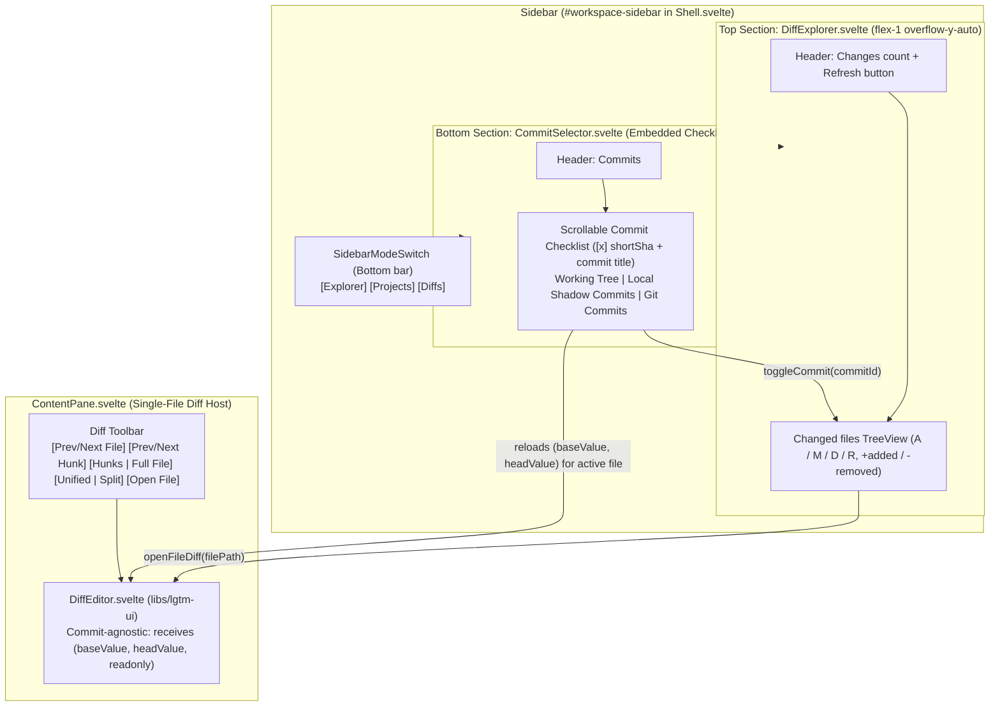
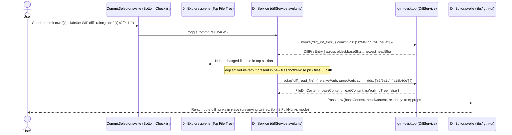

# DiffExplorer & CommitSelector

## Overview

`DiffExplorer` (`apps/lgtm-web/src/lib/components/DiffExplorer.svelte`) and `CommitSelector` (`apps/lgtm-web/src/lib/components/CommitSelector.svelte`) render the CodeDiff.nvim-style changed-file tree and an embedded commit checklist inside the left sidebar of `Shell.svelte`. The top portion of the sidebar (`DiffExplorer`) lists the files modified across the checked commits with status badges (`A`, `M`, `D`, `R`) and line counts (`+added` / `-removed`), opening one file at a time in `DiffEditor`. The bottom portion of the sidebar embeds `CommitSelector` as a scrollable checklist of commits and commit titles (with no popover menu) supporting uncommitted working-tree changes, local-only LGTM shadow commits (`refs/lgtm/snapshots/<branch>`), and standard Git branch commits.

## Design

### Layout

```text
+-------------------------------------------------------------------------+
| [SidebarTrigger] lgtm   [lgtm / feature-diffs v]                        |
|-----------------------------+-------------------------------------------|
| Changes (4)        [Refresh]| [D src/app.rs] [src/lib.rs]               |
|-----------------------------|-------------------------------------------|
| v src                       | Diff: src/app.rs [< Hunk >] [Hunks|Full] [Unified|Split]
|   M app.rs          +42 -11 |-------------------------------------------|
|   M events.rs       +18  -2 | 10 | const prev = getRoot()               |
|   A services/diff.rs +96 -0 | 11 | - const old = readLegacy(prev)       |
| v docs/architecture         | 11 | + const next = readUnified(prev)     |
|   M index.md         +6  -1 | 12 | return next                          |
|                             |                                           |
|-----------------------------|                                           |
| Commits                     |                                           |
|-----------------------------|                                           |
| [ ] Working Tree      local |                                           |
| [x] s2f9a1c Snapshot  local |                                           |
| [x] s18b40e WIP diff  local |                                           |
| [ ] bcabc2b feat: nes   git |                                           |
| [ ] 5d69847 feat: ini   git |                                           |
|-----------------------------+-------------------------------------------|
| [Explorer][Projects][Diffs] | [LSP] src > app.rs (2 commits)      Ready |
+-------------------------------------------------------------------------+
```



### Behavior

- Default: When the user switches the sidebar to `Diffs`, `DiffService` checks `Working Tree` (if uncommitted changes exist) or the latest commit in the embedded `CommitSelector` checklist, builds a collapsible hierarchical directory `TreeNode[]` tree from the flat `DiffFileEntry[]` paths (compacting single-child intermediate folders such as `docs/architecture` to match `codediff.nvim` and expanding all folder branches by default), populates `DiffExplorer` via `TreeView` (`libs/lgtm-ui`), and opens the first changed file in `DiffEditor`.
- Folder collapse and expand: Clicking a directory branch row in `DiffExplorer` collapses or expands its child files and subdirectories using `TreeView` (`@ark-ui/svelte/tree-view`) with indent guides and `Folder` / `FolderOpen` icons.
- Interaction (`CommitSelector` checklist -> `DiffExplorer` & `DiffEditor`): Checking or unchecking a commit row in `CommitSelector` updates `selectedCommitIds` in `DiffService`, recomputes the combined diff from the oldest checked commit's `baseSha` to the newest checked commit's `headSha`, refreshes `DiffExplorer`, and updates `DiffEditor`:
  - If the currently open `activeFilePath` is still modified across `selectedCommitIds`, `DiffService` fetches the new `(baseContent, headContent)` pair for that file and updates `DiffEditor` in place.
  - If `activeFilePath` is no longer in the changed list, `DiffService` selects the first changed file in the new list and loads it into `DiffEditor`.
  - When `Working Tree` is the newest checked item, `DiffService` sets `readonly = false` on `DiffEditor`. Otherwise `DiffService` sets `readonly = true`.
- Interaction (`DiffExplorer` -> `DiffEditor`): Click any file row in `DiffExplorer` to load its `(baseContent, headContent)` pair for the currently checked commits into `DiffEditor`.
- Interaction (`ContentPane` toolbar): Use the diff toolbar (or shortcuts registered in `apps/lgtm-web/src/lib/keybindings.ts`) to jump between hunks, step to the previous or next changed file, toggle between `Hunks Only` (`showFullFile = false`) and `Full File` (`showFullFile = true`), or toggle between `Unified` and `Split` columns.
- Loading, empty, and error: Display `"Select at least one commit"` when all checkboxes are unchecked or `"No changes in selected commits"` when the net diff is empty, while keeping `CommitSelector` visible at the bottom.
- Accessibility: Expose `role="tree"` on `DiffExplorer` and `role="group"` with `aria-label="Commits"` and native checkbox semantics (`role="checkbox"`, `aria-checked`) on each `CommitSelector` row.

## Implementation

### Public API

```ts
export type DiffCommitSource = 'working_tree' | 'local' | 'git'

export interface DiffCommitItem {
  id: string
  shortSha: string
  title: string
  source: DiffCommitSource
  baseSha: string
  headSha: string | null
}

export type DiffFileStatus = 'added' | 'modified' | 'deleted' | 'renamed'

export interface DiffFileEntry {
  path: string
  oldPath?: string | null
  status: DiffFileStatus
  additions: number
  deletions: number
}

export interface DiffExplorerProps {
  diff: DiffService
  workspace: WorkspaceService
}

export interface CommitSelectorProps {
  items: DiffCommitItem[]
  selectedIds: string[]
  loading?: boolean
  ontoggle: (commitId: string) => void
}
```

```svelte
<div class="flex h-full min-h-0 flex-col">
  <div class="min-h-0 flex-1 overflow-y-auto">
    <DiffExplorer {diff} {workspace} />
  </div>
  <div class="h-44 shrink-0 overflow-y-auto border-t border-border">
    <CommitSelector
      items={diff.commits}
      selectedIds={diff.selectedCommitIds}
      loading={diff.loading}
      ontoggle={(id) => void diff.toggleCommit(id)}
    />
  </div>
</div>
```

### State and Data Flow



| State Property | Owner | Description |
| --- | --- | --- |
| `commits` | `DiffService` (`lgtm-web`) | Ordered list of `DiffCommitItem` entries rendered in the bottom `CommitSelector` checklist (`Working Tree`, LGTM `local` shadow commits, and `git` commits). |
| `selectedCommitIds` | `DiffService` (`lgtm-web`) | Checked commit IDs in `CommitSelector` whose combined range (`oldest.baseSha .. newest.headSha`) drives the diff. |
| `files` | `DiffService` (`lgtm-web`) | Changed files (`DiffFileEntry[]`) across `selectedCommitIds`. |
| `treeNodes` | `DiffService` (`lgtm-web`) | Hierarchical `TreeNode[]` directory tree derived from `files` (with `branch: true` folder nodes and compacted single-child folder paths) passed to `<TreeView>` in `DiffExplorer.svelte`. |
| `expandedFolders` | `DiffService` (`lgtm-web`) | Folder branch paths expanded in `<TreeView>` (all folder branches expanded by default, collapsible on click). |
| `activeFilePath` | `DiffService` (`lgtm-web`) | Workspace-relative path of the file currently shown in `DiffEditor`. |
| `viewMode` | `DiffService` (`lgtm-web`) | Active column layout (`'unified' \| 'split'`). |
| `showFullFile` | `DiffService` (`lgtm-web`) | Toggles `DiffEditor` between collapsed unchanged blocks (`false`, hunks only) and the full uncollapsed file (`true`) via `diff.toggleFullFile()`. |

### Styling and Responsiveness

- Split the 236px `Sidebar` container (`--sidebar-width: 236px`) vertically into the top `DiffExplorer` tree (`min-h-0 flex-1 overflow-y-auto`) and the bottom `CommitSelector` checklist (`h-44 shrink-0 overflow-y-auto border-t border-border`).
- Render both file rows and commit checklist rows with compact square item highlights (`rounded-none`) and neutral `--accent` hover and active tokens.
- Each row in `CommitSelector` displays a compact checkbox, short SHA, single-line commit title (`truncate`), and a right-aligned `local` or `git` badge.
- Color file status badges and line counts with semantic diff tokens:
  - `A` (`added`) and `+additions`: `text-emerald-400`
  - `M` (`modified`): `text-amber-400`
  - `D` (`deleted`) and `-deletions`: `text-rose-400`
  - `R` (`renamed`): `text-sky-400`

### Maintainer Notes

- `DiffEditor` has no knowledge of commits or Git history. `DiffService` translates `selectedCommitIds` + `activeFilePath` into plain `(baseValue, headValue, readonly)` props for `DiffEditor`.
- Centralize all diff navigation and view-toggle shortcuts (`nextHunk`, `prevHunk`, `nextFile`, `prevFile`, `toggleViewMode`, `toggleFullFile`) in `apps/lgtm-web/src/lib/keybindings.ts` so they can be registered directly with Helical UI's `which-key` and hotkey system.
- When `"working_tree"` is included in `selectedCommitIds`, saving the `head` buffer in `DiffEditor` dispatches `AppEvent::FileSaved`, which refreshes the file's `+additions / -deletions` counts in `DiffExplorer` automatically.
