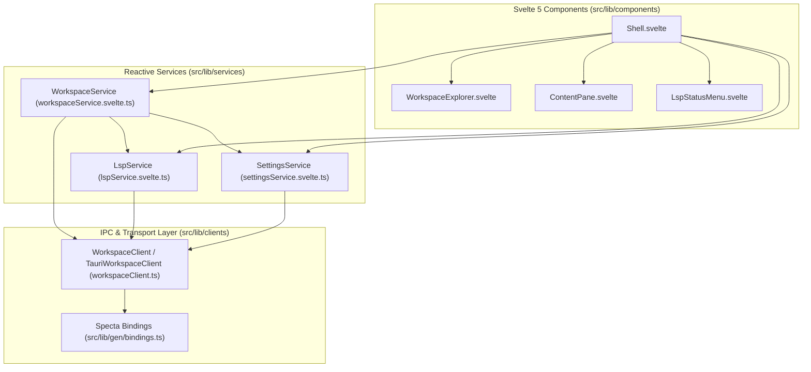
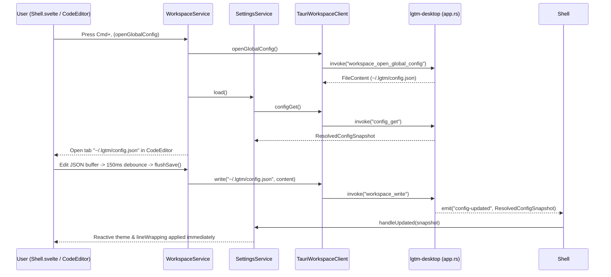

# Web & Desktop Frontend (`lgtm-web`) — software architecture

## Overview

`lgtm-web` is the Svelte 5 and SvelteKit frontend for LGTM, serving both the native Tauri v2 desktop IDE shell (`lgtm-desktop`) and the browser-accessible review interface (`lgtm-forge`). In desktop mode, `lgtm-web` composes portable Helical UI primitives from `@cloudvoyant/helical-svelte` and `lgtm-ui` with three single-responsibility reactive services (`WorkspaceService`, `LspService`, and `SettingsService`) over a typed Specta IPC client (`WorkspaceClient`), coordinating cross-service lifecycle events in `Shell.svelte`.

## Requirement

### Functional

- Reactive workspace and editor state (`WorkspaceService`): Browse workspace directories, manage open file and read-only diagnostics tabs, debounce editor buffer saves (`150ms`), open global (`~/.lgtm/config.json`) and local (`.lgtm/config.json`) configuration files as standard editor tabs (`Cmd+,` and `Cmd+Shift+,`), and flush pending saves on tab switch, workspace switch, or application exit.
- Language server status, diagnostics, and navigation (`LspService`): Track per-language server readiness (`Starting`, `Ready`, `Unavailable`, `Stopped`) and file diagnostics (`lsp-status` and `lsp-diagnostics` events), forward live buffer edits (`lsp_did_change`), resolve hover documentation (`lsp_hover`) and go-to-definition locations (`lsp_goto_definition`), and open or refresh read-only diagnostics buffer tabs.
- File-driven user settings (`SettingsService`): Load the resolved configuration snapshot (`config_get`), react to live `config-updated` events emitted whenever `~/.lgtm/config.json` or `<workspace>/.lgtm/config.json` is saved, synchronize the active color theme (`system`, `light`, `dark`) with the document root and native Tauri window chrome, expose editor preferences (`lineWrapping`), and persist recent workspace roots in `localStorage`.

### Non-Functional

- Single-responsibility services: Keep `WorkspaceService`, `LspService`, and `SettingsService` focused on their respective domains; wire cross-service event subscriptions (`lsp-status`, `lsp-diagnostics`, `config-updated`, `workspace-quit-requested`) and keyboard shortcuts in `Shell.svelte`.
- Generated IPC type parity: Consume Specta-generated TypeScript bindings (`src/lib/gen/bindings.ts`) inside `WorkspaceClient` so frontend services and Rust Tauri commands share compile-time contract checks.

## Design

### Usage

```ts
import { createWorkspaceClient } from '$lib/clients/workspaceClient'
import { LspService } from '$lib/services/lspService.svelte'
import { SettingsService } from '$lib/services/settingsService.svelte'
import { WorkspaceService } from '$lib/services/workspaceService.svelte'

const client = createWorkspaceClient()
const lsp = new LspService(client)
const settings = new SettingsService(client)
const workspace = new WorkspaceService(client, lsp, settings)

await workspace.init()
await workspace.openGlobalConfig()
await workspace.openLocalConfig()
```

### Components and Responsibilities



- `Shell.svelte`: Application entry point that instantiates `WorkspaceService`, `LspService`, and `SettingsService`, subscribes to Tauri backend events (`lsp-status`, `lsp-diagnostics`, `config-updated`, `workspace-quit-requested`), synchronizes OS/window color scheme media queries with `SettingsService.theme`, and binds global shortcuts (`Cmd+,` for global config, `Cmd+Shift+,` for local project config).
- `WorkspaceService` (`workspaceService.svelte.ts`): Owns the active workspace tree, expanded directories, open editor tabs, dirty buffer tracking, and `150ms` debounced save timer; delegates LSP notifications to `LspService` and loads initial settings through `SettingsService`.
- `LspService` (`lspService.svelte.ts`): Owns reactive language server status maps and per-file UTF-16 diagnostic arrays, formats status indicators for `LspStatusMenu.svelte`, and queries hover/definition/diagnostics buffers via `WorkspaceClient`.
- `SettingsService` (`settingsService.svelte.ts`): Owns the latest `ResolvedConfigSnapshot` from `lgtm-config`, derives `theme` (`ThemeMode`), `lineWrapping` (`LineWrap`), `activeRoot`, and `recentRoots`, and updates `knownRoots` in `localStorage`.
- `WorkspaceClient` (`workspaceClient.ts`): Defines the transport-agnostic `WorkspaceClient` interface and `TauriWorkspaceClient` implementation over `@tauri-apps/api/core` and `src/lib/gen/bindings.ts`.

### Data and Control Flow



### Interfaces and Contracts

| Service / Method | Signature | Description |
| --- | --- | --- |
| `WorkspaceService.init` | `init(): Promise<void>` | Load initial settings snapshot, open the remembered or default workspace root, and mark the frontend ready for quit handshakes. |
| `WorkspaceService.openWorkspace` | `openWorkspace(path?: string): Promise<void>` | Flush pending saves, open the target workspace directory, refresh `LspService`, and record the root in `SettingsService`. |
| `WorkspaceService.selectFile` | `selectFile(relativePath: string): Promise<void>` | Read a workspace file, open or focus its editor tab, and synchronize LSP status. |
| `WorkspaceService.openGlobalConfig` | `openGlobalConfig(): Promise<void>` | Ensure `~/.lgtm/config.json` exists with `$schema`, attach Biome JSON LSP, and open it as a standard file tab (`Cmd+,`). |
| `WorkspaceService.openLocalConfig` | `openLocalConfig(): Promise<void>` | Ensure `<workspace>/.lgtm/config.json` exists with `$schema`, attach Biome JSON LSP, and open it as a standard file tab (`Cmd+Shift+,`). |
| `WorkspaceService.scheduleSave` / `flushSave` | `scheduleSave(content: string): void` / `flushSave(): Promise<void>` | Forward live `didChange` updates to `LspService` and persist dirty buffers after `150ms` or before navigation/quit. |
| `LspService.refresh` | `refresh(): Promise<void>` | Fetch the current `LspWorkspaceSnapshot` (`servers` and `diagnostics`) for the active workspace. |
| `LspService.hover` / `gotoDefinition` | `hover(path: string, offset: number)` / `gotoDefinition(path: string, offset: number)` | Query LSP hover Markdown or definition locations at a UTF-16 code-unit offset. |
| `SettingsService.load` | `load(): Promise<ResolvedConfigSnapshot \| null>` | Fetch the latest `ResolvedConfigSnapshot` from `config_get` and update reactive preferences. |
| `SettingsService.handleUpdated` | `handleUpdated(next: ResolvedConfigSnapshot): void` | Apply a live `config-updated` event payload when `~/.lgtm/config.json` or `.lgtm/config.json` is saved. |
| `SettingsService.rememberRoot` | `rememberRoot(root: string): void` | Prepend `root` to `knownRoots` and persist the MRU list to `localStorage`. |

## Implementation

### Package layout

```text
apps/lgtm-web/
├── package.json
├── svelte.config.js
├── vite.config.ts
└── src/
    ├── app.css                              Theme imports and global element resets
    ├── app.html                             Root HTML shell
    ├── lib/
    │   ├── clients/
    │   │   ├── reviewServiceClient.ts       Connect RPC client for lgtm-forge
    │   │   └── workspaceClient.ts           Typed Tauri IPC client for workspace, LSP, and config commands
    │   ├── components/
    │   │   ├── Shell.svelte                 Top-level IDE chrome, event wiring, theme sync, and shortcuts
    │   │   ├── WorkspaceExplorer.svelte     Sidebar workspace switcher, file tree, and context menu
    │   │   ├── ContentPane.svelte           TabBar and CodeEditor / Markdown / Diagnostics view host
    │   │   └── LspStatusMenu.svelte         Header menu displaying language server status and actions
    │   ├── gen/
    │   │   ├── bindings.ts                  Specta-generated Rust IPC types and command wrappers
    │   │   └── lgtm/v1/                     Buf-generated Protobuf types for lgtm-forge
    │   └── services/
    │       ├── workspaceService.svelte.ts   Reactive workspace tree, tabs, and debounced save service
    │       ├── lspService.svelte.ts         Reactive LSP status, diagnostics, hover, and navigation service
    │       ├── settingsService.svelte.ts    Reactive read-only settings snapshot and MRU workspace roots service
    │       └── reviewService.ts             Hello-review demonstration service
    └── routes/
        ├── +layout.svelte
        └── +page.svelte
```

## References

- [Desktop application (`lgtm-desktop`) architecture](../desktop/index.md).
- [Configuration library (`lgtm-config`) architecture](../config/index.md).
- [LSP library (`lgtm-lsp`) architecture](../lsp/index.md).
- [End-to-end testing architecture](../e2e/index.md).
- [Application architecture](../index.md).
