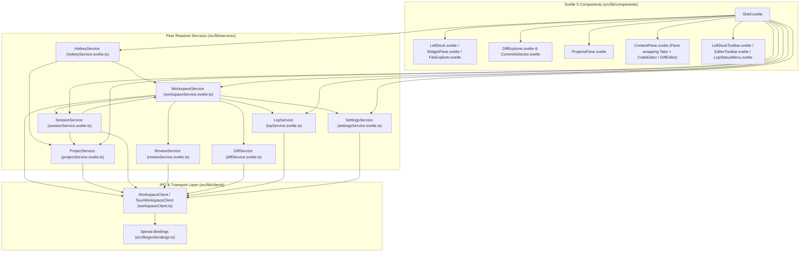
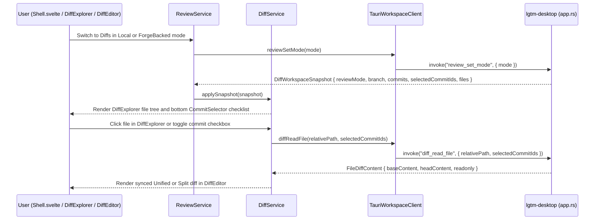
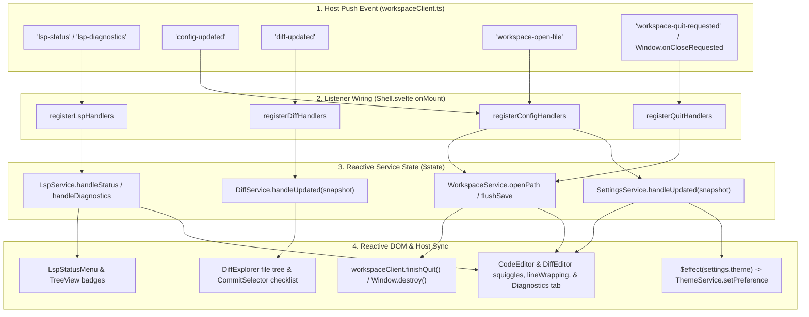

# Web & Desktop Frontend (`lgtm-web`) - software architecture

## Overview

`lgtm-web` is the Svelte 5 and SvelteKit frontend for LGTM, serving both the native Tauri v2 desktop IDE shell (`lgtm-desktop`) and the browser-accessible review interface (`lgtm-forge`). In desktop mode, `lgtm-web` composes portable Helical UI primitives from `@cloudvoyant/helical-svelte` and `lgtm-ui` (`CodeEditor`, `DiffEditor`, `TreeView`, `Tabs`, `Menu`, `ContextMenu`) with peer reactive services (`WorkspaceService`, `ProjectService`, `SessionService`, `ReviewService`, `DiffService`, `LspService`, `SettingsService`, and `HotkeyService`) over a typed Specta IPC client (`WorkspaceClient`), wired via `createAppServices` and `useService` context in `Shell.svelte`.

## Requirement

### Functional

- Browse workspace directories and projects, manage open file and read-only diagnostics tabs, debounce editor buffer saves (`150ms`), open global (`~/.lgtm/config.json`) and local (`.lgtm/config.json`) configuration files as standard editor tabs (`Mod+,` and `Mod+Shift+,`), and flush pending saves on tab switch, workspace switch, or application exit.
- Enter diff inspection in either `Local` mode (LGTM shadow commits in `~/.lgtm/snapshots/$repoSlug` plus uncommitted working-tree changes) or `ForgeBacked` mode (standard Git branch commits in `.git`) through `ReviewService`, and coordinate with `DiffService` to populate `DiffExplorer`, `CommitSelector`, and `DiffEditor`.
- Track per-language server readiness (`Starting`, `Ready`, `Unavailable`, `Stopped`) and file diagnostics, forward live buffer edits, resolve hover documentation and go-to-definition locations, and open or refresh read-only diagnostics buffer tabs.
- Load and live-reload user settings from `~/.lgtm/config.json` and `<workspace>/.lgtm/config.json`, synchronize the active color theme (`system`, `light`, `dark`) with the document root and native Tauri window chrome, expose editor preferences (`lineWrapping`), and persist recent workspace roots.
- Provide modal keybindings, `WhichKey` leader chords (`Space`), a searchable keybinding explorer (`Space ?`), a command palette and colon command menu (`Mod+K` and `:`), independent dock pane toggles (`Mod+B` for the Explorer widget dock and `Mod+Shift+B` for the Projects dock), and pane-scoped `TreeView` navigation and actions.

### Non-Functional

- Keep each frontend service focused on a single domain and wire cross-service event subscriptions and keyboard shortcuts in the top-level shell entrypoint.
- Enforce compile-time IPC contract parity between frontend services and Rust Tauri commands.

## Design

### Usage

```ts
import { createWorkspaceClient } from '$lib/clients/workspaceClient'
import { createAppServices, setServicesContext } from '$lib/services/context'

const client = createWorkspaceClient()
const services = createAppServices(client)
const { workspace } = setServicesContext(services)

await workspace.open()
await workspace.openPath('~/.lgtm/config.json', { title: 'Settings', focus: true })
await workspace.openPath('.lgtm/config.json', { title: 'Settings (project)', focus: true })
```

### Components and Responsibilities



- `Shell.svelte`: Application entry point that constructs peer services via `createAppServices` and `setServicesContext`, mounts `<WhichKey>` and `<CommandProvider>`, composes `Titlebar`, `LeftDock`, `ContentPane`, `LeftDockToolbar`, and `EditorToolbar`, subscribes to Tauri backend events (`lsp-status`, `lsp-diagnostics`, `config-updated`, `session-updated`, `diff-updated`, `workspace-quit-requested`), and synchronizes OS/window color scheme media queries with `SettingsService.theme`.
- `HotkeyService` (`hotkeyService.svelte.ts`): Registers the application keymap (`Mod+S`, `Mod+K`, `Mod+B` for the Explorer widget dock, `Mod+Shift+B` for the Projects dock, `Mod+,`, `Mod+Shift+,`, `:`, and `Space` leader chords) and shared `CommandNode` catalog (`:projects`, `:explorer`, `:project-add`, `:worktree-new`, `:worktree-remove`, `:diffs`, `:diff-mode`, `:diff-full`, `:review-mode`, `:write`, `:settings`, `:settings-project`) with Helical UI's `WhichKeyController`.
- `WorkspaceService` (`workspaceService.svelte.ts`): Owns the active workspace root, file explorer tree, expanded directories, independent `projectsOpen` and `explorerOpen` dock states and resizable widths, open editor tabs, in-memory workspace snapshot cache, dirty buffer tracking, and `150ms` debounced save timer.
- `ProjectService` (`projectService.svelte.ts`): Owns the ordered list of open `Project` models, managed worktrees, branch switcher state, and project/worktree modal dialog state.
- `SessionService` (`sessionService.svelte.ts`): Orchestrates loading, applying, and saving `~/.lgtm/sessions/<id>.json` snapshots across `ProjectService` and `WorkspaceService`.
- `ReviewService` (`reviewService.svelte.ts`): Owns the active review context mode (`mode: 'local' | 'forge_backed'`), enters diff viewing in either local shadow-commit mode or branch Git-commit mode, and prepares the hook point for future `lgtm-forge` review sessions and comments.
- `DiffService` (`diffService.svelte.ts`): Owns the reactive commit checklist (`commits`, `selectedCommitIds`), changed file list (`files`), active single-file diff payload (`activeFile`), layout mode (`viewMode: 'unified' | 'split'`), and full-file vs. hunks-only state (`showFullFile: boolean`). See [DiffExplorer & CommitSelector architecture](diff-explorer.md).
- `LspService` (`lspService.svelte.ts`): Owns reactive language server status maps and per-file UTF-16 diagnostic arrays, formats status indicators for `LspStatusMenu.svelte`, and queries hover/definition/diagnostics buffers via `WorkspaceClient`.
- `SettingsService` (`settingsService.svelte.ts`): Owns the latest `ResolvedConfigSnapshot` from `lgtm-config`, derives `theme` (`ThemeMode`), `lineWrapping` (`LineWrap`), `activeRoot`, and `recentRoots`, and updates `knownRoots` in `localStorage`.
- `WorkspaceClient` (`workspaceClient.ts`): Defines the transport-agnostic `WorkspaceClient` interface and `TauriWorkspaceClient` implementation over `@tauri-apps/api/core` and `src/lib/gen/bindings.ts`.

### Data and Control Flow



### Event Handling and Push Propagation

`lgtm-web` does not use an internal frontend event bus. UI state propagates synchronously through Svelte 5 `$state` runes and `$effect` blocks. Tauri event listeners in `workspaceClient.ts` are used strictly for unsolicited push notifications from `lgtm-desktop` (`AppEvents::emit_to_webview`) and native window close hooks, wired in `Shell.svelte` `onMount`.



| Listener Registration (`workspaceClient.ts`) | Subscribed Events | Payload Shape | Target Service Call (`Shell.svelte`) |
| --- | --- | --- | --- |
| `registerLspHandlers` | `"lsp-status"`<br/>`"lsp-diagnostics"` | `LspServerStatusEvent`<br/>`LspFileDiagnosticsEvent` | `workspace.handleLspStatus(event)`<br/>`workspace.handleLspDiagnostics(event)` |
| `registerConfigHandlers` | `"config-updated"`<br/>`"workspace-open-file"` | `ResolvedConfigSnapshot`<br/>`FileOpenedEvent` | `workspace.settings.handleUpdated(snapshot)`<br/>`workspace.openPath(event.path, { title: event.title, focus: event.focus })` |
| `registerDiffHandlers` | `"diff-updated"` | `DiffWorkspaceSnapshot` | `workspace.handleDiffUpdated(snapshot)` |
| `registerQuitHandlers` | `"workspace-quit-requested"`<br/>`Window.onCloseRequested` | `void`<br/>`CloseRequestedEvent` | `await workspace.flushSave()` -> `finishQuit()` / `destroy()` |

### Interfaces and Contracts

| Service / Method | Signature | Description |
| --- | --- | --- |
| `WorkspaceService.init` | `init(): Promise<void>` | Load initial configuration snapshot, open the remembered or default workspace root, and mark the frontend ready for quit handshakes. |
| `WorkspaceService.openWorkspace` | `openWorkspace(path?: string): Promise<void>` | Flush pending saves, open the target workspace directory, refresh `LspService` and `DiffService`, and record the root in `SettingsService`. |
| `WorkspaceService.selectFile` | `selectFile(relativePath: string): Promise<void>` | Read a workspace file, open or focus its editor tab, and synchronize LSP status. |
| `WorkspaceService.openPath` | `openPath(path: string, options?: OpenPathOptions): Promise<void>` | Open or focus any workspace file or configuration file (`~/.lgtm/config.json` or `.lgtm/config.json`) via `workspace_read`, attach `vscode-json-language-server` asynchronously, and refresh configuration when opening config files. |
| `WorkspaceService.scheduleSave` / `flushSave` | `scheduleSave(content: string): void` / `flushSave(): Promise<void>` | Forward live `didChange` updates to `LspService` and persist dirty buffers after `150ms` or before navigation/quit. |
| `ReviewService.setMode` / `toggleMode` | `setMode(mode: ReviewMode): Promise<DiffWorkspaceSnapshot \| null>` / `toggleMode(): Promise<DiffWorkspaceSnapshot \| null>` | Set or toggle the active review diff mode (`'local'` or `'forge_backed'`) and forward the returned `DiffWorkspaceSnapshot` to `DiffService`. |
| `DiffService.refresh` / `applySnapshot` | `refresh(): Promise<void>` / `applySnapshot(snapshot: DiffWorkspaceSnapshot): Promise<void>` | Fetch or apply `DiffWorkspaceSnapshot` (`commits`, `selectedCommitIds`, `files`) for the active workspace and review mode. |
| `DiffService.toggleCommit` | `toggleCommit(commitId: string): Promise<void>` | Toggle a commit checkbox in `CommitSelector`, refresh `files` across `selectedCommitIds`, and reload the active file in `DiffEditor`. |
| `DiffService.selectFile` | `selectFile(path: string): Promise<void>` | Fetch `FileDiffContent` (`baseContent`, `headContent`) for `path` across `selectedCommitIds` and open it in `DiffEditor`. |
| `DiffService.selectNextFile` / `selectPrevFile` | `selectNextFile(): Promise<void>` / `selectPrevFile(): Promise<void>` | Step to the next or previous changed file in `DiffExplorer` and load its diff into `DiffEditor`. |
| `DiffService.toggleViewMode` / `toggleFullFile` | `toggleViewMode(): void` / `toggleFullFile(): void` | Toggle `DiffEditor` between `'unified'` and `'split'` columns or between collapsed hunks (`showFullFile = false`) and the full file (`showFullFile = true`). |
| `LspService.refresh` | `refresh(): Promise<void>` | Fetch the current `LspWorkspaceSnapshot` (`servers` and `diagnostics`) for the active workspace. |
| `LspService.requestHover` / `getDefinitions` | `requestHover(path: string, offset: number)` / `getDefinitions(path: string, offset: number)` | Query LSP hover Markdown or definition locations at a UTF-16 code-unit offset. |
| `LspService.requestCompletions` / `requestSignatureHelp` | `requestCompletions(path: string, offset: number)` / `requestSignatureHelp(path: string, offset: number)` | Query LSP completion items or signature help at a UTF-16 code-unit offset. |
| `SettingsService.load` | `load(): Promise<ResolvedConfigSnapshot \| null>` | Fetch the latest `ResolvedConfigSnapshot` from `config_get` and update reactive preferences. |
| `SettingsService.update` | `update(patch: LgtmConfigPatch, scope?: ConfigScope): Promise<ResolvedConfigSnapshot>` | Persist a partial `LgtmConfigPatch` to global or project `config.json` via `config_update` and apply the returned snapshot. |
| `SettingsService.handleUpdated` | `handleUpdated(next: ResolvedConfigSnapshot): void` | Apply a live `config-updated` event payload when `~/.lgtm/config.json` or `.lgtm/config.json` is saved. |
| `SettingsService.rememberRoot` | `rememberRoot(root: string): void` | Prepend `root` to `knownRoots` and persist the MRU list to `localStorage`. |
| `HotkeyService.keymap` / `commandItems` | `readonly keymap: Record<string, WhichKeyNode>` / `get commandItems(): CommandNode[]` | Return the `WhichKey` binding tree and reactive hierarchical `CommandMenu` / `CommandPalette` command catalog. |
| `HotkeyService.toggleExplorer` | `toggleExplorer(): boolean` | Toggle the Explorer widget dock pane (`#explorer-dock-pane`, `Mod+B` / `Space e`) and focus `workspace` when opened. |
| `HotkeyService.showSidebarMode` | `showSidebarMode(mode: 'explorer' \| 'projects'): boolean` | Independently toggle the Projects dock (`#projects-dock-pane`, `Mod+Shift+B` / `Space p p`) or Explorer widget dock (`#explorer-dock-pane`, `Mod+B` / `Space p e`) and focus the opened pane. |
| `HotkeyService.openConfiguredCommandSurface` / `openColonCommandMenu` | `openConfiguredCommandSurface(): boolean` / `openColonCommandMenu(): boolean` | Open the Helical UI `CommandMenu` / `CommandPalette` (`Mod+K` or `Space :`) or the bottom-docked colon `CommandMenu` (`:`). |

## References

- [Modal keybindings & command surfaces (`lgtm-web` & `lgtm-ui`) architecture](keybindings.md).
- [ProjectsPane UI component](projects-pane.md).
- [DiffExplorer & CommitSelector UI components](diff-explorer.md).
- [DiffEditor UI component (`libs/lgtm-ui`)](../ui/diff-editor.md).
- [Desktop diff viewer and commit inspection](../desktop/diffs.md).
- [Desktop application (`lgtm-desktop`) architecture](../desktop/index.md).
- [Desktop project and session management](../desktop/projects.md).
- [Desktop event handling & service orchestration](../desktop/events.md).
- [Session library (`lgtm-session`) architecture](../session/index.md).
- [Project library (`lgtm-project`) architecture](../project/index.md).
- [Configuration library (`lgtm-config`) architecture](../config/index.md).
- [LSP library (`lgtm-lsp`) architecture](../lsp/index.md).
- [End-to-end testing architecture](../e2e/index.md).
- [Application architecture](../index.md).
