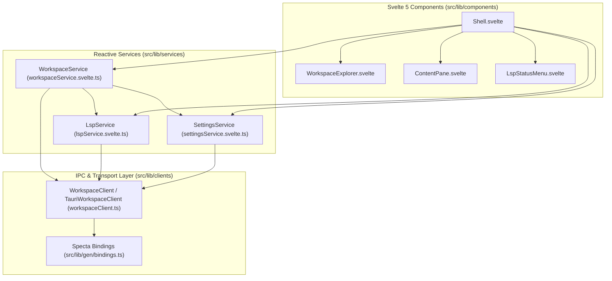
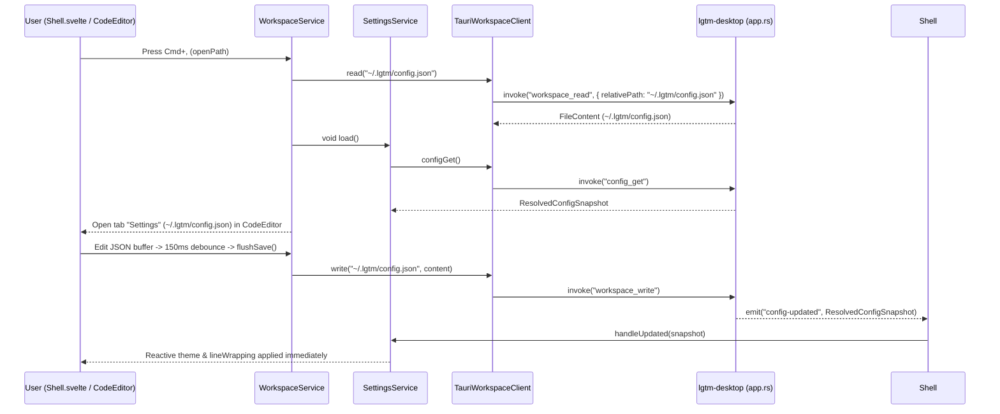
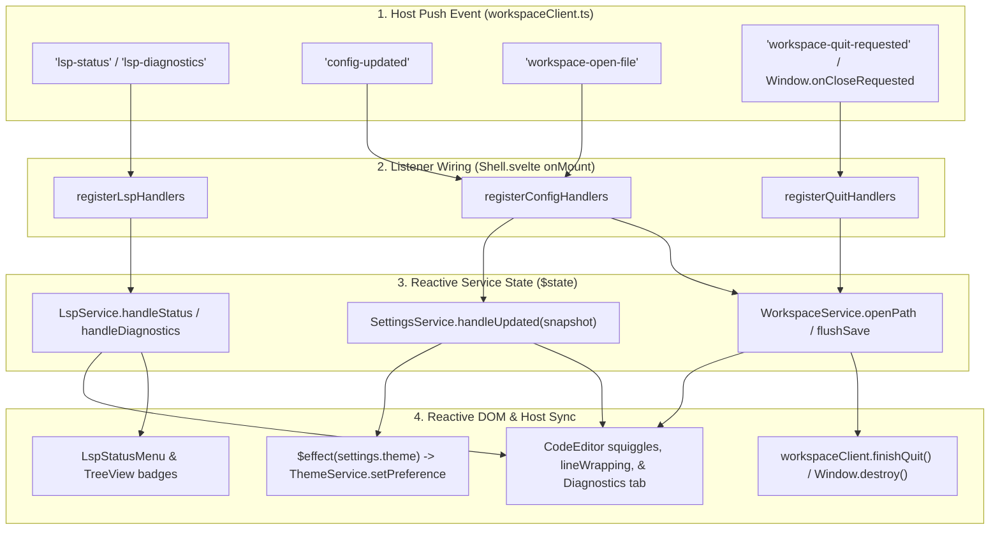

# Web & Desktop Frontend (`lgtm-web`) — software architecture

## Overview

`lgtm-web` is the Svelte 5 and SvelteKit frontend for LGTM, serving both the native Tauri v2 desktop IDE shell (`lgtm-desktop`) and the browser-accessible review interface (`lgtm-forge`). In desktop mode, `lgtm-web` composes portable Helical UI primitives from `@cloudvoyant/helical-svelte` and `lgtm-ui` with four single-responsibility reactive services (`WorkspaceService`, `LspService`, `SettingsService`, and `HotkeyService`) over a typed Specta IPC client (`WorkspaceClient`), coordinating cross-service lifecycle events in `Shell.svelte`.

## Requirement

### Functional

- Reactive workspace and editor state (`WorkspaceService`): Browse workspace directories, manage open file and read-only diagnostics tabs, debounce editor buffer saves (`150ms`), open global (`~/.lgtm/config.json`) and local (`.lgtm/config.json`) configuration files as standard editor tabs (`Cmd+,` and `Cmd+Shift+,`), refresh clean config tabs on external updates, and flush pending saves on tab switch, workspace switch, or application exit.
- Language server status, diagnostics, and navigation (`LspService`): Track per-language server readiness (`Starting`, `Ready`, `Unavailable`, `Stopped`) and file diagnostics (`lsp-status` and `lsp-diagnostics` events), forward live buffer edits (`lsp_did_change`), resolve hover documentation (`lsp_hover`) and go-to-definition locations (`lsp_goto_definition`), and open or refresh read-only diagnostics buffer tabs.
- File-driven and command-driven user settings (`SettingsService`): Load the resolved configuration snapshot (`config_get`), apply scoped partial updates (`config_update`), react to live `config-updated` events emitted whenever `~/.lgtm/config.json` or `<workspace>/.lgtm/config.json` is saved, synchronize the active color theme (`system`, `light`, `dark`), expose editor (`lineWrapping`) and modal keybinding (`commandStyle`, `preset`, `leaderOnly`, `paneOutline`, `clickToInsert`) preferences, and persist recent workspace roots in `localStorage`.
- Modal keybindings and command surfaces (`HotkeyService`): Register app-level `WhichKey` leader bindings (`Space`), global shortcuts (`Mod+k`, `Mod+,`, `Mod+Shift+,`), and the hierarchical `CommandNode[]` catalog shared by `CommandMenu` (`:` and `Mod+k` when `commandStyle == "menu"`) and `CommandPalette` (`Mod+k` when `commandStyle == "palette"`). See [Modal keybindings architecture](keybindings.md).

### Non-Functional

- Single-responsibility services: Keep `WorkspaceService`, `LspService`, and `SettingsService` focused on their respective domains; wire cross-service event subscriptions (`lsp-status`, `lsp-diagnostics`, `config-updated`, `workspace-quit-requested`) and keyboard shortcuts in `Shell.svelte`.
- Generated IPC type parity: Consume Specta-generated TypeScript bindings (`src/lib/gen/bindings.ts`) inside `WorkspaceClient` so frontend services and Rust Tauri commands share compile-time contract checks.

## Design

### Usage

```ts
import { createWorkspaceClient } from '$lib/clients/workspaceClient'
import { LspService } from '$lib/services/lspService.svelte'
import { SettingsService } from '$lib/services/settingsService.svelte'
import { WorkspaceService } from '$lib/services/workspaceService.svelte'

const client = createWorkspaceClient()
const lsp = new LspService(client)
const settings = new SettingsService(client)
const workspace = new WorkspaceService(client, lsp, settings)

await workspace.init()
await workspace.openPath('~/.lgtm/config.json', { title: 'Settings', focus: true })
await workspace.openPath('.lgtm/config.json', { title: 'Settings (project)', focus: true })
```

### Components and Responsibilities



- `Shell.svelte`: Application entry point that instantiates `WorkspaceService`, `LspService`, and `SettingsService`, subscribes to Tauri backend events (`lsp-status`, `lsp-diagnostics`, `config-updated`, `workspace-quit-requested`), synchronizes OS/window color scheme media queries with `SettingsService.theme`, and binds global shortcuts (`Cmd+,` for global config, `Cmd+Shift+,` for local project config).
- `WorkspaceService` (`workspaceService.svelte.ts`): Owns the active workspace tree, expanded directories, open editor tabs, dirty buffer tracking, and `150ms` debounced save timer; delegates LSP notifications to `LspService` and loads initial settings through `SettingsService`.
- `LspService` (`lspService.svelte.ts`): Owns reactive language server status maps and per-file UTF-16 diagnostic arrays, formats status indicators for `LspStatusMenu.svelte`, and queries hover/definition/diagnostics buffers via `WorkspaceClient`.
- `SettingsService` (`settingsService.svelte.ts`): Owns the latest `ResolvedConfigSnapshot` from `lgtm-config`, derives `theme` (`ThemeMode`), `lineWrapping` (`LineWrap`), `activeRoot`, and `recentRoots`, and updates `knownRoots` in `localStorage`.
- `WorkspaceClient` (`workspaceClient.ts`): Defines the transport-agnostic `WorkspaceClient` interface and `TauriWorkspaceClient` implementation over `@tauri-apps/api/core` and `src/lib/gen/bindings.ts`.

### Data and Control Flow



### Event Handling and Push Propagation

`lgtm-web` does not use an internal frontend event bus; UI state propagates synchronously through Svelte 5 `$state` runes and `$effect` blocks. Tauri event listeners in `workspaceClient.ts` are used strictly for unsolicited push notifications from `lgtm-desktop` (`AppEvents::emit_to_webview`) and native window close hooks, wired in `Shell.svelte` `onMount`.



| Listener Registration (`workspaceClient.ts`) | Subscribed Events | Payload Shape | Target Service Call (`Shell.svelte`) |
| --- | --- | --- | --- |
| `registerLspHandlers` | `"lsp-status"`<br/>`"lsp-diagnostics"` | `LspServerStatusEvent`<br/>`LspFileDiagnosticsEvent` | `workspace.handleLspStatus(event)`<br/>`workspace.handleLspDiagnostics(event)` |
| `registerConfigHandlers` | `"config-updated"`<br/>`"workspace-open-file"` | `ResolvedConfigSnapshot`<br/>`FileOpenedEvent` | `workspace.settings.handleUpdated(snapshot)`<br/>`workspace.openPath(event.path, { title: event.title, focus: event.focus })` |
| `registerQuitHandlers` | `"workspace-quit-requested"`<br/>`Window.onCloseRequested` | `void`<br/>`CloseRequestedEvent` | `await workspace.flushSave()` -> `finishQuit()` / `destroy()` |

### Interfaces and Contracts

| Service / Method | Signature | Description |
| --- | --- | --- |
| `WorkspaceService.init` | `init(): Promise<void>` | Load initial settings snapshot, open the remembered or default workspace root, and mark the frontend ready for quit handshakes. |
| `WorkspaceService.openWorkspace` | `openWorkspace(path?: string): Promise<void>` | Flush pending saves, open the target workspace directory, refresh `LspService`, and record the root in `SettingsService`. |
| `WorkspaceService.selectFile` | `selectFile(relativePath: string): Promise<void>` | Read a workspace file, open or focus its editor tab, and synchronize LSP status. |
| `WorkspaceService.openPath` | `openPath(path: string, options?: OpenPathOptions): Promise<void>` | Open or focus any workspace file or configuration file (`~/.lgtm/config.json` or `.lgtm/config.json`) via `workspace_read`, attach `vscode-json-language-server` asynchronously, and refresh settings when opening config files. |
| `WorkspaceService.scheduleSave` / `flushSave` | `scheduleSave(content: string): void` / `flushSave(): Promise<void>` | Forward live `didChange` updates to `LspService` and persist dirty buffers after `150ms` or before navigation/quit. |
| `LspService.refresh` | `refresh(): Promise<void>` | Fetch the current `LspWorkspaceSnapshot` (`servers` and `diagnostics`) for the active workspace. |
| `LspService.requestHover` / `getDefinitions` | `requestHover(path: string, offset: number)` / `getDefinitions(path: string, offset: number)` | Query LSP hover Markdown or definition locations at a UTF-16 code-unit offset. |
| `LspService.requestCompletions` / `requestSignatureHelp` | `requestCompletions(path: string, offset: number)` / `requestSignatureHelp(path: string, offset: number)` | Query LSP completion items or signature help at a UTF-16 code-unit offset. |
| `SettingsService.load` | `load(): Promise<ResolvedConfigSnapshot \| null>` | Fetch the latest `ResolvedConfigSnapshot` from `config_get` and update reactive preferences. |
| `SettingsService.update` | `update(patch: LgtmConfigPatch, scope?: ConfigScope): Promise<ResolvedConfigSnapshot>` | Persist a partial `LgtmConfigPatch` to global or project `config.json` via `config_update` and apply the returned snapshot. |
| `SettingsService.handleUpdated` | `handleUpdated(next: ResolvedConfigSnapshot): void` | Apply a live `config-updated` event payload when `~/.lgtm/config.json` or `.lgtm/config.json` is saved. |
| `SettingsService.rememberRoot` | `rememberRoot(root: string): void` | Prepend `root` to `knownRoots` and persist the MRU list to `localStorage`. |
| `HotkeyService.keymap` / `commandItems` | `readonly keymap: Record<string, WhichKeyNode>` / `get commandItems(): CommandNode[]` | Return the `WhichKey` binding tree and reactive hierarchical `CommandMenu` / `CommandPalette` command catalog. |

## References

- [ProjectsPane UI component](projects-pane.md).
- [Desktop application (`lgtm-desktop`) architecture](../desktop/index.md).
- [Desktop project and session management](../desktop/projects.md).
- [Desktop event handling & service orchestration](../desktop/events.md).
- [Session library (`lgtm-session`) architecture](../session/index.md).
- [Project library (`lgtm-project`) architecture](../project/index.md).
- [Configuration library (`lgtm-config`) architecture](../config/index.md).
- [LSP library (`lgtm-lsp`) architecture](../lsp/index.md).
- [End-to-end testing architecture](../e2e/index.md).
- [Application architecture](../index.md).
