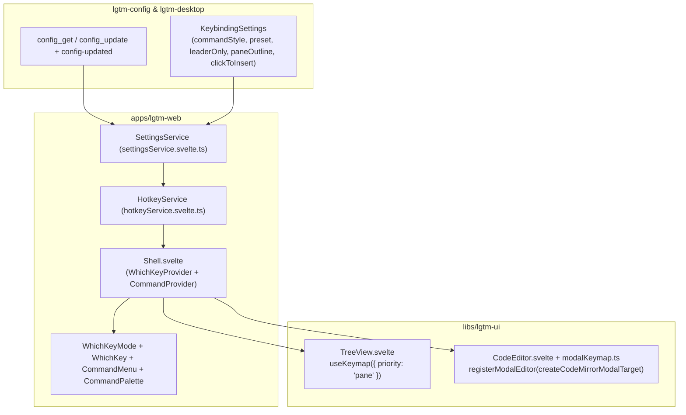
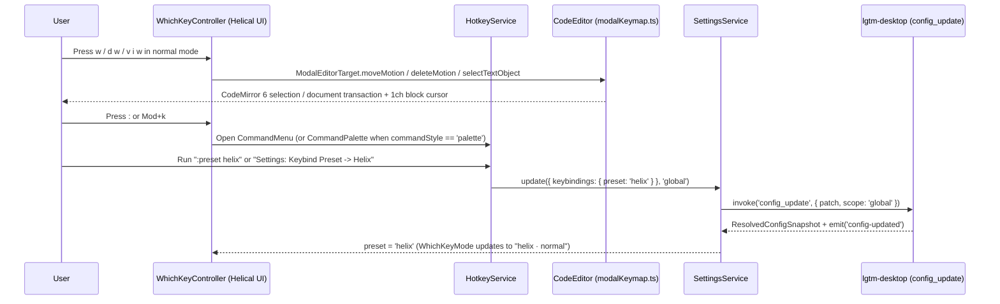

# Modal Keybindings & Command Surfaces (`lgtm-web` & `lgtm-ui`) — software architecture

## Overview

`lgtm-web` and `lgtm-ui` adopt `@cloudvoyant/helical-svelte` `v0.23.0` to provide modal keyboard navigation across panes, files, and the CodeMirror 6 editor. One document-level `WhichKeyController` owns modal state (`normal`, `insert`, `visual`, `visual_line`, `goto`), pane focus (`workspace` and `editor`), Flash two-character jump labels, and `Space` leader sequences. `HotkeyService` registers all application keybindings and command nodes in one place, feeding `WhichKey`, `CommandMenu` (`:` and default `Mod+k`), and `CommandPalette` (`Mod+k` when `keybindings.commandStyle == "palette"`).

## Requirement

### Functional

- Support `vim`, `kakoune`, and `helix` modal editing presets across the workspace shell, file explorer (`TreeView`), and code editor (`CodeEditor`).
- Translate Helical `ModalEditorTarget` motions, text objects, operators, visual selections, multi-cursors, registers, and macros into CodeMirror 6 `EditorSelection` and `TransactionSpec` dispatches without adding a second modal state machine inside CodeMirror.
- Provide `CommandMenu` (`:`) as the default command surface and allow switching `Mod+k` between `CommandMenu` (`"menu"`) and `CommandPalette` (`"palette"`) via `keybindings.commandStyle`.
- Allow toggling and switching all user preferences (`appearance.theme`, `editor.lineWrapping`, `keybindings.*`, `lsp.enabled`) from `CommandMenu` and `CommandPalette` via `config_update`, updating open clean `Settings` tabs automatically.

### Non-Functional

- Route all keyboard events through a single document-level `keydown` listener in `WhichKeyProvider` with zero duplicate listeners per tree node or editor line.
- Keep `libs/lgtm-ui` components (`CodeEditor`, `TreeView`) decoupled from `WorkspaceService` and Tauri IPC.

## Design

### Components and Responsibilities

- `HotkeyService` (`apps/lgtm-web/src/lib/services/hotkeyService.svelte.ts`): Single source of truth for app-level `KeymapBinding[]` (`Space` leader tree, `Mod+k`, `Mod+,`, `Mod+Shift+,`) and hierarchical `CommandNode[]` items (Ex aliases `:w`, `:q`, `:wq`, `:e`, `:bn`, `:bp`, `:bd`, `:theme`, `:preset`, `:command-style`, `:wrap`, `:diagnostics`, `:lsp-restart`, and nested settings toggles).
- `createCodeMirrorModalTarget` (`libs/lgtm-ui/src/code-editor/modalKeymap.ts`): Pure TypeScript adapter implementing `ModalEditorTarget` over a CodeMirror 6 `EditorView`, mapping `vim`, `kakoune`, and `helix` motions, text objects, operators, visual ranges, multi-cursor selections (`Alt+j` / `Alt+k`, `C`, `,`), and viewport scrolling (`zz`, `zt`, `zb`, `Ctrl-d`, `Ctrl-u`).
- `CodeEditor.svelte` (`libs/lgtm-ui/src/code-editor/CodeEditor.svelte`): Registers the active `EditorView` with `WhichKeyController.registerModalEditor`, enables `EditorState.allowMultipleSelections.of(true)`, gates pointer-to-insert transitions with `data-modal-ignore-pointer`, and styles normal/visual mode cursors as solid `1ch` blocks (`html[data-modal-mode='normal'] .cm-cursor`).
- `TreeView.svelte` (`libs/lgtm-ui/src/tree-view/TreeView.svelte`): Registers pane-scoped bindings (`j`, `k`, `h`, `l`, `Enter`, `Home`, `End`, `a`, `A`, `r`, `F2`, `d`, `Delete`) via `useKeymap(..., { priority: 'pane' })`.

### Data and Control Flow

### Interfaces and Contracts

| Symbol | Location | Description |
| --- | --- | --- |
| `createCodeMirrorModalTarget` | `libs/lgtm-ui/src/code-editor/modalKeymap.ts` | Adapt a CodeMirror 6 `EditorView` to Helical UI's `ModalEditorTarget` contract. |
| `scrollEditorAlign` / `scrollEditorHalfPage` | `libs/lgtm-ui/src/code-editor/modalKeymap.ts` | Scroll the active CodeMirror cursor line (`center`, `top`, `bottom`) or move by a half page (`down`, `up`). |
| `HotkeyService` | `apps/lgtm-web/src/lib/services/hotkeyService.svelte.ts` | Build reactive `KeymapBinding[]`, `CommandNode[]`, and `CommandPaletteItem[]` catalogs and execute workspace, LSP, and settings commands. |
| `SettingsService.update` | `apps/lgtm-web/src/lib/services/settingsService.svelte.ts` | Persist a scoped `LgtmConfigPatch` via `config_update` and refresh reactive settings state. |

## References

- [Web & Desktop Frontend (`lgtm-web`) architecture](index.md).
- [Configuration library (`lgtm-config`) architecture](../config/index.md).
- [Desktop application (`lgtm-desktop`) architecture](../desktop/index.md).
