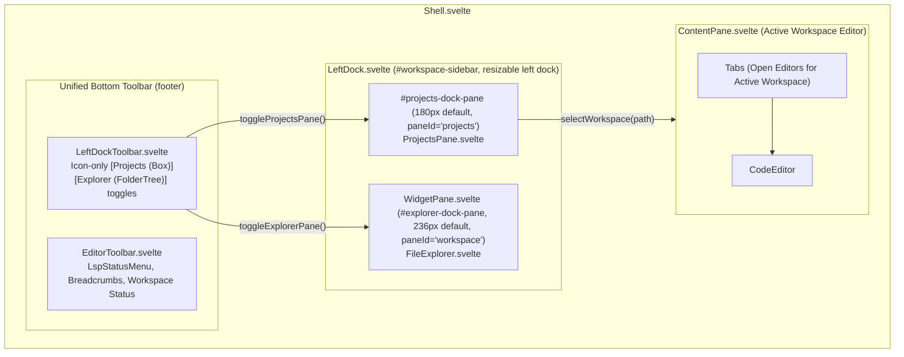
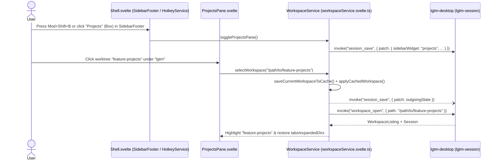

# ProjectsPane

## Overview

`ProjectsPane` renders open projects and their linked Git worktrees in the left sidebar using the shared `TreeView`, `ContextMenu`, and `Dialog` primitives from `libs/lgtm-ui` and `@cloudvoyant/helical-svelte`. Each project row represents the primary repository checkout directly with a distinctive default `Box` icon (or a user-customized icon and color), and linked Git worktrees render as collapsible child `TreeView` items underneath it. Collapsing a project branch hides its child worktrees just like collapsing a directory in `WorkspaceExplorer`.

## Design

### Layout

```text
+-------------------------------------------------------------------------------+
| [SidebarTrigger] lgtm   [lgtm / feature-projects v]                           |
|----------------------+------------------------+-------------------------------|
| Projects      [+][Y] | Workspace       [+][F] | [src/lib.rs *] [src/app.rs]   |
|----------------------|------------------------|-------------------------------|
| [Box] lgtm (main)  v | v src                  | 1  pub mod models;            |
|   | feature-projects |     lib.rs             | 2  pub mod services;          |
|   | feature-lsp      |     app.rs             | 3                             |
| [Rocket] hypertext > |   Cargo.toml           |                               |
| [Box] premise        |   README.md            |                               |
|----------------------+------------------------|-------------------------------|
| [Box][FolderTree]                             | [LSP] src > lib.rs      Ready |
+-------------------------------------------------------------------------------+
```



### Behavior

- Default: Restore the active session's sidebar configuration, custom project icons/colors, and expanded or collapsed branch state in `TreeView`, and highlight the active workspace row (either a project row or a child worktree item).
- Interaction: Click the leftmost icon-only `Projects` button (`Box`, the default project icon) in `SidebarFooter` or press `Mod+Shift+B` (`Space p p`) to toggle the narrow `Projects` dock pane (`#projects-dock-pane`, `180px`) independently alongside the `WorkspaceExplorer` widget slot (`#explorer-dock-pane`, `236px`). Click the `Explorer` button (`FolderTree`) or press `Mod+B` (`Space e`) to toggle the Explorer widget slot while keeping `Projects` visible alongside it. Both panes remain mounted in the DOM and toggle visibility via `hidden` so toggling widgets or collapsing the left dock never unmounts or re-renders their state.
- Interaction: Click a project row or a child worktree item to switch the active workspace immediately. `WorkspaceService` snapshots the outgoing workspace's modified tabs, last-active tab, and expanded directories in memory, swaps the single mounted `CodeEditor` and `WorkspaceExplorer` to the target workspace state immediately, and flushes pending file writes, session persistence, and outgoing LSP process shutdown asynchronously in the background.
- Interaction: Click the branch collapse trigger on a project with linked worktrees (or click an already-selected project row) to collapse or expand its child worktree items (`ArkTreeView.BranchContent` with `ArkTreeView.BranchIndentGuide`) without switching the active workspace.
- Interaction: Right-click a project row to open its `ContextMenu` (`New Worktree`, `Edit`, `Open Primary Checkout`, `Collapse Worktrees` / `Expand Worktrees`, `Remove Project`). Right-click a child worktree item to open its `ContextMenu` (`Open Worktree`, `Rename Worktree`, `Remove Worktree`).
- Interaction: Select `Edit` from a project's context menu to open the `Edit Project` modal dialog (`Dialog` with `DialogDismiss` top-right close trigger, `Field` / `FieldLabel` / `Input`, `ColorSelector` circular swatches from `libs/lgtm-ui`, and `ToggleGroup` icon grid) to update the project display name, accent color (9 circular swatches), and icon (16 icons, `box` default), persisted in `default.json` via `Save`.
- Interaction: Select `Rename Worktree` from a worktree item's context menu (or press `r` or `F2` while the worktree row is focused) to rename the worktree section inline in `TreeView`. The custom worktree label is saved in `default.json` and preserved across project refreshes while keeping the underlying Git branch name unchanged and displayed alongside the custom label.
- Interaction: Select `New Worktree` from a project's context menu or header action to open the `New Worktree` modal dialog (`Dialog`) prefilled with a generated `worktree/<adjective>-<noun>-<hex>` branch name and a live `~/.lgtm/worktrees/<project>/<branch-slug>` checkout path preview. Submitting creates the managed worktree and switches to it. If creation fails (such as an invalid branch, a branch already checked out in another worktree, or an existing target directory), the modal stays open and displays the error message inside the dialog.
- Interaction: Select `Remove Worktree` from a worktree item's context menu to open the `Remove Worktree` modal dialog (`Dialog`), confirming deletion of its `~/.lgtm/worktrees/<project>/<branch-slug>` storage on disk (or prompting `Delete anyway` if dirty or untracked files exist).
- Loading, empty, and error: Show a compact notice with an `Add project` button when no projects are open.
- Accessibility and hotkeys: Reuse `@ark-ui/svelte/tree-view` (`TreeView` in `libs/lgtm-ui`) for WAI-ARIA tree roles, `aria-expanded` branch controls, and `ContextMenu` triggers, and register all keyboard bindings through `@cloudvoyant/helical-svelte` (`useKeymap(..., { priority: 'pane' })` in `TreeView.svelte` and `WhichKeyNode` / `CommandNode` entries in `HotkeyService`) rather than ad-hoc `keydown` listeners.

### Keybindings and Commands

| Shortcut / Chord | Command / Scope | Action |
| --- | --- | --- |
| `Mod+Shift+B` / `Space p p` | `:projects` (`projects.show`) | Toggle the narrow `Projects` dock pane (`#projects-dock-pane`, `180px`) open or closed independently and focus it when opened. |
| `Mod+B` / `Space e` / `Space p e` | `:explorer` (`workspace.toggleExplorer`) | Toggle the `WorkspaceExplorer` widget dock pane (`#explorer-dock-pane`, `236px`) open or closed independently and focus it when opened. |
| `Space p a` | `:project-add` (`projects.add`) | Open a folder picker and attach the selected project to the active session. |
| `Space p n` | `:worktree-new` (`projects.newWorktree`) | Open the `New Worktree` modal dialog for the active project. |
| `Space p d` | `:worktree-remove` (`projects.removeWorktree`) | Open the `Remove Worktree` modal dialog for the active linked Git worktree. |
| `j` / `ArrowDown` | `TreeView` (`normal` mode) | Move focus to the next visible project or worktree row. |
| `k` / `ArrowUp` | `TreeView` (`normal` mode) | Move focus to the previous visible project or worktree row. |
| `l` / `ArrowRight` | `TreeView` (`normal` mode) | Expand a collapsed project branch, move focus to its first worktree, or select a worktree leaf. |
| `h` / `ArrowLeft` | `TreeView` (`normal` mode) | Collapse an expanded project branch or move focus from a worktree leaf to its parent project row. |
| `Enter` | `TreeView` (`normal` mode) | Switch the active workspace to the focused project or worktree checkout. |
| `a` | `TreeView` (`normal` mode) | Open the `New Worktree` modal dialog for the focused project (`ProjectsPane`) or create a file (`WorkspaceExplorer`). |
| `r` / `F2` | `TreeView` (`normal` mode) | Rename the focused worktree section inline without changing its Git branch name (`renamable: false` on root project rows). |
| `d` / `Delete` | `TreeView` (`normal` mode) | Remove the focused project from the session or open the `Remove Worktree` modal dialog for the focused worktree. |
| `Home` / `End` | `TreeView` (`normal` mode) | Move focus to the first or last visible tree row. |

## Implementation

### Public API

```ts
export interface ProjectsPaneProps {
  workspace: WorkspaceService
}
```

```svelte
<div id="projects-dock-pane" data-pane-id="projects" hidden={!workspace.projectsOpen}>
  <ProjectsPane {workspace} />
</div>
<div id="explorer-dock-pane" data-pane-id="workspace" hidden={!workspace.explorerOpen}>
  <WorkspaceExplorer {workspace} />
</div>
```

### State and Data Flow



| State Property | Owner | Persisted In | Description |
| --- | --- | --- | --- |
| `projectsOpen` / `explorerOpen` | `WorkspaceService` (`lgtm-web`) | Derived / synced with `sidebarWidget` | Independently controls visibility of `#projects-dock-pane` and `#explorer-dock-pane` via `hidden` without unmounting either pane. |
| `sidebarWidget` | `WorkspaceService` (`lgtm-web`) | `~/.lgtm/sessions/default.json` | Persists the primary sidebar mode (`"projects"` or `"explorer"`) across restarts. |
| `projects` | `WorkspaceService` (`lgtm-web`) | `~/.lgtm/sessions/default.json` | Ordered list of `Project` models, each with its `root_path`, `icon`, `color`, `collapsed` state, and open linked `worktrees`. |
| `root` | `WorkspaceService` (`lgtm-web`) | `~/.lgtm/sessions/default.json` | Canonical path of the currently active workspace (a project `root_path` or a linked `Worktree.path`). |
| `tabs` (`edited` / `lastOpened`) | `WorkspaceService` (`lgtm-web`) | `~/.lgtm/sessions/default.json` | Open editor tabs for the active workspace. Only edited tabs and the last opened tab persist. |

### Styling and Responsiveness

- Reuse `TreeView` and `ContextMenu` from `libs/lgtm-ui` inside `#projects-dock-pane` (`180px` / `w-45`) alongside `#explorer-dock-pane` (`236px` / `w-59`) so project branches and worktree items share the compact `h-6` row height (`treeViewRowVariants`), `ArkTreeView.BranchIndentGuide` vertical border lines (`treeViewIndentGuideBase`), square item highlights (`rounded-none`), and `--accent` / `--ring` hover and focus tokens used by `WorkspaceExplorer`.
- Extend `TreeView` (`libs/lgtm-ui/src/tree-view/`) with optional `version`, `selectableBranches`, `expandedValue`, `onExpandedChange`, and per-node `renamable` props so clicking a project branch row selects the primary checkout (`project.root_path`) or toggles branch expansion when already selected, its chevron button toggles branch expansion in capture phase, and child worktree rows support inline renaming without allowing root project paths to be renamed.
- Place the icon-only `Projects` (`Box`, leftmost) and `Explorer` (`FolderTree`) dock toggle buttons inside `SidebarFooter` at the bottom of `#workspace-sidebar` in `Shell.svelte`.

### Maintainer Notes

- Each project maps to a single `TreeNode` (`value = project.root_path`, `renamable = false`) with a `Box` default icon (`data-project-icon="box"`) so a project without worktrees takes only one `h-6` row; when `project.worktrees` is non-empty, `node.children` contains the linked worktrees (`renamable = true`), rendered with `ArkTreeView.BranchIndentGuide`.
- All project dialogs (`New Worktree`, `Remove Worktree`, and `Edit Project`) render as modal `@cloudvoyant/helical-svelte` `Dialog` overlays with `DialogDismiss` close buttons rather than inline sidebar forms.
