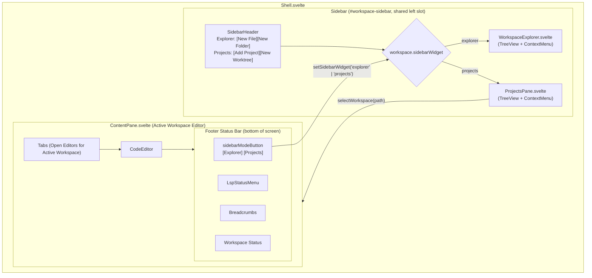
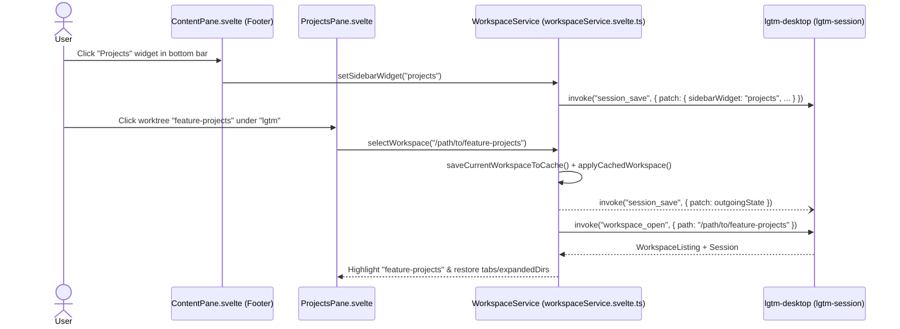

# ProjectsPane

## Overview

`ProjectsPane` renders open projects and their linked Git worktrees in the left sidebar using the shared `TreeView` and `ContextMenu` primitives from `libs/lgtm-ui`, matching the compact `h-6` row styling, `ArkTreeView.BranchIndentGuide` vertical guide lines, and right-click context menus of `WorkspaceExplorer`. Each project row represents the primary repository checkout directly (avoiding a redundant child row for `main`), and linked Git worktrees render as child `TreeView` items underneath it. Collapsing a project branch hides its inactive worktrees while keeping an active linked worktree visible under the branch indent guide.

## Design

### Layout

```text
+-------------------------------------------------------------------+
| [SidebarTrigger] lgtm   [lgtm / feature-projects v]               |
|---------------------------+---------------------------------------|
| Projects          [+][Y]  | [src/lib.rs *] [src/app.rs]           |
|---------------------------|---------------------------------------|
| [FolderOpen] lgtm (main) v| 1  pub mod models;                    |
|   |  feature-projects  <- | 2  pub mod services;                  |
|   |  feature-lsp          | 3                                     |
| [Folder] hypertextual    >|                                       |
|   |  feature-toc (active) |                                       |
| [Folder] premise (main)   |                                       |
|                           |                                       |
|                           |                                       |
|---------------------------+---------------------------------------|
| [Files][Projects] | [LSP] src > lib.rs                      Ready |
+-------------------------------------------------------------------+
```



### Behavior

- Default: Show the sidebar view saved in the active session, restore each project's expanded or collapsed branch state in `TreeView`, and highlight the active workspace row (either a project row or a child worktree item).
- Interaction: Click the bottom-left `Explorer` or `Projects` status-bar buttons to switch the left sidebar view without resizing the pane.
- Interaction: Click a project row or a child worktree item to switch the active workspace immediately. `WorkspaceService` snapshots the outgoing workspace's modified tabs, last-active tab, and expanded directories in memory, swaps the single mounted `CodeEditor` and `WorkspaceExplorer` to the target workspace state immediately, and flushes pending file writes, session persistence, and outgoing LSP process shutdown asynchronously in the background.
- Interaction: Click the branch collapse trigger (`ArkTreeView.BranchTrigger`) on a project with linked worktrees to collapse or expand its child worktree items (`ArkTreeView.BranchContent` with `ArkTreeView.BranchIndentGuide`) without switching the active workspace. When collapsed, hide all inactive linked worktrees and keep only the active linked worktree (if any) visible under the project branch.
- Interaction: Right-click a project row to open its `ContextMenu` (`New Worktree`, `Open Primary Checkout`, `Collapse Worktrees` / `Expand Worktrees`, `Remove Project`). Right-click a child worktree item to open its `ContextMenu` (`Open Worktree`, `Remove Worktree`).
- Interaction: Select `New Worktree` from a project's context menu or header action to open the `New Worktree` dialog prefilled with a generated `worktree/<adjective>-<noun>-<hex>` branch name and a live `~/.lgtm/worktrees/<project>/<branch-slug>` checkout path preview. Submitting creates the managed worktree and switches to it. If creation fails (such as an invalid branch, a branch already checked out in another worktree, or an existing target directory), the dialog stays open and displays the inline error message.
- Interaction: Select `Remove Worktree` from a worktree item's context menu to remove that worktree. Removing a `Managed` worktree prompts for confirmation and deletes its `~/.lgtm/worktrees/<project>/<branch-slug>` storage on disk (requiring a second `Delete anyway` confirmation if dirty or untracked files exist), while removing an `External` worktree only detaches it from the sidebar.
- Loading, empty, and error: Show a compact notice with an `Add project` button when no projects are open.
- Accessibility and hotkeys: Reuse `@ark-ui/svelte/tree-view` (`TreeView` in `libs/lgtm-ui`) for WAI-ARIA tree roles, `aria-expanded` branch controls, and `ContextMenu` triggers, and register all keyboard bindings through `@cloudvoyant/helical-svelte` (`useKeymap(..., { priority: 'pane' })` in `TreeView.svelte` and `WhichKeyNode` / `CommandNode` entries in `HotkeyService`) rather than ad-hoc `keydown` listeners.

## Implementation

### Public API

```ts
export interface ProjectsPaneProps {
  workspace: WorkspaceService
}
```

```svelte
{#if workspace.sidebarWidget === 'projects'}
  <ProjectsPane {workspace} />
{:else}
  <WorkspaceExplorer {workspace} />
{/if}
```

### State and Data Flow



| State Property | Owner | Persisted In | Description |
| --- | --- | --- | --- |
| `sidebarWidget` | `WorkspaceService` (`lgtm-web`) | `~/.lgtm/sessions/default.json` | Controls whether the left sidebar renders `WorkspaceExplorer` or `ProjectsPane`. |
| `projects` | `WorkspaceService` (`lgtm-web`) | `~/.lgtm/sessions/default.json` | Ordered list of `Project` models, each with its `root_path`, `collapsed` state, and open linked `worktrees`. |
| `root` | `WorkspaceService` (`lgtm-web`) | `~/.lgtm/sessions/default.json` | Canonical path of the currently active workspace (a project `root_path` or a linked `Worktree.path`). |
| `tabs` (`edited` / `lastOpened`) | `WorkspaceService` (`lgtm-web`) | `~/.lgtm/sessions/default.json` | Open editor tabs for the active workspace. Only edited tabs and the last opened tab persist. |

### Styling and Responsiveness

- Reuse `TreeView` and `ContextMenu` from `libs/lgtm-ui` inside the 236px `Sidebar` container (`--sidebar-width: 236px`) so project branches and worktree items share the compact `h-6` row height (`treeViewRowVariants`), `ArkTreeView.BranchIndentGuide` vertical border lines (`treeViewIndentGuideBase`), square item highlights (`rounded-none`), and `--accent` / `--ring` hover and focus tokens used by `WorkspaceExplorer`.
- Extend `TreeView` (`libs/lgtm-ui/src/tree-view/`) with optional `selectableBranches`, `expandedValue`, and `onExpandedChange` props so clicking a project branch row selects the primary checkout (`project.root_path`) while its chevron button toggles branch expansion without needing an extra child row for `main`.
- Place the `Explorer` / `Projects` toggle buttons at the far left of the `ContentPane.svelte` footer bar using compact `h-5` icon-and-label buttons separated from `LspStatusMenu` by a subtle vertical border.

### Maintainer Notes

- Each project maps to a single `TreeNode` (`value = project.root_path`) so a project without worktrees takes only one `h-6` row; when `project.worktrees` is non-empty, `node.children` contains the linked worktrees (or only the active linked worktree when `project.collapsed` is `true`), rendered with `ArkTreeView.BranchIndentGuide` rather than TUI text-buffer characters.
- Both project rows and child worktree rows wire `contextItems={(node) => workspace.projectContextItems(node)}` and `onaction={(value, action) => void workspace.projectContextAction(value, action)}` identically to `WorkspaceExplorer.svelte`. Removing a `Managed` worktree (`Remove Worktree`) deletes its checkout under `~/.lgtm/worktrees/<project>/<branch-slug>` via `lgtm-project`, while removing an `External` worktree only detaches the entry from the LGTM session.
