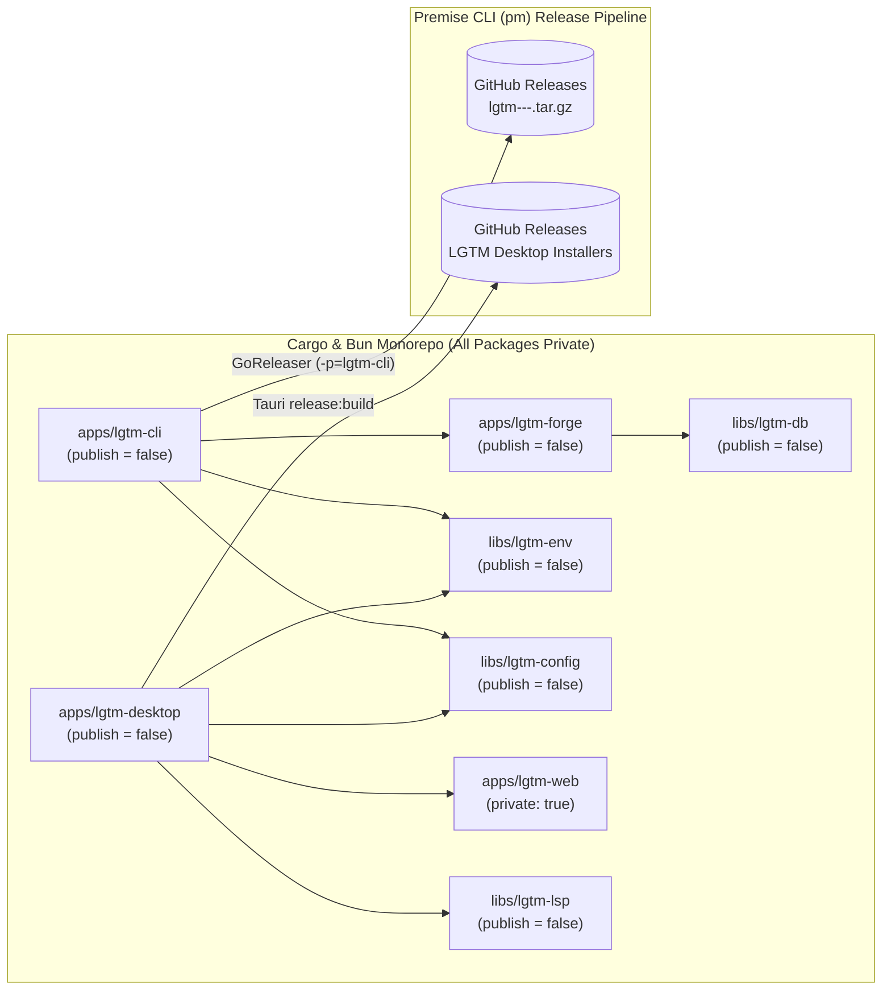

# CI, Release, and Publishing Architecture

## Overview

LGTM uses [Premise](https://github.com/cloudvoyant/premise) (`pm` / `premise`) and GitHub Actions (`cloudvoyant/premise/.github/workflows/on-commit.yaml` and `on-merge.yaml`) to run continuous integration checks and publish release artifacts across its polyglot Cargo, Bun, Tauri, and Neovim workspace.

## Workflows and Triggers

| Workflow | File | Trigger | Behavior |
| --- | --- | --- | --- |
| On Commit | `.github/workflows/on-commit.yaml` | `push` to non-`main` branches, `pull_request` to `main` | Runs workspace `install`, `build`, `lint`, `format:check`, and `test` across Linux and macOS runners. If the `HEAD` commit message on a branch push contains `[publish-rc]`, prepares a SemVer release candidate (`-rc.<N>`) and runs RC release tasks. |
| On Merge | `.github/workflows/on-merge.yaml` | `push` to `main` | Runs workspace validation, computes the next stable SemVer version, tags the release, and publishes binary release artifacts to GitHub Releases. |

## Current Release Architecture (Binary-Only Distribution)

Every Rust crate in the workspace (`lgtm-cli`, `lgtm-desktop`, `lgtm-forge`, `lgtm-db`, `lgtm-config`, `lgtm-env`, `lgtm-lsp`) sets `publish = false` in `Cargo.toml`, and every Bun package (`lgtm-web`, `lgtm-ui`) sets `"private": true` in `package.json`. No source tarballs are uploaded to `crates.io` or `npm` while LGTM's licensing model is being finalized.

Instead, LGTM distributes two precompiled end-user artifacts via GitHub Releases:

1. **`lgtm-cli` (`lgtm` binary archives):** Linked directly against workspace crates (`lgtm-forge`, `lgtm-db`, `lgtm-config`, `lgtm-env`) via Cargo `path` dependencies and cross-compiled from the workspace root (`-p=lgtm-cli`) into `darwin`/`linux` × `amd64`/`arm64` `.tar.gz` archives + `checksums.txt` using GoReleaser (`.goreleaser.yaml`).
2. **`lgtm-desktop` (native desktop installers):** Built via `cargo tauri build` (`apps/lgtm-desktop/mise.toml` `release:build`) with the static `apps/lgtm-web/build` frontend embedded, producing platform installers (`.dmg`, `.app.tar.gz`, `.deb`, `.AppImage`, `.msi`, `.exe`).



### How Premise CLI (`pm`) Orchestrates Releases

1. **Preflight (`pm release preflight`):** Inspects `premise.yaml` and each project's `Cargo.toml` / `package.json`. Because all Cargo crates declare `publish = false` and all npm packages declare `"private": true`, `PreflightPublication` skips `CRATES_TOKEN` and `NPM_TOKEN` registry checks and validates only `GITHUB_TOKEN` for GitHub Releases.
2. **Version Bump (`pm version`):** Updates workspace manifests (`Cargo.toml`, `package.json`, `tauri.conf.json`) to the target `-rc.<N>` or stable version.
3. **Package Registry Step (`publishCargoPackages`):** Iterates Cargo projects in topological order and skips crates with `publish = false` (running the no-op `publish` / `publish:rc` task in `mise.toml` that prints `"Private package; publication disabled"`).
4. **GitHub Release Archive Step (`cargoApplicationReleaseConfig` + `tauri`):**
   - Builds and uploads `lgtm-cli` multi-platform binary archives via GoReleaser from the workspace root (`dir: .`, `flags: [--release, -p=lgtm-cli]`).
   - Builds and uploads `lgtm-desktop` native Tauri installers via `//apps/lgtm-desktop:release:build`.

### Local Release Verification

Validate the GoReleaser configuration and workspace CLI build locally without publishing:

```sh
mise run release:check
mise exec -- goreleaser build --snapshot --single-target --clean --config .goreleaser.yaml
```

## Future Package Publishing Roadmap (`CLO-212`)

Why `crates.io` publication is currently disabled:

- `crates.io` is a source-code registry (`cargo install` compiles from uploaded `.crate` source tarballs) and rejects any published crate that depends on unpublished local `path` dependencies.
- Publishing `lgtm-cli` to `crates.io` therefore requires either publishing all transitive workspace crates (`lgtm-forge`, `lgtm-db`, `lgtm-config`, `lgtm-env`) to `crates.io` or bundling their sources into `lgtm-cli` at publish time—both of which permanently upload internal source code to `crates.io`.

Upstream Premise CLI work is tracked in [CLO-212 (*Support and test binary-only, multi-crate, and parent-bundled workspace publishing in Premise CLI*)](https://linear.app/cloudvoyant/issue/CLO-212/support-and-test-binary-only-multi-crate-and-parent-bundled-workspace) to support and integration-test three first-class workspace publishing modes in `pm`:

| Mode | Description | When to Use |
| --- | --- | --- |
| **1. Binary-only workspace release** | All crates set `publish = false`; `pm` produces GoReleaser CLI archives and Tauri desktop bundles on GitHub Releases without requiring `CRATES_TOKEN`. | Current LGTM mode while licensing is unsettled. |
| **2. Multi-crate topological registry publishing** | Public library crates (`libs/*`, `lgtm-forge`) and `lgtm-cli` set `publish = ["crates-io"]` with `{ path = "...", version = "..." }` dependencies; `pm` bumps internal dependency versions and publishes in dependency order (`lgtm-config` / `lgtm-db` → `lgtm-env` → `lgtm-forge` → `lgtm-cli`). | When LGTM open-sources its SDK crates under a public license. |
| **3. Publish-time parent-package bundling** | `lgtm-cli` links workspace crates via normal `path` dependencies during development/CI (zero source-tree clutter), and `pm` vendors private workspace dependencies into an ephemeral staging directory only during `publish` / `publish:rc`. | When `lgtm-cli` is published to `crates.io` while keeping internal SDKs as a single crate entry. |

Once [CLO-212](https://linear.app/cloudvoyant/issue/CLO-212/support-and-test-binary-only-multi-crate-and-parent-bundled-workspace) lands in Premise CLI and LGTM's licensing is finalized, `lgtm-cli` can re-enable `crates.io` publishing without reintroducing a source-tree bundler.

## References

- [DIFF-287 — Fix workspace crate linking and package publishing for lgtm-cli](https://linear.app/cloudvoyant/issue/DIFF-287/fix-workspace-crate-linking-and-package-publishing-for-lgtm-cli)
- [CLO-212 — Support and test binary-only, multi-crate, and parent-bundled workspace publishing in Premise CLI](https://linear.app/cloudvoyant/issue/CLO-212/support-and-test-binary-only-multi-crate-and-parent-bundled-workspace)
- [Development Guide](development.md)
- [Architecture Overview](architecture/index.md)
