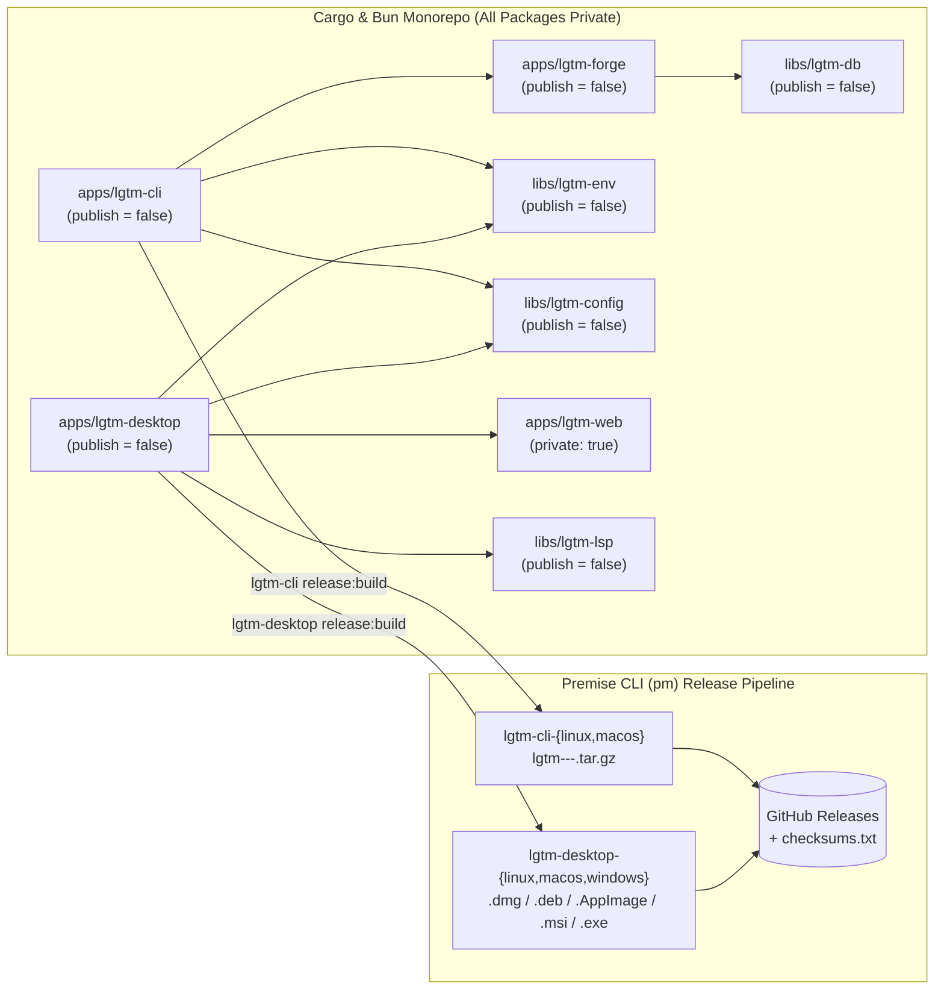

# CI, Release, and Publishing Architecture

## Overview

LGTM uses [Premise](https://github.com/cloudvoyant/premise) (`pm` / `premise`) and GitHub Actions (`.github/workflows/on-commit.yml` and `.github/workflows/on-merge.yml`) to run continuous integration checks and publish release artifacts across its polyglot Cargo, Bun, Tauri, and Neovim workspace.

## Workflows and Triggers

| Workflow  | File                              | Trigger                                                 | Behavior                                                                                                                                                                                                                                                                                                                                                                                                                                                             |
| --------- | --------------------------------- | ------------------------------------------------------- | -------------------------------------------------------------------------------------------------------------------------------------------------------------------------------------------------------------------------------------------------------------------------------------------------------------------------------------------------------------------------------------------------------------------------------------------------------------------- |
| On Commit | `.github/workflows/on-commit.yml` | `pull_request` to `main`, `push` to non-`main` branches | Runs workspace `install`, `build`, `lint`, `format:check`, `test`, and `e2e` across Linux, macOS, and Windows runners once per same-repo branch `push` (and on `pull_request` for external forks). When the `HEAD` commit message on a branch push contains `[publish-rc]`, `cloudvoyant/premise` plans a SemVer release candidate (`-rc.<run_number>`), stages release artifacts across all `release_platforms`, and runs `publish-release` and `publish-packages`. |
| On Merge  | `.github/workflows/on-merge.yml`  | `push` to `main`                                        | Runs workspace validation, computes the next stable SemVer version, tags the release, and publishes binary release artifacts to GitHub Releases.                                                                                                                                                                                                                                                                                                                     |

## Current Release Architecture (Binary-Only Distribution)

Every Rust crate in the workspace (`lgtm-cli`, `lgtm-desktop`, `lgtm-forge`, `lgtm-db`, `lgtm-config`, `lgtm-env`, `lgtm-lsp`) sets `publish = false` in `Cargo.toml`, and every Bun package (`lgtm-web`, `lgtm-ui`) sets `"private": true` in `package.json`. No source tarballs are uploaded to `crates.io` or `npm` while LGTM's licensing model is being finalized.

Instead, LGTM distributes two precompiled end-user artifacts via GitHub Releases by staging platform artifacts during `pm ci flow-matrix` (`release_platforms` in `premise.yaml`) and publishing them together in `publish-release`:

1. **`lgtm-cli` (`lgtm` binary archives):** Declares `release_platforms: [linux, macos]` in `premise.yaml`. Linked directly against workspace crates (`lgtm-forge`, `lgtm-db`, `lgtm-config`, `lgtm-env`) via Cargo `path` dependencies and built via `apps/lgtm-cli/mise.toml` (`release:build`) into `lgtm-<version>-<os>-<arch>.tar.gz` archives in `$PREMISE_ARTIFACT_DIR` (`lgtm-cli-linux`, `lgtm-cli-macos`).
2. **`lgtm-desktop` (native desktop installers):** Declares `release_platforms: [linux, macos, windows]` in `premise.yaml`. Built via `cargo tauri build` (`apps/lgtm-desktop/mise.toml` `release:build`) with the static `apps/lgtm-web/build` frontend embedded, producing platform installers (`.dmg`, `.deb`, `.AppImage`, `.msi`, `.exe`) in `$PREMISE_ARTIFACT_DIR` (`lgtm-desktop-linux`, `lgtm-desktop-macos`, `lgtm-desktop-windows`).



### How Premise CLI (`pm`) Orchestrates Releases

1. **Plan & Version Calculation (`pm ci plan`):** On `main` pushes (`release: always`) or non-`main` branch pushes containing `[publish-rc]` (`release: auto`), `cloudvoyant/premise@v0` computes the target release version (`vX.Y.Z` or `vX.Y.Z-rc.<run_number>`) and emits the platform matrix with `"native": true` for projects declaring `ci.release_platforms` (`lgtm-cli` and `lgtm-desktop`).
2. **Matrix Build & Artifact Staging (`pm ci flow-matrix`):** Runs `install`, `build`, `lint`, `format:check`, and `test` for every project row. When a release version is active and the row is native (`lgtm-cli` on Linux/macOS and `lgtm-desktop` on Linux/macOS/Windows), runs `mise run release:build` with `RELEASE_VERSION` and `PREMISE_ARTIFACT_DIR` and uploads `<project>-<platform>` workflow artifacts.
3. **Combined GitHub Release (`pm release` in `publish-release`):** Validates that every expected `<project>-<platform>` directory in `ExpectedReleaseGroups` contains non-empty release files, tags `HEAD` on `origin`, and invokes GoReleaser (`extra_files` + `checksums.txt`) to publish all `lgtm-cli` archives and `lgtm-desktop` installers to the GitHub Release.
4. **Package Registry Step (`pm packages` in `publish-packages`):** Inspects each project's `Cargo.toml` / `package.json`. Because all Cargo crates declare `publish = false` and all npm packages declare `"private": true`, `PreflightPublication` skips `CRATES_TOKEN` and `NPM_TOKEN` registry requirements and `publishCargoPackages` skips `crates.io` publication (`"Private package; publication disabled"`).

### Local Release Verification

Validate the workspace `lgtm-cli` release archive build and GoReleaser configuration locally without publishing:

```sh
tmp_dir="$(mktemp -d)"
RELEASE_VERSION="0.0.0-local" PREMISE_ARTIFACT_DIR="$tmp_dir" mise run //apps/lgtm-cli:release:build
tar -tzvf "$tmp_dir"/lgtm-0.0.0-local-*.tar.gz
rm -rf "$tmp_dir"
mise run release:check
```

## Future Package Publishing Roadmap (`CLO-212`)

Why `crates.io` publication is currently disabled:

- `crates.io` is a source-code registry (`cargo install` compiles from uploaded `.crate` source tarballs) and rejects any published crate that depends on unpublished local `path` dependencies.
- Publishing `lgtm-cli` to `crates.io` therefore requires either publishing all transitive workspace crates (`lgtm-forge`, `lgtm-db`, `lgtm-config`, `lgtm-env`) to `crates.io` or bundling their sources into `lgtm-cli` at publish time—both of which permanently upload internal source code to `crates.io`.

Upstream Premise CLI work is tracked in [CLO-212 (_Support and test binary-only, multi-crate, and parent-bundled workspace publishing in Premise CLI_)](https://linear.app/cloudvoyant/issue/CLO-212/support-and-test-binary-only-multi-crate-and-parent-bundled-workspace) to support and integration-test three first-class workspace publishing modes in `pm` (as well as fixing `cargoApplicationReleaseConfig` in monorepos to inspect `manifest.PublicationTargets()` and resolve binary names from `[[bin]]` / `package.binary`):

| Mode                                               | Description                                                                                                                                                                                                                                                                                        | When to Use                                                                                      |
| -------------------------------------------------- | -------------------------------------------------------------------------------------------------------------------------------------------------------------------------------------------------------------------------------------------------------------------------------------------------- | ------------------------------------------------------------------------------------------------ |
| **1. Binary-only workspace release**               | All crates set `publish = false`; `pm` produces CLI binary archives and Tauri desktop bundles on GitHub Releases without requiring `CRATES_TOKEN`.                                                                                                                                                 | Current LGTM mode while licensing is unsettled.                                                  |
| **2. Multi-crate topological registry publishing** | Public library crates (`libs/*`, `lgtm-forge`) and `lgtm-cli` set `publish = ["crates-io"]` with `{ path = "...", version = "..." }` dependencies; `pm` bumps internal dependency versions and publishes in dependency order (`lgtm-config` / `lgtm-db` → `lgtm-env` → `lgtm-forge` → `lgtm-cli`). | When LGTM open-sources its SDK crates under a public license.                                    |
| **3. Publish-time parent-package bundling**        | `lgtm-cli` links workspace crates via normal `path` dependencies during development/CI (zero source-tree clutter), and `pm` vendors private workspace dependencies into an ephemeral staging directory only during `publish` / `publish:rc`.                                                       | When `lgtm-cli` is published to `crates.io` while keeping internal SDKs as a single crate entry. |

Once [CLO-212](https://linear.app/cloudvoyant/issue/CLO-212/support-and-test-binary-only-multi-crate-and-parent-bundled-workspace) lands in Premise CLI and LGTM's licensing is finalized, `lgtm-cli` can re-enable `crates.io` publishing without reintroducing a source-tree bundler.

## References

- [DIFF-287 — Fix workspace crate linking and package publishing for lgtm-cli](https://linear.app/cloudvoyant/issue/DIFF-287/fix-workspace-crate-linking-and-package-publishing-for-lgtm-cli)
- [CLO-212 — Support and test binary-only, multi-crate, and parent-bundled workspace publishing in Premise CLI](https://linear.app/cloudvoyant/issue/CLO-212/support-and-test-binary-only-multi-crate-and-parent-bundled-workspace)
- [Development Guide](development.md)
- [Architecture Overview](architecture/index.md)
