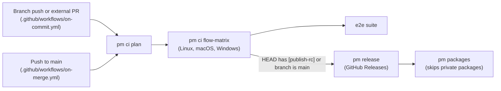
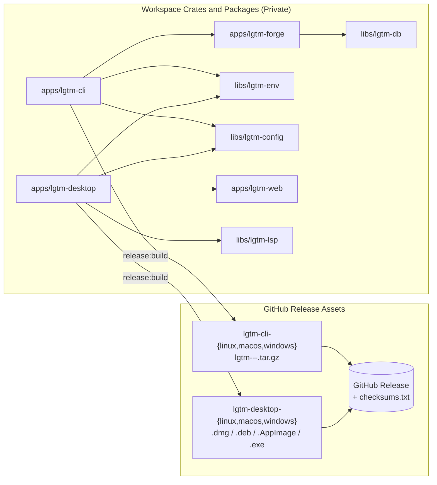
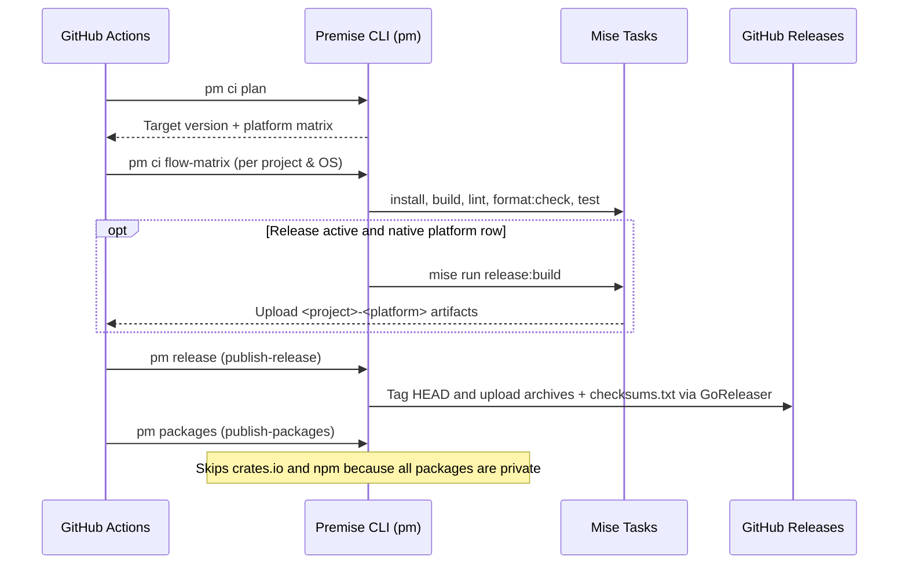
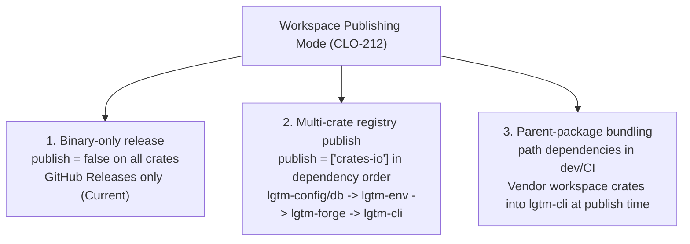

# CI, Release, and Publishing Architecture

## Overview

LGTM runs continuous integration and releases with [Premise](https://github.com/cloudvoyant/premise) (`pm` / `premise`) and GitHub Actions. All Rust crates set `publish = false` in `Cargo.toml`, and all Bun packages set `"private": true` in `package.json`. GitHub Releases distribute precompiled `lgtm` CLI archives and native `lgtm-desktop` installers across Linux, macOS, and Windows.

## Workflows and Triggers



| Workflow | File | Trigger | Release Condition |
| --- | --- | --- | --- |
| On Commit | `.github/workflows/on-commit.yml` | Branch `push` or external fork `pull_request` | Publishes `-rc.<run_number>` when the `HEAD` commit message contains `[publish-rc]` |
| On Merge | `.github/workflows/on-merge.yml` | `push` to `main` | Publishes the next stable SemVer tag (`vX.Y.Z`) on every merge |

## Binary Release Pipeline



| Project | Release Platforms | Build Task | Staged Artifacts |
| --- | --- | --- | --- |
| `lgtm-cli` | `linux`, `macos`, `windows` | `//apps/lgtm-cli:release:build` | `lgtm-<version>-{linux-x86_64,macos-aarch64,windows-x86_64}.tar.gz` |
| `lgtm-desktop` | `linux`, `macos`, `windows` | `//apps/lgtm-desktop:release:build` | `lgtm-desktop_<version>_{aarch64.dmg,amd64.AppImage,amd64.deb,x64-setup.exe}` |



## Local Release Verification

Run the commands below to verify the `lgtm-cli` release archive and GoReleaser configuration locally without publishing:

```sh
tmp_dir="$(mktemp -d)"
RELEASE_VERSION="0.0.0-local" PREMISE_ARTIFACT_DIR="$tmp_dir" mise run //apps/lgtm-cli:release:build
tar -tzvf "$tmp_dir"/lgtm-0.0.0-local-*.tar.gz
rm -rf "$tmp_dir"
mise run release:check
```

## Future Registry Publishing (`CLO-212`)

`crates.io` compiles packages from uploaded source tarballs and rejects crates that depend on unpublished local `path` dependencies. Publishing `lgtm-cli` to `crates.io` uploads internal source code unless workspace crates are published or bundled. [CLO-212](https://linear.app/cloudvoyant/issue/CLO-212/support-and-test-binary-only-multi-crate-and-parent-bundled-workspace) tracks three workspace publishing modes in Premise CLI:



| Mode | Configuration | When to Use |
| --- | --- | --- |
| 1. Binary-only release | Set `publish = false` on all crates and ship binaries on GitHub Releases | Current mode while licensing is private |
| 2. Multi-crate registry publish | Set `publish = ["crates-io"]` on SDK crates and `lgtm-cli` and publish in dependency order | When SDK crates are open-sourced |
| 3. Parent-package bundling | Keep `path` dependencies in source and vendor internal crates into `lgtm-cli` during `pm packages` | When publishing only `lgtm-cli` to `crates.io` |

## References

- [DIFF-287: Fix workspace crate linking and package publishing for lgtm-cli](https://linear.app/cloudvoyant/issue/DIFF-287/fix-workspace-crate-linking-and-package-publishing-for-lgtm-cli)
- [CLO-212: Support and test binary-only, multi-crate, and parent-bundled workspace publishing in Premise CLI](https://linear.app/cloudvoyant/issue/CLO-212/support-and-test-binary-only-multi-crate-and-parent-bundled-workspace)
- [Development Guide](development.md)
- [Architecture Overview](architecture/index.md)
