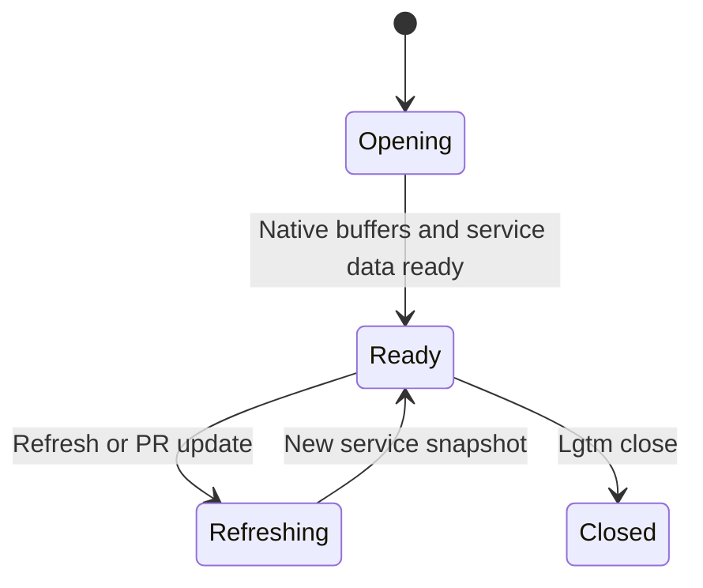
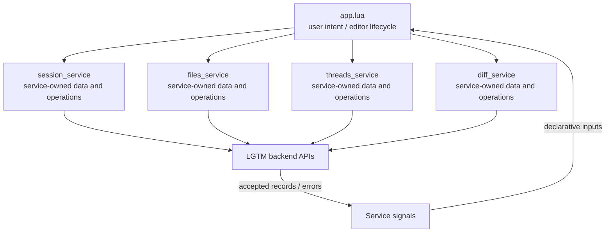

# Application orchestration

## Overview

Coordinate review tabs, notes actions, export presentation and the UI components that display service data.

## Design

### Layout

```text
Files                 │ old source                  │ new source
──────────────────────│─────────────────────────────│─────────────────────────────
✓ file.lua            │ submit(body)                │ submit(body, done)
  other.lua           │                             │╭─ Local draft · Open ─────╮
                      │                             ││ Keep failed-save text.   │
                      │                             │╰ Enter open · za expand ─╯
```

### Behavior



### Public API

```lua
require("lgtm.app").open(state, on_loaded)
```

`:Lgtm refresh`, `files`, `threads`, `complete`, `submit`, `sync`, and `close` operate on the active review. Global keys use `setup.prefix`; component-local keys are documented by their feature pages.

### State and Data Flow

| Owner | State |
| --- | --- |
| Application | Tab/window lifecycle, selected file/side, modal visibility, and focus restoration. |
| Service | session_service owns review metadata; files_service owns file lists and marks; threads_service owns feedback; diff_service owns comparison/source data. |
| Backend | Saved feedback, original anchor evidence, and authoritative location/lifecycle decisions. |



## Implementation

- [Source](../../apps/lgtm.nvim/lua/lgtm/app.lua).
- [Overall service and backend wiring](../architecture/lgtm.nvim/index.md).
