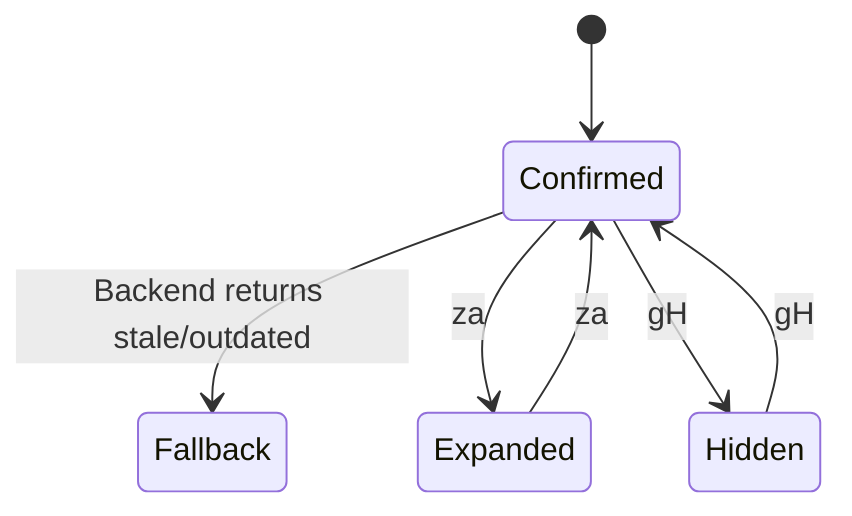
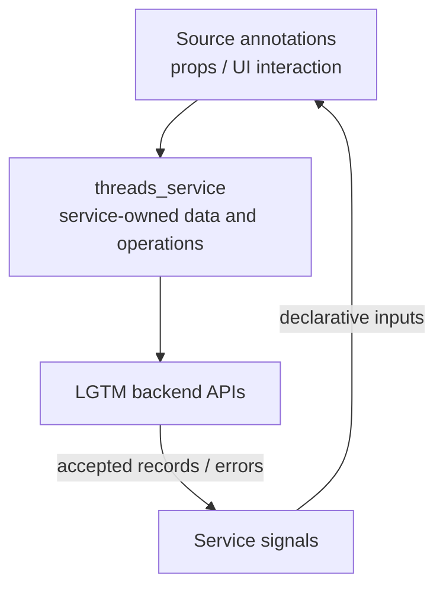

# Annotation overlay

## Overview

Render cards at backend-confirmed locations and map their padding across CodeDiff panes.

## Design

### Layout

```text
20 submit(body, done)
   ╭─ Published · Open · 1 reply ──────────────────╮
   │ Keep the draft after a failed save.           │
   ╰ Alex · Enter open · za expand ────────────────╯
```

### Behavior



### Public API

```lua
require("lgtm.features.annotation_overlay").render_review(state, panes, path)
```

Enter / K open feedback. `c` adds a comment; `dd` opens the discussion; `x` toggles resolution. `za` / `zA` expand one/all cards; `gH` toggles cards. `]c` / `[c` and `]n` / `[n` navigate feedback. `setup.mappings` remaps supported keys. Ordinary editing keys retain their normal behavior away from feedback.

### State and Data Flow

| Owner | State |
| --- | --- |
| Component | Expanded thread IDs, card visibility, buffer key bindings, and opposite-pane padding. |
| Service | threads_service supplies placement results and comments. This adapter does not match text, relocate anchors, or infer stale status. |
| Backend | Saved feedback, original anchor evidence, and authoritative location/lifecycle decisions. |



## Implementation

- [Source](../../../apps/lgtm.nvim/lua/lgtm/features/annotation_overlay.lua).
- [Overall service and backend wiring](../../architecture/lgtm.nvim/index.md).
