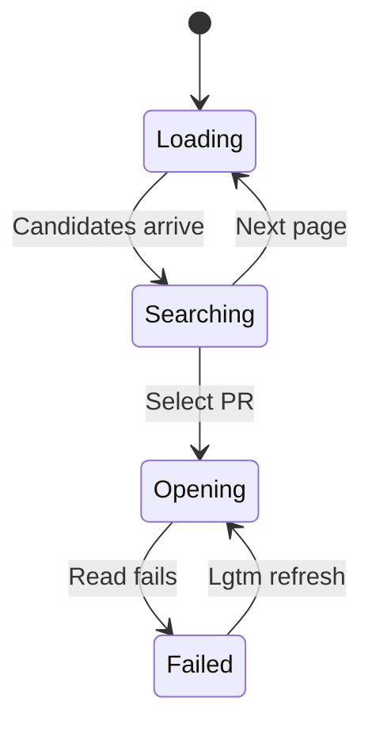
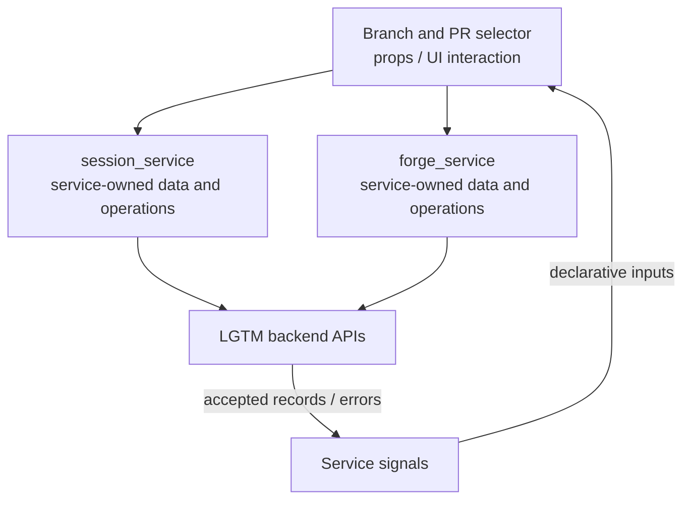

# Branch and PR selector

## Overview

Choose a branch base or find a PR, then open its workspace.

## Design

### Layout

```text
Search Pull requests
╭──────────────────────────────────────────────────╮
│ head:feature                                     │
├──────────────────────────────────────────────────┤
│ #248 Refactor review UI                          │
│ Next page…                                       │
╰ Enter select · Esc cancel ───────────────────────╯
```

### Behavior



### Public API

```lua
require("lgtm.features.branch_pr_selector").open(repository_url)
```

`:Lgtm prs` opens PR search. Enter selects a PR or the next page. Esc cancels. `select_base(callback)` uses the configured input provider.

### State and Data Flow

| Owner | State |
| --- | --- |
| Component | Query text, selected result, current page, and loading notification. |
| Service | PR candidates, request status, and review metadata belong to session_service. forge_service resolves local checkout metadata. |
| Backend | Saved feedback, original anchor evidence, and authoritative location/lifecycle decisions. |



## Implementation

- [Source](../../../apps/lgtm.nvim/lua/lgtm/features/branch_pr_selector.lua).
- [Overall service and backend wiring](../../architecture/lgtm.nvim/index.md).
