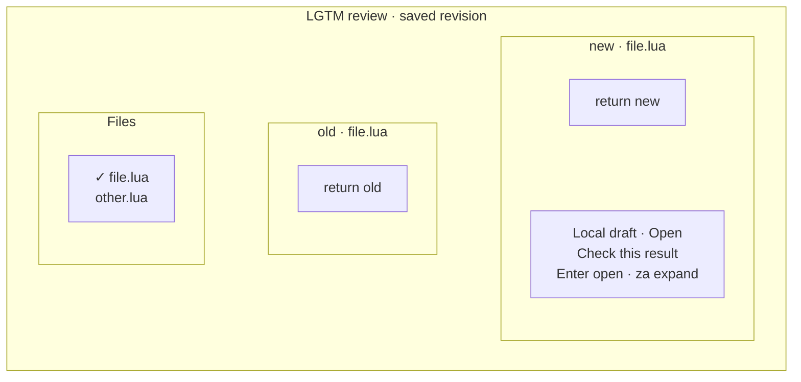
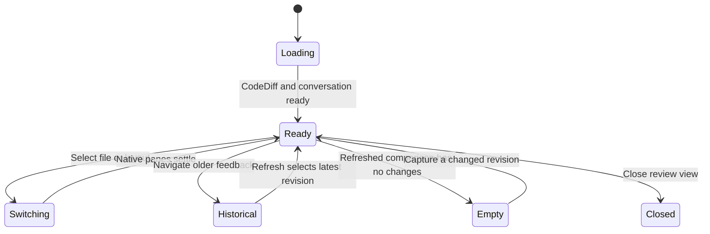
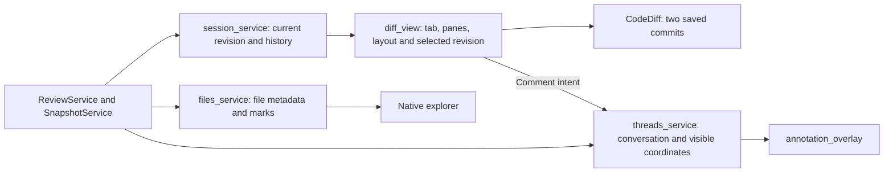

# CodeDiff view

## Overview

Show a saved review revision using CodeDiff layouts and read-only source panes. Git reviews use native revision buffers; directory and remote views use the existing file adapter with backend snapshot content.

## Design

### Layout



### Behavior



## Implementation

### Public API

```lua
require("lgtm.features.diff_view").open_native(state)
```

`:Lgtm layout` toggles the supported CodeDiff layout. `c` in normal or visual mode opens a comment composer. `:Lgtm refresh` captures saved source again; changing an ordinary editing buffer does not change an open snapshot. The source panes remain read-only. Closing the view keeps the session and feedback.

### State and Data Flow



- [Source](../../../apps/lgtm.nvim/lua/lgtm/features/diff_view.lua).
- [Overall architecture](../../architecture/lgtm.nvim/index.md).
