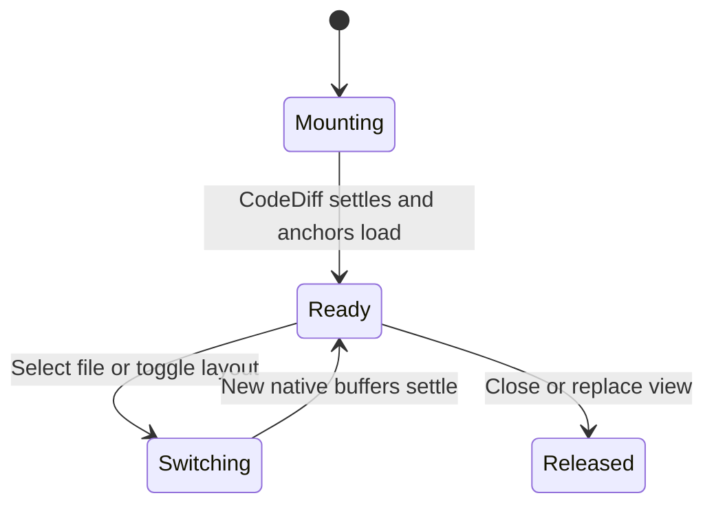
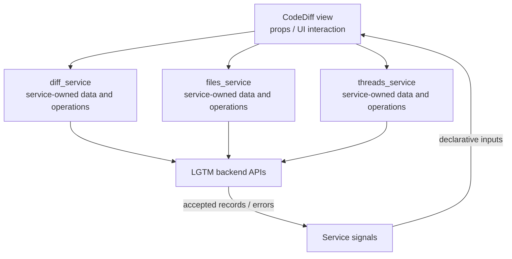

# CodeDiff view

## Overview

Adapt native CodeDiff buffers and lifecycle events to LGTM review features.

## Design

### Layout

```text
CodeDiff explorer     │ original                    │ modified
──────────────────────│─────────────────────────────│─────────────────────────────
  M file.lua          │ return old                  │ return new
                      │                             │ LGTM comment card
```

### Behavior



### Public API

```lua
require("lgtm.features.diff_view").open_native(state)
```

CodeDiff retains native navigation, editable working buffers, and refresh behavior. `:Lgtm layout` toggles the supported layout; LGTM’s card and file keys are layered onto the mounted buffers.

### State and Data Flow

| Owner | State |
| --- | --- |
| Component | Mounted tab, source windows, layout, selected file, buffer checks, and readiness generation. |
| Service | CodeDiff loads native diff content. diff_service owns backend comparison/source records; files_service receives native file metadata; threads_service supplies annotations. |
| Backend | Saved feedback, original anchor evidence, and authoritative location/lifecycle decisions. |



## Implementation

- [Source](../../../apps/lgtm.nvim/lua/lgtm/features/diff_view.lua).
- [Overall service and backend wiring](../../architecture/lgtm.nvim/index.md).
