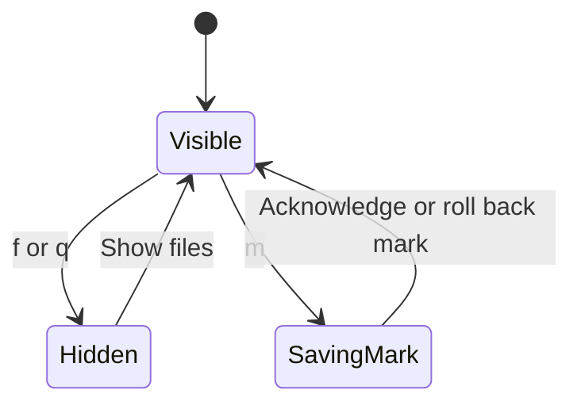
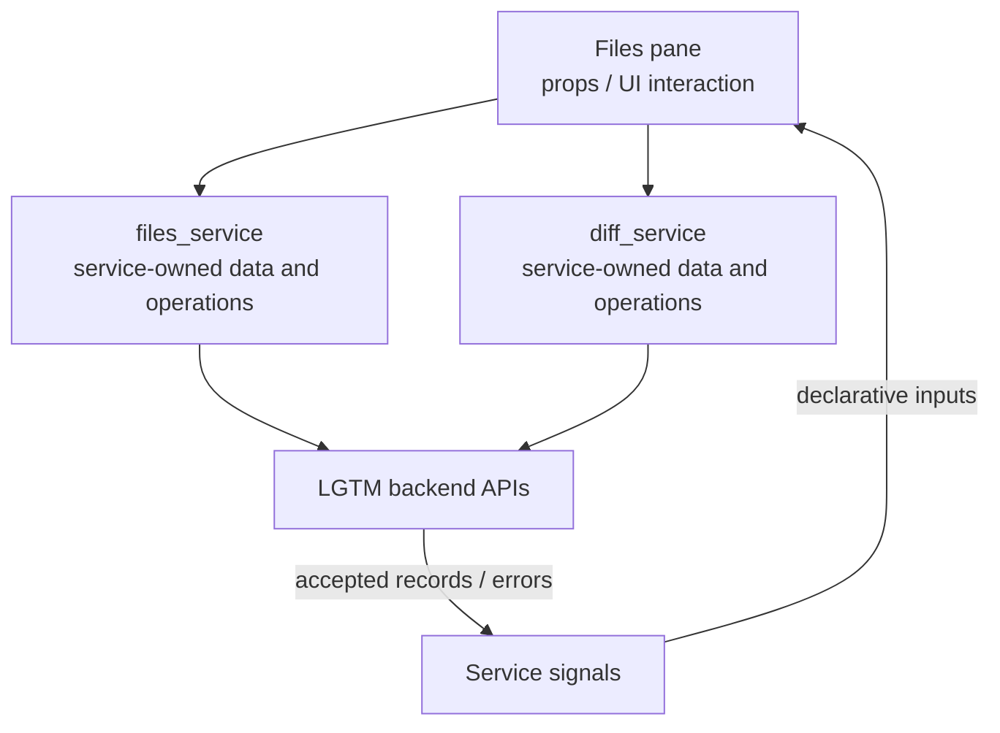

# Files pane

## Overview

Navigate backend-loaded files, or add reviewed marks to CodeDiff’s native explorer.

## Design

### Layout

```text
LGTM files
──────────────────────────────────
▶ ✓ M file.lua
  · = notes.md
  · M other.lua
```

### Behavior



### Public API

```lua
require("lgtm.features.files_pane").show(state, focus)
```

Enter selects a file; `m` toggles its reviewed mark. Tab / Shift-Tab navigate unreviewed files; `]f` / `[f` navigate files. `f` / `q` hide the directory pane. The native CodeDiff tree retains its own navigation.

### State and Data Flow

| Owner | State |
| --- | --- |
| Component | Selected file path, explorer visibility, cursor position, and native panel attachment. |
| Service | files_service owns file records, reviewed marks, loading, and serialized mark writes. The component derives labels and checkmarks from those records. |
| Backend | Saved feedback, original anchor evidence, and authoritative location/lifecycle decisions. |



## Implementation

- [Source](../../../apps/lgtm.nvim/lua/lgtm/features/files_pane.lua).
- [Overall service and backend wiring](../../architecture/lgtm.nvim/index.md).
