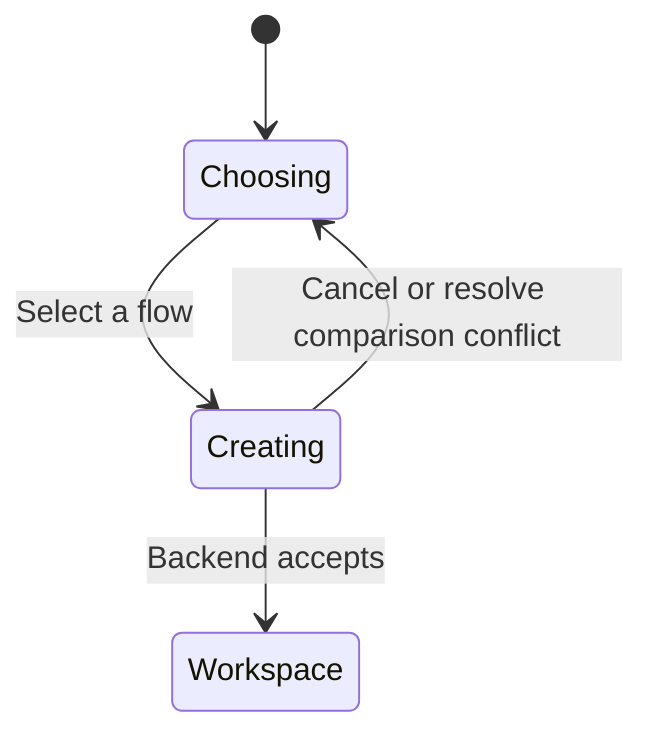
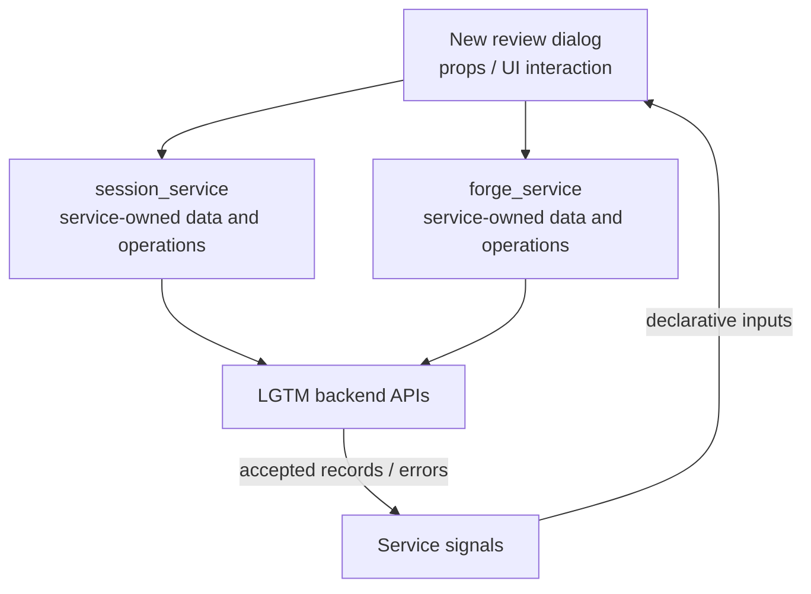

# New review dialog

## Overview

Choose a local comparison, a directory, or a forge PR.

## Design

### Layout

```text
Review
  working
  staged
  branch
  PR
```

### Behavior



### Public API

```lua
require("lgtm.features.new_review_dialog").open()
```

`:Lgtm review` opens the flow picker. Enter selects; Esc cancels. User-provided `vim.ui.select` and `vim.ui.input` providers remain supported.

### State and Data Flow

| Owner | State |
| --- | --- |
| Component | Selected flow, directory input, and comparison-conflict choice. |
| Service | Session options and the accepted review belong to session_service. |
| Backend | Saved feedback, original anchor evidence, and authoritative location/lifecycle decisions. |



## Implementation

- [Source](../../../apps/lgtm.nvim/lua/lgtm/features/new_review_dialog.lua).
- [Overall service and backend wiring](../../architecture/lgtm.nvim/index.md).
