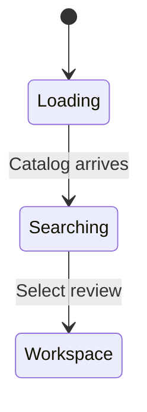
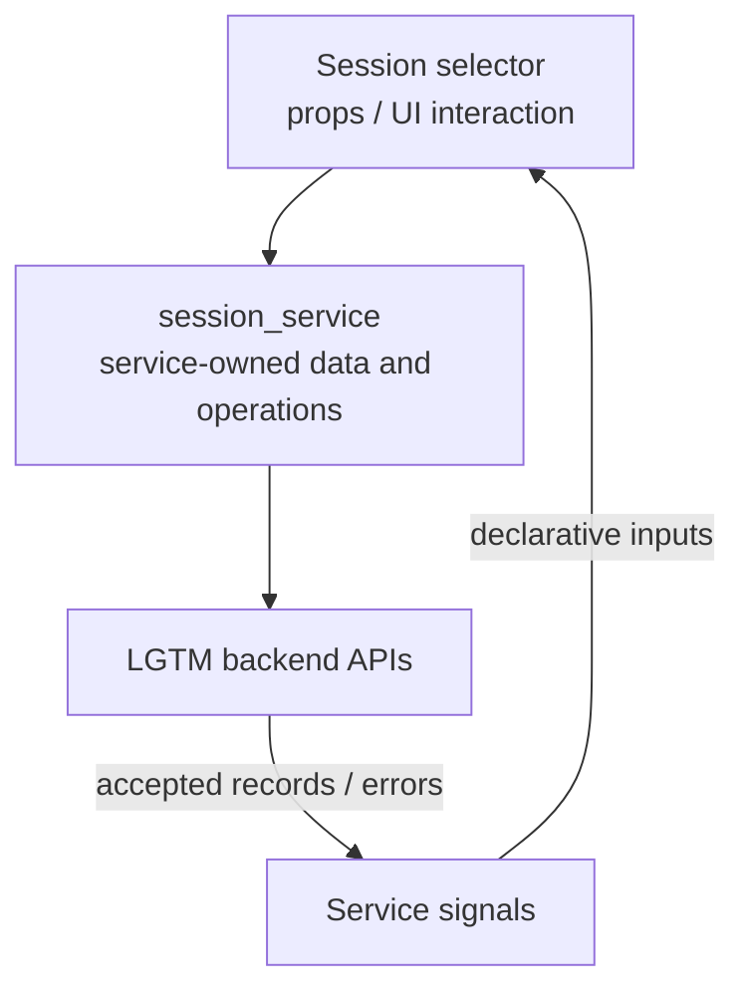

# Session selector

## Overview

Resume an active or completed local or forge review.

## Design

### Layout

```text
Search Local / GitHub reviews
╭──────────────────────────────────────────────────╮
│ feature                                          │
├──────────────────────────────────────────────────┤
│ feature [active] 2026-10-28 09:00                 │
│ PR #248 [completed] 2026-10-27 16:20              │
╰ Enter select · Esc cancel ───────────────────────╯
```

### Behavior



### Public API

```lua
require("lgtm.features.session_selector").select(completed)
```

`:Lgtm sessions` lists active reviews; `:Lgtm sessions completed` lists completed reviews. Enter opens the selected review; Esc cancels.

### State and Data Flow

| Owner | State |
| --- | --- |
| Component | Search query, focused result, and open/closed picker. |
| Service | The review catalog and loading/error state belong to session_service. |
| Backend | Saved feedback, original anchor evidence, and authoritative location/lifecycle decisions. |



## Implementation

- [Source](../../../apps/lgtm.nvim/lua/lgtm/features/session_selector.lua).
- [Overall service and backend wiring](../../architecture/lgtm.nvim/index.md).
