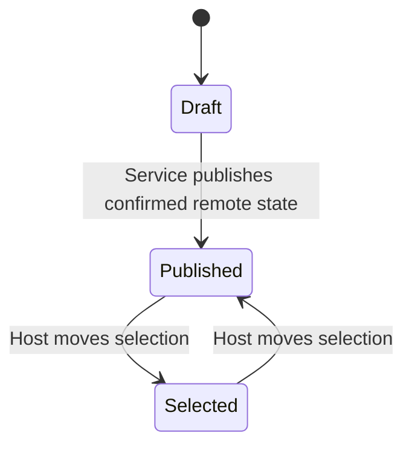
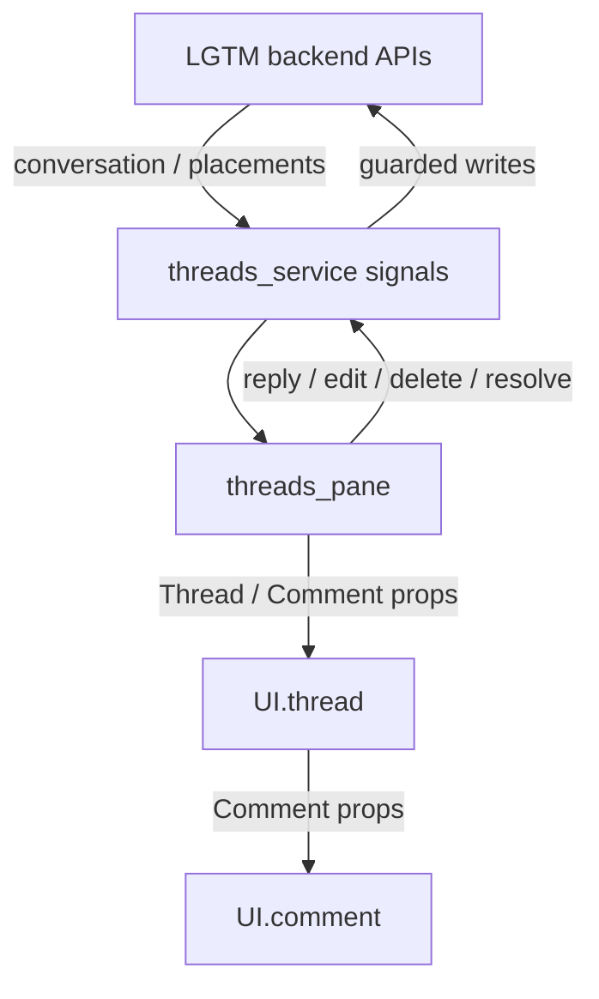

# Thread comment

## Overview

Render one top-level comment or reply from input props.

## Design

### Layout

```text
TOP-LEVEL COMMENT · Alex · Published
   Keep the draft after a failed save.

   └─ REPLY 1 · You · GitHub draft
      Agreed. The text is retained.
```

### Behavior



### Public API

```lua
require("lgtm.features.thread_comment").render({
  thread_id = thread.id,
  comment = comment,
  can_resolve = can_resolve,
})
```

Keys are delegated by the [threads pane](threads-pane.md), using the stable comment ID returned in the tree node. The comment component does not implement edit/delete workflows.

### State and Data Flow

| Owner | State |
| --- | --- |
| Component | None. The parent owns selection; there is no fetched record, RPC client, or review state in this component. |
| Service | The parent supplies the Comment, thread ID, and resolution capability. The service remains the record owner. |
| Backend | Saved feedback, original anchor evidence, and authoritative location/lifecycle decisions. |



## Implementation

- [Source](../../../apps/lgtm.nvim/lua/lgtm/features/thread_comment.lua).
- [Overall service and backend wiring](../../architecture/lgtm.nvim/index.md).
