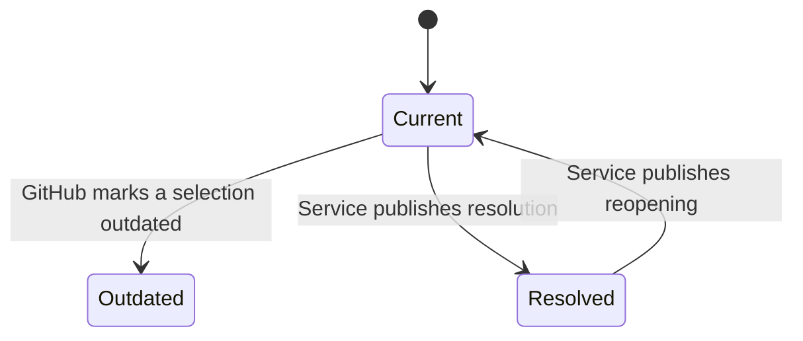
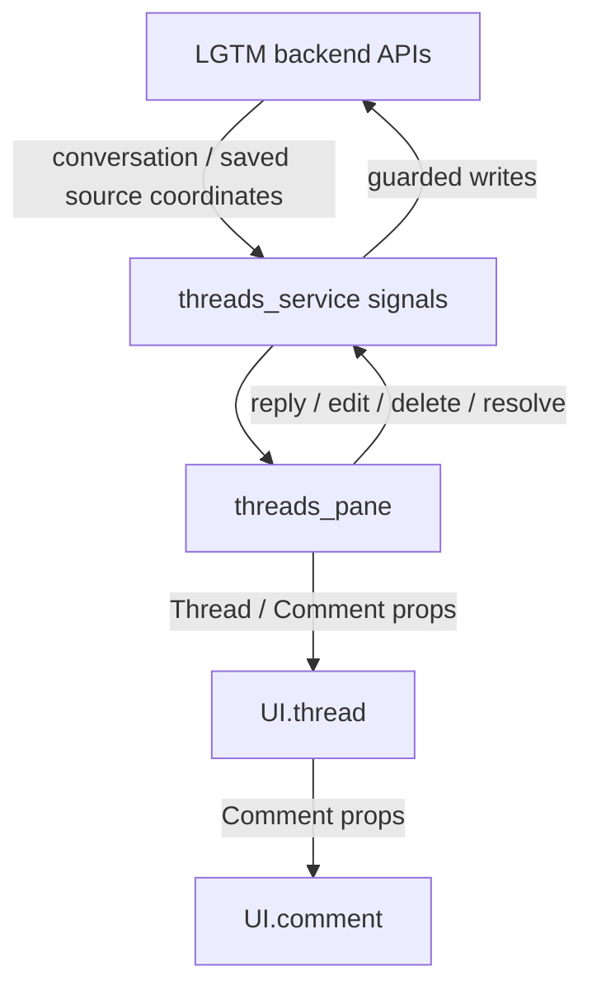

# Thread

## Overview

Compose a thread header, location evidence, and its comment components.

## Design

### Layout

```text
OUTDATED · OPEN · 1 reply
──────────────────────────────────────────────────
Original lines 20–22
> submit(body)
TOP-LEVEL COMMENT · Alex · Published
  Keep this discussion.
  └─ REPLY 1 · You · Local draft
     Agreed.
```

### Behavior



### Public API

```lua
require("lgtm.features.thread").render({
  thread = thread,
  comments = comments,
  can_resolve = can_resolve,
  width = width,
  mode = "split",
  index = 1,
  count = 1,
})
```

The [threads pane](threads-pane.md) owns keys and dispatches actions. This component returns NUI tree nodes with stable thread/comment IDs.

### State and Data Flow

| Owner | State |
| --- | --- |
| Component | None. Rendering is a pure function of props; selection belongs to the host. |
| Service | The parent supplies a Thread, its comments, location status, and allowed actions from service data. |
| Backend | Saved feedback, original anchor evidence, and authoritative location/lifecycle decisions. |



## Implementation

- [Source](../../../apps/lgtm.nvim/lua/lgtm/features/thread.lua).
- [Overall service and backend wiring](../../architecture/lgtm.nvim/index.md).
