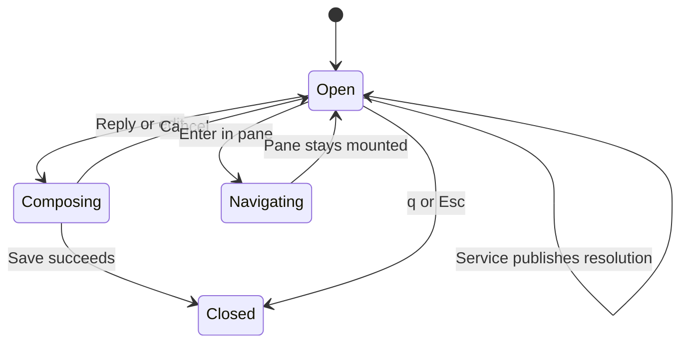
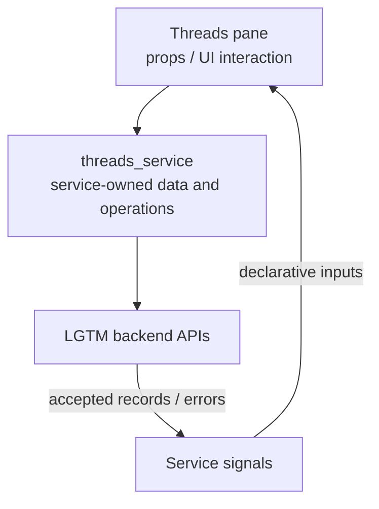
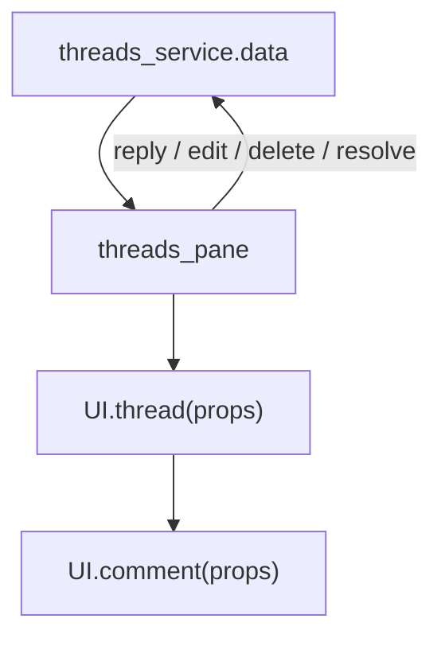

# Threads pane

## Overview

Render a reactive conversation as a persistent pane or a selected-thread modal.

## Design

### Layout

```text
source buffer                              │ OPEN · 1 reply · file.lua:20
                                           │──────────────────────────────────────
                                           │ TOP-LEVEL COMMENT · Alex · Published
                                           │   Keep this discussion.
                                           │   └─ REPLY 1 · You · Local draft
                                           │      Agreed.
```

### Behavior



### Public API

```lua
require("lgtm.features.threads_pane").open_selected(state, threads, pane, on_ready)
```

Tab / Shift-Tab select comments. `c` replies, `e` edits, `dd` requests deletion, and `x` toggles resolution. Enter in the pane navigates to code. `q` / Esc close the host. `setup.mappings` remaps these keys. Backend permissions still apply.

### State and Data Flow

| Owner | State |
| --- | --- |
| Component | Host mode, selected comment ID, scroll/focus position, and open/closed window. Selected thread IDs restrict a modal; the pane follows the full conversation. |
| Service | threads_service owns conversations, placements, request status, and guarded mutations. The pane does not retain its own comment list. |
| Backend | Saved feedback, original anchor evidence, and authoritative location/lifecycle decisions. |





## Implementation

- [Source](../../../apps/lgtm.nvim/lua/lgtm/features/threads_pane.lua).
- [Overall service and backend wiring](../../architecture/lgtm.nvim/index.md).
