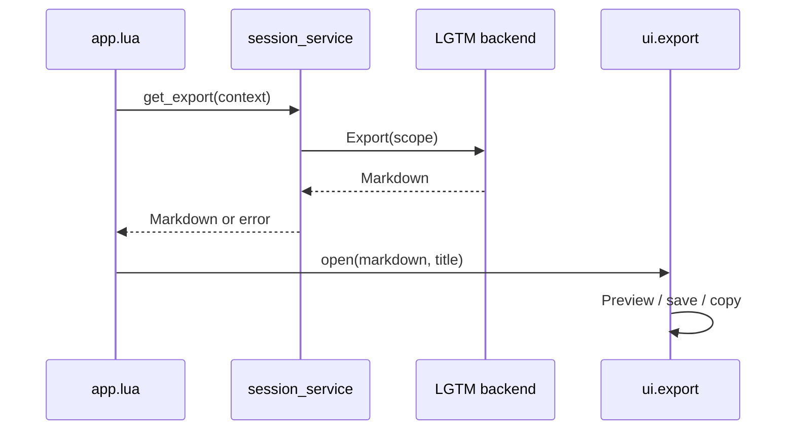

# Export service operation

## Overview

`session_service.get_export` obtains backend-generated Markdown for the selected review scope. The application selects the scope and opens the reusable export widget.

## Design

### Public API

```lua
require("lgtm.services.session_service").get_export(
  context,
  function(error, markdown)
    -- Consume the generated Markdown.
  end
)
```

Use `:Lgtm export` for the selected review. The backend controls feedback selection and formatting; the UI offers Preview, Save file and Copy to clipboard.

### State and Data Flow



Export does not create a review or mutate feedback. Preview windows and file/clipboard choices belong to the widget.

## Implementation

- [Service](../../../apps/lgtm.nvim/lua/lgtm/services/session_service.lua).
- [Export widget](../../architecture/lgtm.nvim/ui/export.md).
