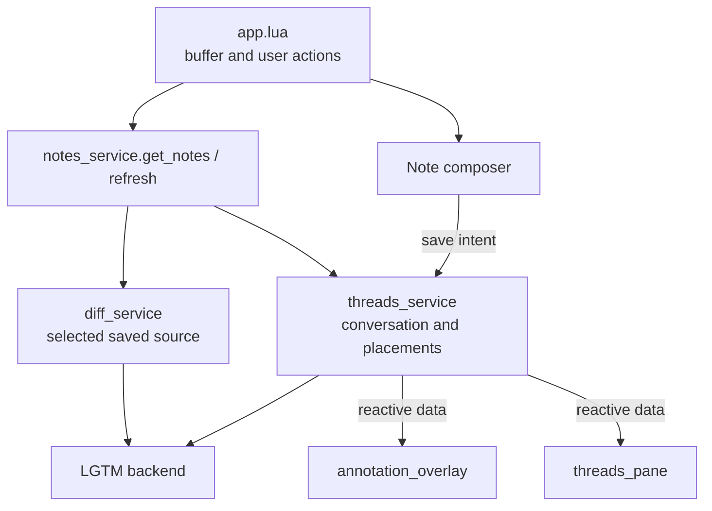

# Notes service

## Overview

Load and refresh saved-file notes without importing UI components or notification providers. The application owns composers, panes, promotion prompts and buffer subscriptions.

## Design

### Public API

```lua
require("lgtm.services.notes_service").get_notes(
  buffer,
  function(error, context)
    -- Consume the service context.
  end
)
```

The context exposes `refresh(callback)`. Notes do not create a review when the file has no saved discussion. `app.lua` handles `:Lgtm note`, `:Lgtm notes`, visual ranges and `:Lgtm promote`; supported interaction keys remain in the [annotation overlay](../feature/annotation-overlay.md) and [threads pane](../feature/threads-pane.md).

### State and Data Flow

| Owner | State |
| --- | --- |
| notes_service | Saved-file context, selected backend source and pending read generation. |
| threads_service | Conversation, placements and mutations. |
| app.lua | Buffer subscriptions, composer lifecycle and presentation of errors. |



## Implementation

- [Service](../../../apps/lgtm.nvim/lua/lgtm/services/notes_service.lua).
- [Application](../../../apps/lgtm.nvim/lua/lgtm/app.lua).
