# PRD: code and document review

## Summary

The first `lgtm` release will be a browser and neovim based review tool, which will support local reviews, GitHub synced PR reviews, as well as arbitrary local file annotations.

## Problem and Evidence

[Copy from ADR]

## Users and Use Cases

- Primarily SWEs
- PR code review
- Local code review prior to PRs (to deal with Agent code slop)
- File annotations for spec driven plans

## Goals

- Support all the above
- Construct LGTM in a way it will easily integrate with Difflab and be extendible for "premium" features

## Non-Goals

- Pure TUI based review like `tuicr`
- Going beyond review (No sync, etc.)

## Proposed Experience

### Start or resume a review

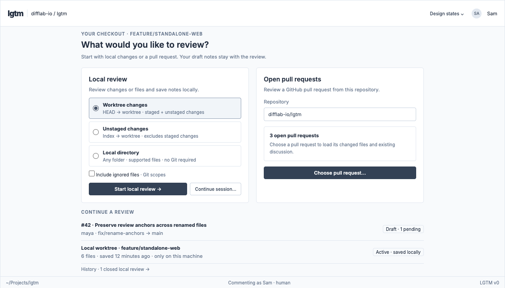

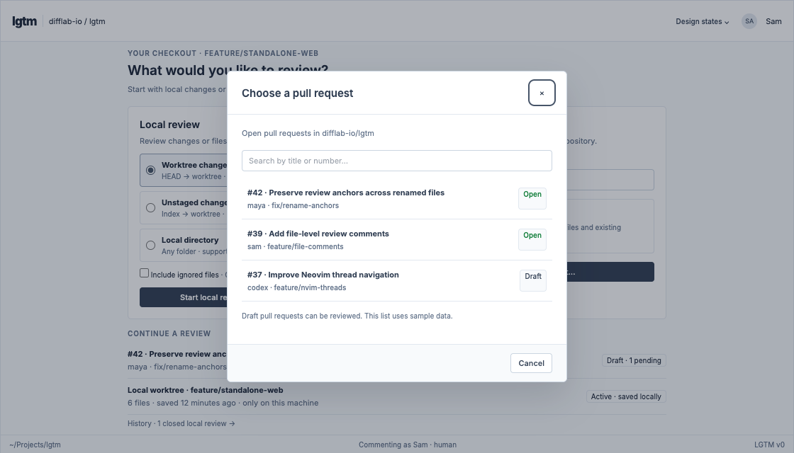

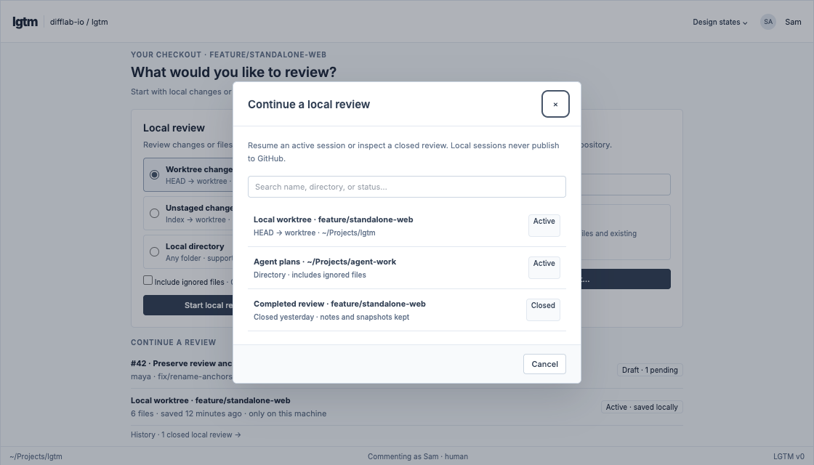

### Review a directory and ignored files

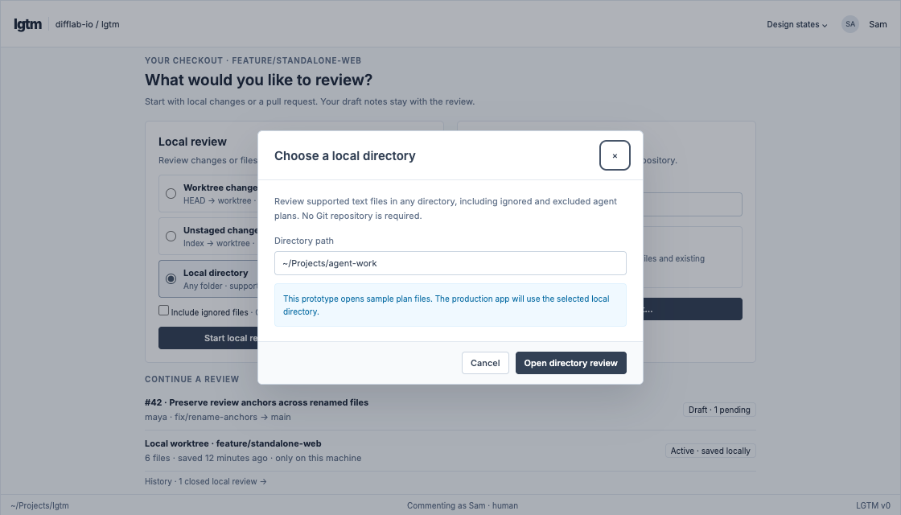

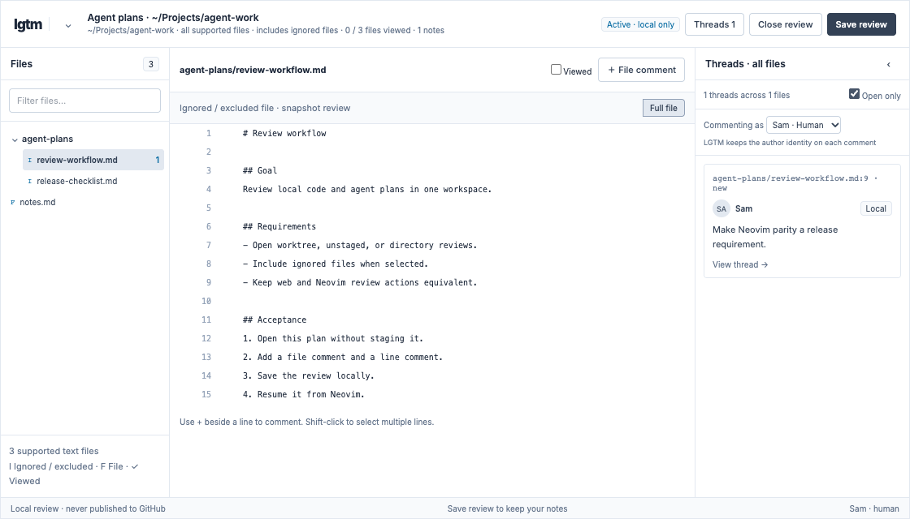

### Navigate files and maximize review space

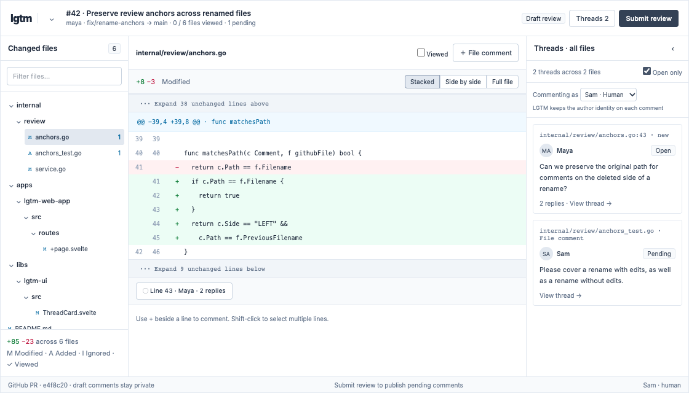

### Inspect differences and complete files

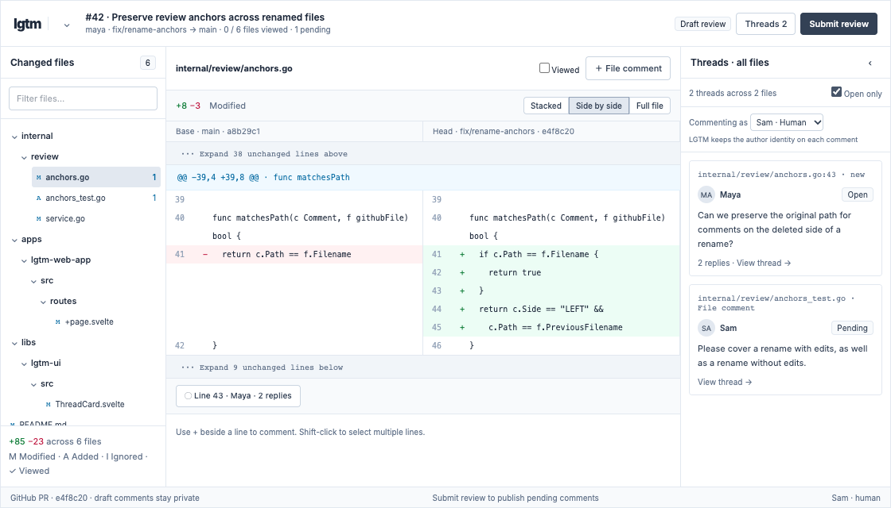

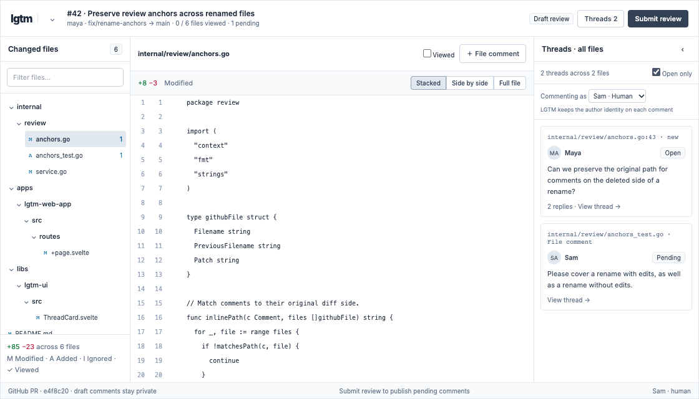

### Comment on lines, ranges, files, and reviews

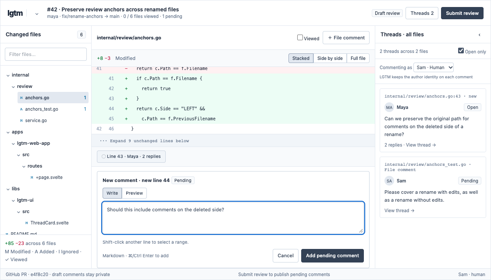

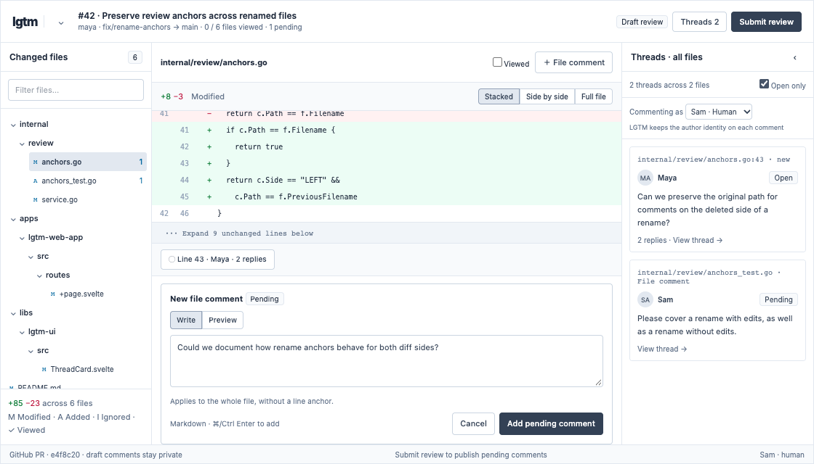

### Keep local comments attached as content changes

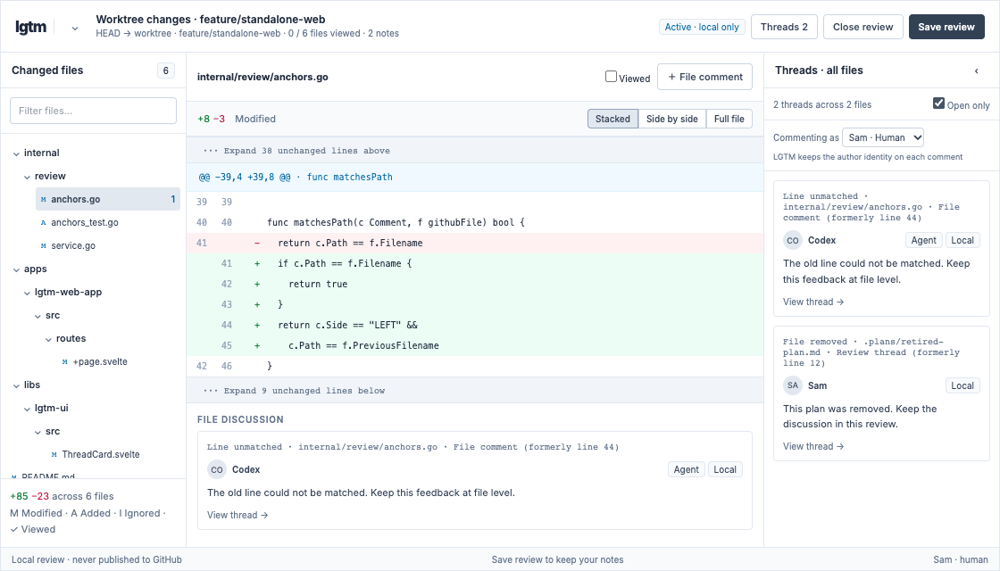

### Read and resolve threads across all files

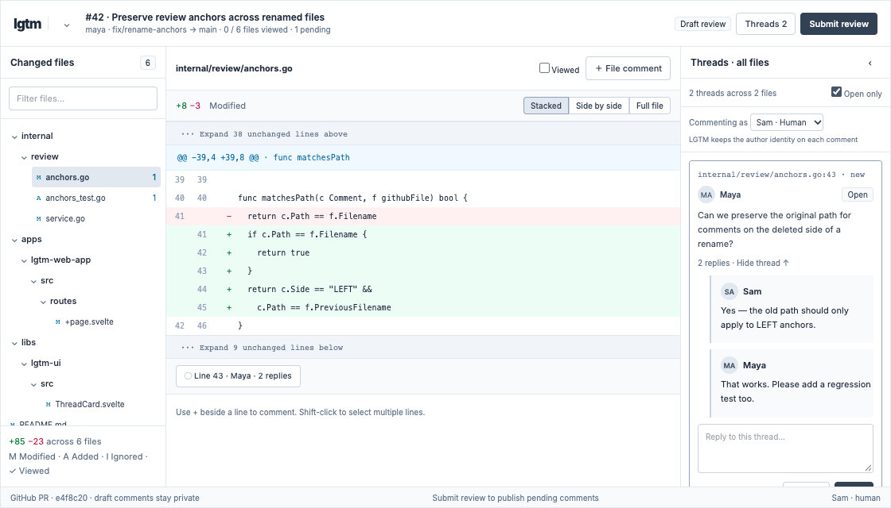

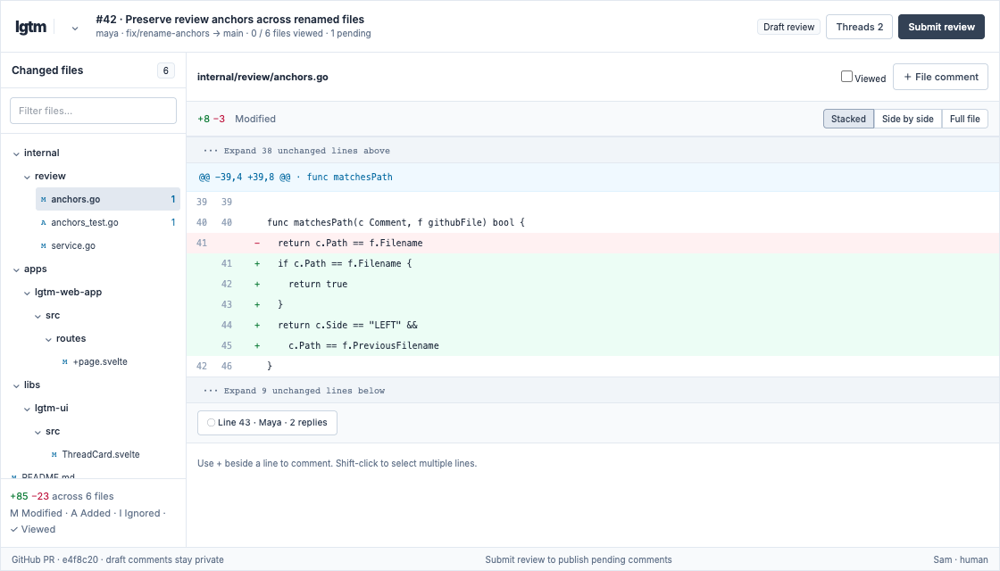

### Save and close local sessions

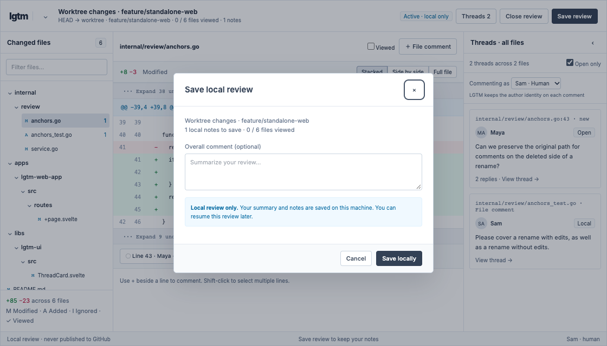

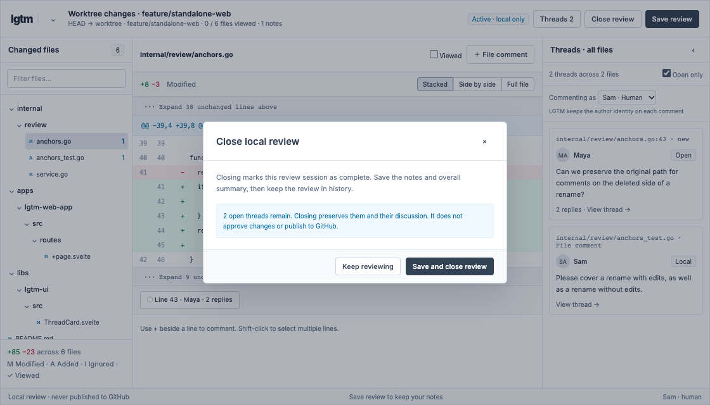

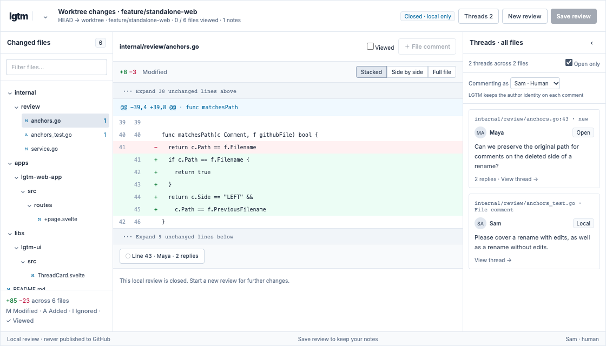

### Preserve human and agent identity

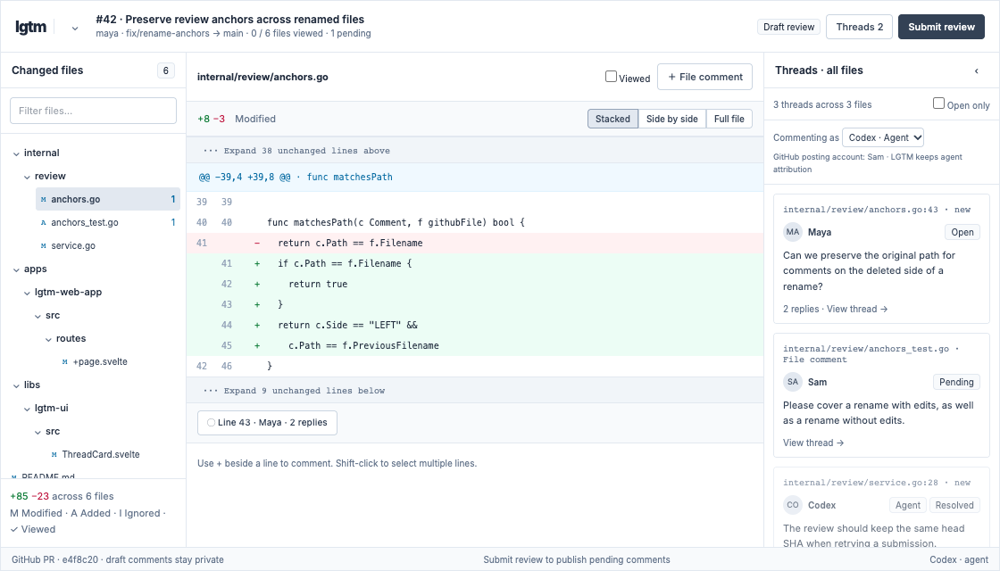

### Submit a GitHub review

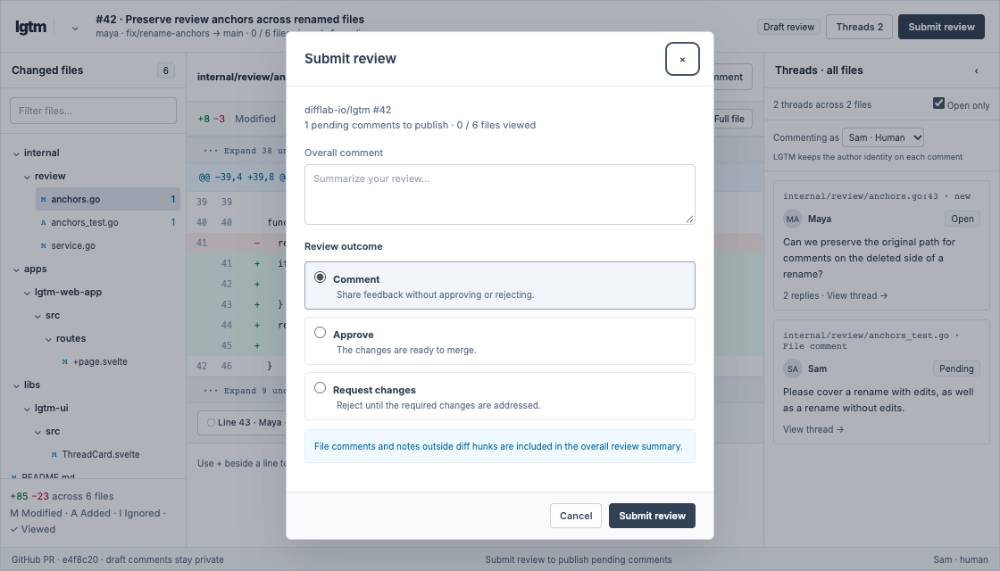

## Requirements

### R1. Start or resume a review

Priority: HIGH

Acceptance: Basic requirement for parity with this genre of tools

### R2. Review a directory and ignored files

Priority: HIGH

Acceptance: Must be able to review gitignored plans and annotate them, as well as whole repo for annotations

### R4. Inspect differences and complete files

Priority: MEDIUM

Acceptance: Must be able to view a few lines above and below the diff minimally, and full files too. Ok to show full files as well.

### R5. Comment on lines, ranges, files, and reviews

Priority: HIGH

Acceptance: Ranges is nice to have, can be a future feature.

### R6. Keep local comments attached as content changes

Priority: HIGH

Acceptance: Expected for review tools.

### R7. Read and resolve threads across all files

Priority: HIGH

Acceptance: Must be possible to see all comments at once. It would be unacceptable to need to navigate file by file in a large review to resolve and review all comments.

### R8. Save and close local sessions

Priority: MEDIUM

Acceptance: Sessions must be resumable until closed. Ditto for PRs.

### R9. Preserve human and agent identity

Priority: HIGH

Acceptance: GitHub will not support this, but difflab must show agent identities in comments/reviews.

### R10. Submit a GitHub review

Priority: HIGH

Acceptance: Essential, this is big for productivity.

### R11. Neovim functional parity

Priority: HIGH

Acceptance: Review-focused parity: CodeDiff comments collapsed by default, Enter/K to open threads, Atlas-style reply/edit/delete/resolve shortcuts, cross-file threads, searchable PR/local-session selection, and review submission with an optional final comment. WhichKey groups and ordinary-file notes follow review.nvim workflows. General PR dashboards, issues, merge and CI browsing are outside scope.

Supported editor installation and keybindings are documented in [lgtm.nvim](../../apps/lgtm.nvim/README.md). CLI access to notes, ignored directories and export is documented in [CLI review usage](../../apps/lgtm-cli/README.md).

### R12. Agent access and accessibility

Priority: MEDIUM

Acceptance: Also essential, and keeps forge clean from agent slop.

### R13. Export notes and reviews

Priority: HIGH

Acceptance: Export notes, local reviews and GitHub conversations as Markdown through the API, CLI and editor. Preserve authors, anchors, replies, resolution and final review body. Export must not promote, complete or submit anything.

### R14. Operation feedback

Priority: HIGH

Acceptance: Notify draft saves only after backend persistence. Show submission progress, confirmed success, errors and uncertain outcomes, retaining failed text and exposing reconciliation. Document notification dependencies.

### R15. End-to-end validation

Priority: HIGH

Acceptance: Separate Rust backend/CLI and Lua editor suites under top-level `e2e/`, each with its own Mise config and no parent `e2e/mise.toml`. Editor tests use real CodeDiff, WhichKey, notification provider and backend. Deterministic GitHub HTTP fixtures are distinct from live tests; any live fixture repository is private.

## Success Measures

## Risks and Dependencies

## Open Questions

## Rollout
